<div align="center">

# CodeForge AI

**A local-first, action-first intelligent programming workbench — executable code first, deeper reasoning only when needed, and memory that survives disconnection.**

C/C++ core · Java server · Python automation · Windows · Linux · macOS · Android · iOS

**Version 1.2.0 · 2026-11-21**

[](LICENSE)
[](#architecture)
[](#architecture)
[](docs/MODELS.md)
[](docs/SECURITY.md)

</div>

> **Upgrading from an earlier build?** v1.2.0 is the only supported release. Older packages and tags have been removed from both platforms, so replace your program files with the v1.2.0 bundle on this page. The console checks the public release index and shows an in-app banner when a newer build exists; update notices apply from this release onward.
>
> **旧版用户请注意：** v1.2.0 是唯一受支持的版本，更早的安装包和标签已从两个平台删除。请用本页的 v1.2.0 安装包覆盖升级。控制台会在启动时检查公开发布页，有新版本时显示升级横幅；升级提醒从本版本开始生效。

## Download

**Windows 10/11 (x64), one click:** [`CodeForge-AI-1.2.0-windows-x64.zip`](https://github.com/IAMMEZSH/CodeForge-AI/releases/download/v1.2.0/CodeForge-AI-1.2.0-windows-x64.zip) — prebuilt `CodeForge.exe`, core binaries, server JAR and JDK bootstrap. GitCode mirror: [`CodeForge-AI-1.2.0-windows-x64.zip`](https://gitcode.com/gcw_So3EkhfR/CodeForge-AI/releases/download/v1.2.0/CodeForge-AI-1.2.0-windows-x64.zip).

| Platform | Release artifact | GitHub | GitCode |
|---|---|---|---|
| Windows 10/11 x64, prebuilt | `CodeForge-AI-1.2.0-windows-x64.zip` | [Download](https://github.com/IAMMEZSH/CodeForge-AI/releases/download/v1.2.0/CodeForge-AI-1.2.0-windows-x64.zip) | [Download](https://gitcode.com/gcw_So3EkhfR/CodeForge-AI/releases/download/v1.2.0/CodeForge-AI-1.2.0-windows-x64.zip) |
| Linux x64 / ARM64 / s390x / 32-bit, source | `CodeForge-AI-1.2.0-linux-source.tar.gz` | [Download](https://github.com/IAMMEZSH/CodeForge-AI/releases/download/v1.2.0/CodeForge-AI-1.2.0-linux-source.tar.gz) | [Download](https://gitcode.com/gcw_So3EkhfR/CodeForge-AI/releases/download/v1.2.0/CodeForge-AI-1.2.0-linux-source.tar.gz) |
| macOS Apple silicon / Intel, source | `CodeForge-AI-1.2.0-macos-source.tar.gz` | [Download](https://github.com/IAMMEZSH/CodeForge-AI/releases/download/v1.2.0/CodeForge-AI-1.2.0-macos-source.tar.gz) | [Download](https://gitcode.com/gcw_So3EkhfR/CodeForge-AI/releases/download/v1.2.0/CodeForge-AI-1.2.0-macos-source.tar.gz) |
| Android / iOS / Termux / iSH, source | `CodeForge-AI-1.2.0-mobile-source.zip` | [Download](https://github.com/IAMMEZSH/CodeForge-AI/releases/download/v1.2.0/CodeForge-AI-1.2.0-mobile-source.zip) | [Download](https://gitcode.com/gcw_So3EkhfR/CodeForge-AI/releases/download/v1.2.0/CodeForge-AI-1.2.0-mobile-source.zip) |
| All platforms, source only | `CodeForge-AI-1.2.0-source.zip` | [Download](https://github.com/IAMMEZSH/CodeForge-AI/releases/download/v1.2.0/CodeForge-AI-1.2.0-source.zip) | [Download](https://gitcode.com/gcw_So3EkhfR/CodeForge-AI/releases/download/v1.2.0/CodeForge-AI-1.2.0-source.zip) |
| Documentation set | `CodeForge-AI-1.2.0-docs.zip` | [Download](https://github.com/IAMMEZSH/CodeForge-AI/releases/download/v1.2.0/CodeForge-AI-1.2.0-docs.zip) | [Download](https://gitcode.com/gcw_So3EkhfR/CodeForge-AI/releases/download/v1.2.0/CodeForge-AI-1.2.0-docs.zip) |

Both mirrors carry the same eight uploaded release assets: the six archives above, `SHA256SUMS.txt` and `manifest-1.2.0.json` (each platform also auto-generates its own source archives). Names and SHA-256 hashes are identical on [GitHub](https://github.com/IAMMEZSH/CodeForge-AI/releases/tag/v1.2.0) and [GitCode](https://gitcode.com/gcw_So3EkhfR/CodeForge-AI/releases/v1.2.0). Every platform archive contains the full source and the English manual in `docs/MANUAL.md`; the documentation archive carries the complete manual set with all four quick starts.

<div align="center">


</div>

---

## What it is

CodeForge AI is a self-contained, action-first programming assistant that runs on your own machine. Short calculator, command and code requests return runnable code instead of a long deliberation; deeper reasoning is reserved for tasks that need it. It executes programs in isolated workspaces and **automatically repairs failing code** by combining compiler diagnostics with a large language model. Models are downloaded as GGUF files and served locally by `llama.cpp`.

Local inference stays on the machine. When you configure an **online brain** (any DeepSeek-compatible OpenAI API) and the device is connected, the router sends that request to the online model for maximum capability; if the network or the API fails, the request automatically falls back to the local model. Everything learned online — answers, web snippets and research findings — is written into a persistent local memory store, so the offline brain keeps the knowledge after the connection drops.

**Core capabilities**

- **Action-first replies** — simple calculator, command and code requests return executable code in seconds instead of disappearing into a long monologue. The managed runtime caps reasoning with `--reasoning off --reasoning-budget 256` and disables the chat template's thinking mode; the model still reasons when the task genuinely needs it. A capped-reasoning calculator request returned code in 4.6 s.
- **Dual-brain routing** — online DeepSeek-class capability when configured and reachable, local offline inference otherwise, with automatic fallback and `route`/`route_error` reported on every request.
- **Persistent memory** — append-only JSONL memory with CJK bigram + Latin tokenization, SHA-256 deduplication, relevance scoring, kind weights, recency decay and pruning. Chat turns, web findings, debug outcomes and distilled online lessons are recalled offline.
- **Workspace index** — the server indexes project sources (up to 1,500 files, secret/config/build directories excluded) into `memory/project-index.jsonl`, so questions about your own repository are answered with real paths and excerpts.
- **Agentic debug loop** — run → collect diagnostics → ask the model for a patch → re-run, for up to eight iterations (default three), with full process-tree timeouts. RUN, PREVIEW, SAVE and placement work even when no model is running.
- **Multi-language execution** — Python, C, C++, Java, JavaScript, TypeScript, Go, Rust, PHP and C# are compiled and executed inside per-run workspaces with captured stdout/stderr. Missing runtimes are downloaded on demand from the official sources into `native/toolchains/<runtime>`, with live progress and no system PATH changes.
- **Build and deliver to the Desktop in any supported language** — ask for a game, tool or app and the agent writes the source, calls `codeforge_build`, and leaves a finished double-clickable result on the Desktop: a native `.exe` for C, C++, Go, Rust and C#; a runnable `.jar` with launcher for Java; launchers pinned to the detected interpreter for Python, JavaScript, TypeScript and PHP; an `index.html` page plus shortcut for HTML/CSS. Each delivery gets its own Desktop folder and `.lnk`/`.desktop`/`.command` shortcut, Unicode names and paths work, and compiler errors go back to the model for a fix-and-retry instead of ending as an unbuilt file. Language toolchains are auto-provisioned when the command is missing.
- **Auto-compile switch that opens and verifies the result** — the chat-header **AUTO COMPILE** toggle and Environment → Command Agent share one persisted setting, `agent.auto_compile`. While it is on, every build request is compiled, delivered to the destination you named, launched, and checked for a real window before the answer reports success. Python GUI apps open with `pythonw`, Java GUI apps with `javaw`, native apps directly, and web deliveries in the browser. A process that exits or never shows a window returns `phase:"verify"` with its log and re-enters the automatic repair loop, so a runtime or window failure is fixed and rebuilt rather than reported as done. Python imports, Node packages and Go modules are provisioned through domestic and international mirrors during the same delivery.
- **Dependency provisioning at delivery time** — generated Python files are import-scanned and missing packages are installed through pip mirrors; Node projects install missing npm dependencies; Go modules resolve before the build. Every delivered artifact also runs a startup self-check, and missing language toolchains are fetched into `native/toolchains` without changing the system PATH.
- **Static code inspection that never executes the sample** — point **Inspect** at any file or project folder. Every scanned file gets language and encoding detection, SHA-256/SHA-1/MD5 hashes, entropy, line/class/function/import metrics, network clues, masked secrets, a 0–100 risk score with concrete indicators, and JSON plus Markdown reports under `workspace/reports/code-inspection/`. Files scoring 70+ are copied into a read-only quarantine vault. After the report is written, the source files are re-hashed to prove their bytes were not modified; the optional shred step overwrites and deletes **only the quarantine copies created by that run**, never the originals, and keeps a sidecar audit record.
- **Game engine adapters** — the **Engines** tab and `codeforge_engine` drive **Godot 4, Unity, Unreal Engine 5, Cocos Creator and LÖVE** using the engines you already installed. No engine is downloaded or bundled. CodeForge finds engines through environment variables, PATH, Unity Hub, Epic Games and the standard install folders, finds projects by their real markers (`project.godot`, `ProjectSettings/ProjectVersion.txt` + `Assets/`, `*.uproject`, Cocos `package.json` + `assets/`, `main.lua`), reads Godot export presets, then builds, exports and runs through each engine's own CLI. Every export is checked against the artifact on disk, and a missing engine returns the exact install hint instead of a false success. LÖVE `.love` packaging works with no engine installed, and a fused `.exe` is produced when `love.exe` is present.
- **Universal HTTP and secret vault** — `codeforge_api` / `POST /api/api-call` can call any HTTP or HTTPS endpoint with any method, headers, query, body and timeout. Named secrets stored through `POST /api/secrets` are injected into the request in memory; values are never echoed in responses, logs or reports. This covers arbitrary REST, JSON, form and authenticated API work beyond the built-in web search tools.
- **Agent file, test and research tools** — `codeforge_read`, `codeforge_list`, `codeforge_write`, `codeforge_edit`, `codeforge_test`, `codeforge_crawl`, `codeforge_deep_search` and `codeforge_corpus` let the model open real files, walk project trees, apply exact replacements, run the detected test command, crawl same-domain pages, run multi-query research over fetched pages and query the local research corpus. Tool results come back to the model before its next step.
- **Office documents and PDF, directly** — the **Office** view and `codeforge_office` create, preview, edit, search and delete DOCX/DOC, XLSX/XLS/XLSM, PPTX/PPT, PDF, ODT/ODS/ODP, RTF, CSV/TSV and text files. Preview returns real document structure — paragraphs, sheet grids, slide shapes, PDF page counts — and PDF pages render page images in the console. Editing covers text, table cells, workbook cells/rows/sheets, slide text and lifecycle, PDF metadata and pages, and text files; deletions move to `workspace/.trash/office` unless permanent deletion is explicitly requested.
- **Download center for software, games and web files** — the **Downloads** view and `codeforge_download` either fetch a URL you supply, or search for a named file and rank candidates by official domain, exact filename, platform and requested size. Transfers resume with `.part` files, a stalled-body watchdog, same-URL retries, live speed/ETA, SHA-256 reporting and optional hash verification; the agent sees the job state, saved path and hash.
- **Whole-disk file access, gated by permission** — the **Files** view and `codeforge_fs` enumerate drives, browse folders, search by path/name/content across disks, and create, rename, copy, move, trash or delete files and folders. Nothing outside the workspace runs until **Settings → Full filesystem access** is enabled (`permissions.full_filesystem`); deletions require explicit confirmation, go to `workspace/.trash/fs`, sensitive system directories are guarded, and every operation is appended to `logs/file-access.jsonl`.
- **Email sending** — the **Mail** view and `codeforge_mail` send plain-text or HTML mail through any SMTP account with To/Cc/Bcc, attachments up to 25 MB, SSL/STARTTLS/none and a connection test. The SMTP password lives in the local encrypted KeyStore, never in `config.json` or API responses.
- **HTML/CSS live preview** — generated pages render in a sandboxed iframe served from a per-run session folder with a strict CSP.
- **Model-independent workbench** — compile/run buttons, **AUTO COMPILE**, save-to-any-path, language downloads, project placement and launcher creation are executed by the local server and the local control plane. A 4B offline model, a 30B model or an online API all get the same execution and placement capabilities; only the prose differs. The **AUTO COMPILE** toggle is persisted as `agent.auto_compile` and drives the same build/deliver/open/verify path described above.
- **Any command, any installed application, any platform** — the Command Agent runs PowerShell, cmd, bash, sh or zsh commands on Windows, macOS and Linux, not only programming tasks. It discovers installed tools and desktop applications on this host, carries per-platform control references for Office/WPS/LibreOffice, browsers, media, archives, OCR, cloud CLIs and databases, and can download 70 missing tools automatically through portable toolchains, the native package manager, pip or npm. If it meets unfamiliar software it searches, reads official documentation and then uses it.
- **Publishing with a guard** — the agent can prepare commits, builds, packages, release assets and site deploys. Public actions (`git push`, release/PR/issue creation, registry/container pushes, remote copies, cloud deploys and write HTTP methods) stay blocked until **Allow publishing** is enabled in the Command Agent settings or the run is started through the API with `allow_publish=true`; blocked calls identify themselves instead of failing silently.
- **Natural language is never intercepted** — every plain-language request goes straight to the active model, offline or online. Build, compile and deliver phrases such as “write a game and put it on the Desktop” reach the agent and produce a runnable artifact instead of being routed into a local file-copy shortcut. Only explicit `/` commands (`/run`, `/save`, `/copy`, `/move`, `/launcher`, `/install`) execute locally.
- **Any file, any path** — code blocks can be saved to the exact path you type (one path per file), missing folders are confirmed before creation, and nothing is silently renamed. The whole project can be copied to any folder, any file or folder can be copied or moved to a chosen path, the Desktop, or a bare drive (`D`, `D盘`, `D盘根目录`), and a real launcher can be created anywhere (Windows `.lnk`, Linux `.desktop`, macOS `.command`).
- **12 curated offline models** — a mix of Chinese and international models including Qwen3-Coder, DeepSeek, Seed-OSS, GPT-OSS, Devstral, Gemma, Phi and Codestral.
- **Domestic model downloads** — every offline model resolves through `hf-mirror.com` by default, with automatic `huggingface.co` fallback, resumable transfers and mandatory upstream SHA-256 verification. Override the source with `llm.model_mirror` or `CODEFORGE_MODEL_MIRROR`.
- **CPU or CUDA llama.cpp runtime** — install the managed CPU build (Windows x64/ARM64, macOS arm64/x64, Linux x64/ARM64/s390x, Android ARM64), or add the official CUDA build and let CodeForge detect it. The runtime panel offers **Auto / CPU / CUDA**; Auto uses the GPU build when present, CUDA offloads all 99 layers, and CPU remains the fallback for machines without an NVIDIA GPU. The server verifies SHA-256, retries through GitHub mirror fallbacks when the asset host is blocked, and controls `llama-server` with a user-selectable 2K–512K context window (16K default).
- **Faster answers on NVIDIA hardware** — the CUDA build measured ~83.6 tok/s on an RTX 4070 12 GB versus ~4.5 tok/s on CPU for the same Qwen3 4B model, while a direct `add(a,b)` completion returned code in 0.8 s. Short prompts and cap-limited reasoning reach code quickly instead of deliberating.
- **Adjustable reply limit for online and offline replies** — a highest-to-lowest selector from 393,216 down to 64 tokens in the runtime panel, applied to the next reply without restarting inference. Offline models use the full selected value; online providers apply their own output cap (DeepSeek: 8,192). The model's context window minus the prompt remains the real cap on the actual reply.
- **In-app update notices** — since 1.2.0 the console reads the public release index on load and every six hours. When a newer stable tag exists it shows a banner with the version and a direct download link, dismissible per version. The check fetches only release metadata from GitCode (GitHub fallback) and sends no prompt, file, key or usage data; set `"updates": {"enabled": false}` in `config.json` to turn it off.
- **Native control center** — a Win32 C++ app that starts the server, shows live readiness, and opens the console in an Edge app window.
- **One web console everywhere** — the same responsive futuristic UI works on desktop browsers, Android WebView, and iOS WKWebView.
- **Interruptible chat with a live reasoning trace** — every turn shows stage-by-stage execution (memory recall, workspace scan, live research, context assembly, generation), a live token counter with the measured decoding rate on the local runtime, a remaining-time estimate, and a progress bar. The send key becomes **INTERJECT** while the model is working: press it to stop the answer and send your correction immediately, or **STOP** to cancel with an empty box. Cancellation kills the core process on the server, frees the model, and does not write the aborted turn to memory.

## Architecture


- **C/C++ main core** — all orchestration, compilation, execution, diagnostics, model calls, and the debug loop.
- **Java server** — REST API, download manager with resume, archive extraction, runtime management, static inspector, secret vault, release publisher and game-engine adapters.
- **Python auxiliary core** — environment bootstrap, portable JDK provisioning, build automation, packaging, and a mock LLM for testing.
- **Mobile thin clients** — Kotlin/WebView and Swift/WKWebView shells that connect to a CodeForge server on the device or LAN.

Deeper dives: [Architecture](docs/ARCHITECTURE.md) · [API reference](docs/API.md) · [Security model](docs/SECURITY.md).

## Request lifecycle

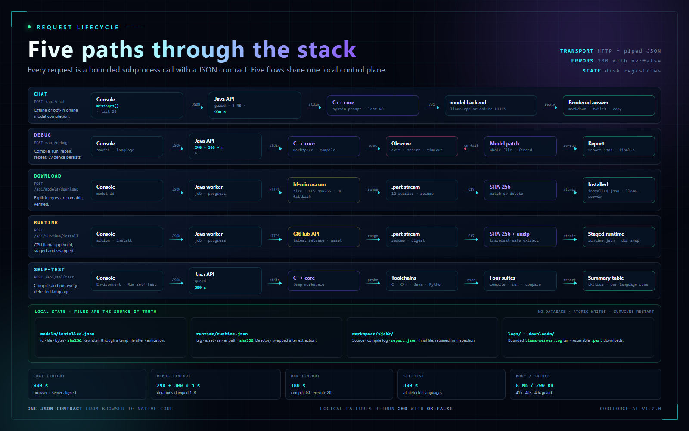

Every action is a bounded subprocess call with a JSON contract. Chat, debug, model download, runtime installation, and the four-language self-test all pass through the same loopback control plane. Timeouts, size caps, and on-disk state are listed in the diagram; exact request and response examples are in the [API reference](docs/API.md).

## Dual brain, memory and online research

```jsonc
{
  "llm": {
    "backend": "auto",
    "online": {
      "enabled": true,
      "base_url": "https://api.deepseek.com",
      "api_key": "",
      "model": "deepseek-chat",
      "timeout_ms": 120000
    }
  },
  "memory": { "enabled": true, "retrieval_limit": 5, "max_entries": 4000 },
  "online": { "enabled": true, "research": "auto", "max_results": 3 },
  "updates": { "enabled": true }
}
```

- **Key vault** — the **Keys** tab adds, tests, switches and deletes any OpenAI-compatible provider key (DeepSeek, OpenAI, Moonshot, Zhipu, Qwen, SiliconFlow, OpenRouter or a custom base URL). An **ONLINE BRAIN** master switch forces offline-only operation while keeping every saved key, and one-click official **TOP UP / CONSOLE / PRICING** links cover each provider. Keys stay in the local `config.json`; the UI only ever shows a masked hint, and no manual file editing or restart is needed.
- **Routing** — the Java server asks for `online` only when a key is configured, the master switch is on, and the network probe succeeds; the C++ core probes the endpoint again and silently falls back to local inference on any failure. `meta.brain` returns the requested route, the actual route, the `online_enabled` switch state and the failure reason.
- **Learning loop** — online answers are distilled into `memory/memories.jsonl` as `lesson` entries, web findings as `web` entries, and debug outcomes as `note` entries. Retrieval combines token overlap, kind weights, recency and deduplication, then injects the top hits into the local system prompt.
- **Offline recall** — with the network disabled, the same questions still retrieve prior lessons and project facts. Verified in testing: a query answered online was recalled with 3 memory hits after switching the server to offline mode.
- **Live research** — when a question benefits from current sources, the server queries Google, Baidu, Baidu Zhidao, DuckDuckGo, Bing, 360 Search and Wikipedia in parallel. Blocked or captcha-walled engines are skipped, results are deduplicated and relevance-filtered, and the strongest candidate is marked for the local model. Findings with URLs are injected into the prompt and stored in local memory.
- **Environment overrides** — `CODEFORGE_ONLINE_LLM`, `CODEFORGE_ONLINE_LLM_URL`, `CODEFORGE_ONLINE_LLM_MODEL`, `CODEFORGE_ONLINE_LLM_KEY`, `CODEFORGE_ONLINE_LLM_TIMEOUT_MS`, `CODEFORGE_ONLINE`, `CODEFORGE_RESEARCH`, `CODEFORGE_MEMORY`.

**Honest limits.** A 4B–36B GGUF model running on one machine cannot literally out-reason a frontier online model. “Smarter offline” means the local brain keeps durable project memory, distilled online lessons, workspace context, current web research and compile/run feedback that a stateless chat window does not have. When maximum raw reasoning matters, configure the online brain; when privacy or connectivity matters, the offline brain keeps working with everything it has learned.

## Agentic debug loop

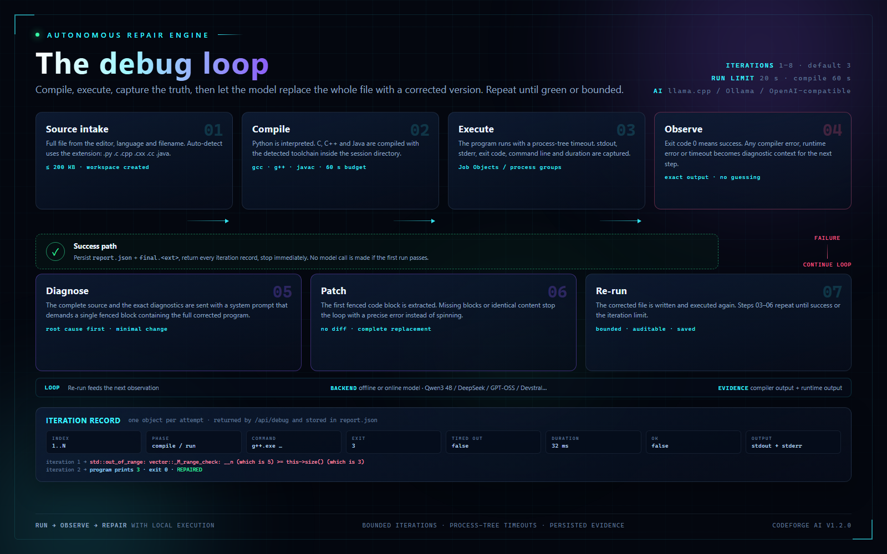

Paste failing source, choose a language (or let the extension decide), and run **Auto-debug**. The core compiles and executes it, captures exit code, stderr, and timeout diagnostics, then asks the local model for a complete corrected file inside a fenced block. The loop repeats up to eight times (default three) and stops as soon as the program exits cleanly. `workspace/<job>/report.json` and the final source stay on disk for inspection.

## Command agent and software control

The chat agent is not limited to code. It can emit one tool block per step and receives the real result before deciding what to do next:

```text
<codeforge_shell>{"command":"Get-ChildItem","cwd":"D:\\work","shell":"powershell","timeout":600}</codeforge_shell>
<codeforge_search>{"query":"SQLite JSON functions","limit":6}</codeforge_search>
<codeforge_fetch>{"url":"https://example.com/docs","max_chars":12000}</codeforge_fetch>
<codeforge_learn>{"software":"qpdf","goal":"merge and encrypt PDFs"}</codeforge_learn>
<codeforge_api>{"method":"POST","url":"https://api.example.com/v1/items","secret_name":"EXAMPLE_TOKEN","body":{"name":"demo"}}</codeforge_api>
<codeforge_write>{"path":"C:\\work\\app.py","content":"print('hi')\n"}</codeforge_write>
<codeforge_test>{"path":"C:\\work","timeout":600}</codeforge_test>
<codeforge_build>{"language":"python","source":"C:\\work\\snake.py","name":"Snake","gui":false}</codeforge_build>
<codeforge_inspect>{"path":"C:\\samples\\suspect.exe","depth":0,"max_files":1,"quarantine":true,"shred_quarantine":false}</codeforge_inspect>
<codeforge_engine>{"action":"export","path":"C:\\games\\star-runner","engine":"godot","target":"windows","preset":"Windows Desktop"}</codeforge_engine>
<codeforge_office>{"action":"update","path":"C:\\docs\\report.docx","update_action":"set_paragraph","paragraph":3,"text":"Revised conclusion."}</codeforge_office>
<codeforge_office>{"action":"open","path":"C:\\docs\\contract.pdf","page":1}</codeforge_office>
<codeforge_download>{"query":"OBS Studio Windows installer","kind":"software","target_dir":"D:\\downloads","wait_sec":180}</codeforge_download>
<codeforge_download>{"url":"https://example.com/tool.zip","filename":"tool.zip","sha256":"<64 hex chars>"}</codeforge_download>
<codeforge_fs>{"op":"search","roots":["D:\\"],"name":"*.log","content":"timeout","limit":50}</codeforge_fs>
<codeforge_fs>{"op":"move","path":"C:\\work\\a.txt","to":"D:\\archive\\a.txt","confirm":true}</codeforge_fs>
<codeforge_mail>{"action":"send","to":"team@example.com","subject":"Nightly build","text":"All checks passed.","attachments":["C:\\builds\\report.pdf"]}</codeforge_mail>
```

- **Commands** — PowerShell, cmd, bash, sh and zsh are supported. The host runs each command with a bounded timeout, streams stdout/stderr to logs, and applies the publish guard before execution.
- **Office, mail, downloads and the disk** — `codeforge_office`, `codeforge_mail`, `codeforge_download` and `codeforge_fs` give the agent the same capabilities as the console tabs: document CRUD and PDF rendering, SMTP mail, URL/search downloads with hash verification, and whole-disk browse/search/edit behind the **Full filesystem access** switch. The agent must state what it will delete or send, and destructive or outbound actions still require the user's intent in the conversation plus the relevant permission.
- **Build & deliver** — `codeforge_build` compiles or packages a source file for any supported language and places the runnable result plus a Desktop shortcut in one deterministic step; `gui:true` switches Python to `.pyw` and C# to `WinExe`. HTML/CSS accepts an `.html` file or a folder containing `index.html`. Errors from the compiler are returned to the model so it can fix and call the tool again.
- **Software** — Windows uses `Get-StartApps`, WinGet and registry uninstall keys; macOS scans `.app` bundles; Linux reads `.desktop` entries. The prompt includes the discovered applications plus launch, Office/COM, browser headless, screen, media, archive, system-settings and cloud-CLI recipes for the current platform.
- **Missing tools** — a missing command is resolved from a portable toolchain, the native package manager, pip or npm; PATH is refreshed, and the command is retried. The same mapping covers database clients (`psql`, `mysql`, `sqlite3`, `mongosh`, `redis-cli`, `clickhouse-client`, `sqlcmd`, `cypher-shell`, `duckdb`, `influx`) and cloud/developer tools (`gh`, `aws`, `az`, `gcloud`, `kubectl`, `helm`, `rclone`, `pandoc`, `tesseract`, `yt-dlp`, `qpdf`, `gs`, `exiftool`).
- **Learning** — search, fetch and learn are first-class tools. When the agent meets an unknown command, version, API or error, it researches before guessing and treats page content as untrusted data.
- **Publishing** — local builds, commits, packages and exports always work. Remote/public actions need the **Allow publishing** switch (with a confirmation dialog), or a direct API run with `allow_publish=true` for that one action; the agent must state what will be published, where, and under which account. The **Publish** tab can create or update a GitHub or GitCode release from `release/` through the REST APIs, optionally deleting older releases, and uses tokens from the local vault, environment or already-authenticated GitHub CLI without ever returning them.
- **Long loops** — the step limit is adjustable from **1 to 512** (default 128) in the Command Agent panel. The agent compacts old tool output before each model call and keeps every executed call in the final `tool_calls` list even if the model fails.

## Office documents, downloads, mail and the whole disk

<table>
<tr>
<td width="50%">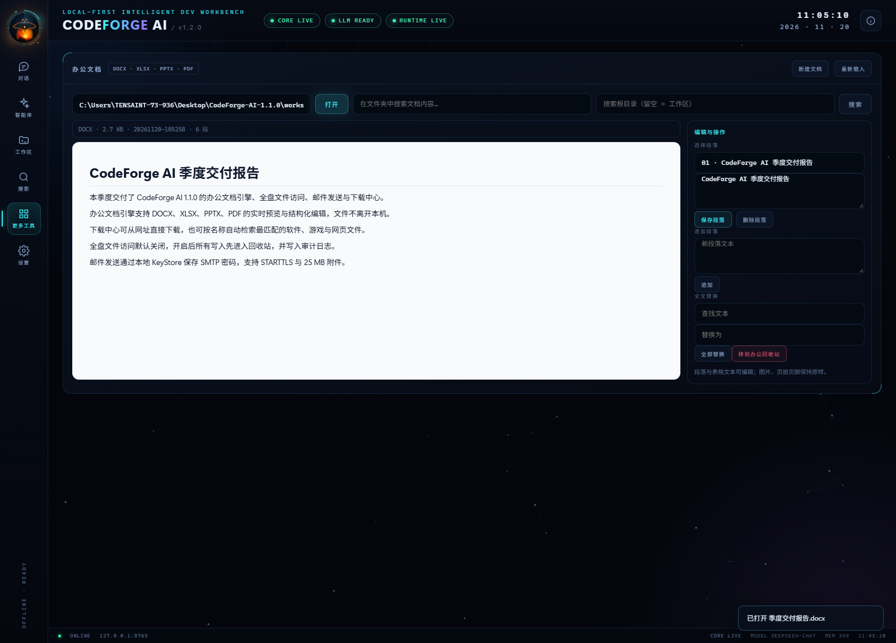</td>
<td width="50%">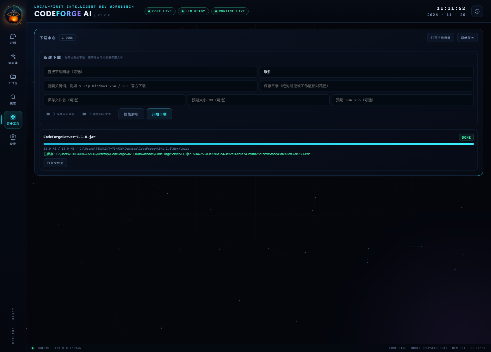</td>
</tr>
<tr>
<td align="center"><em>Office: real text/structure preview, PDF page rendering, structured editing</em></td>
<td align="center"><em>Downloads: URL or search, candidate ranking, resume, SHA-256</em></td>
</tr>
<tr>
<td width="50%">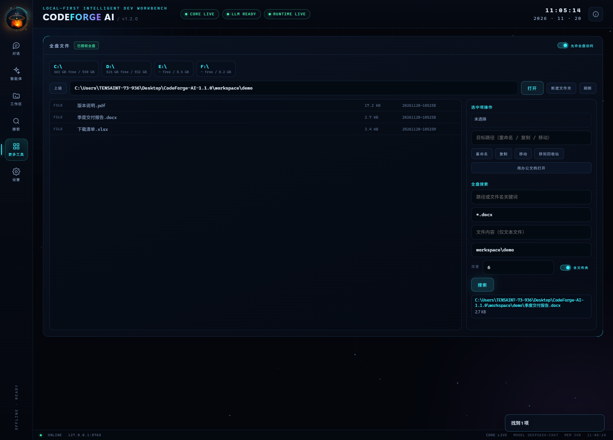</td>
<td width="50%">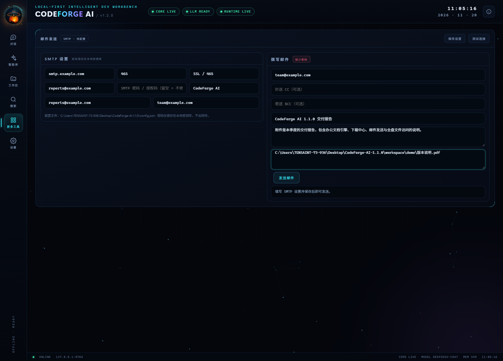</td>
</tr>
<tr>
<td align="center"><em>Files: drives and search, gated by Full filesystem access</em></td>
<td align="center"><em>Mail: SMTP accounts with encrypted password and attachments</em></td>
</tr>
</table>

- **Office** — open a document (or drag in a path), read the returned structure, edit paragraphs, cells, sheets, slides, PDF metadata/pages or text, then save through the same service. PDFs render page-by-page as images; spreadsheet previews show real cell grids; presentations show per-slide shapes. Creation covers DOCX, XLSX, PPTX, PDF, TXT, Markdown, CSV and TSV; ODT, ODS, ODP, RTF and legacy Office files open as read-only previews, and unsupported update actions are reported explicitly.
- **Downloads** — provide a URL for a direct fetch, or a name for search-and-rank. Candidates show source, size, type and score; the job view shows state, speed, ETA, saved path and SHA-256, with cancel, candidate choice and open-folder controls. Cancelling keeps the `.part` file, and starting the same target again resumes from it. “Save page itself” keeps the HTML when the target is a page rather than a binary.
- **Files** — start from drives, navigate folders, or search across selected roots by filename glob and content. The view and API refuse to leave the workspace until **Full filesystem access** is enabled; after that, operations run with an audit trail, a guarded system-directory list and a trash-first delete policy.
- **Mail** — configure host, port, encryption, user and password (stored in the local KeyStore), send a test, then compose with Cc/Bcc and attachments. Missing configuration produces an explicit error instead of a false success.

## Static inspection, integrity and quarantine

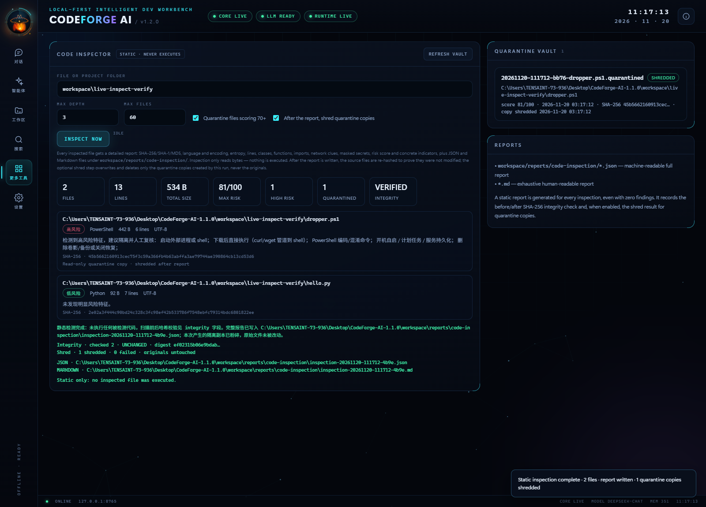

**Inspect** is a static analysis and triage surface for unknown files. It reads bytes only — it never imports, compiles, opens or executes the inspected file on the host. A scan of one file or a whole project produces:

- **File facts** — detected language and family, encoding with confidence, MIME, text/binary classification, entropy, size, timestamps, DOS attributes and Zone.Identifier, SHA-256/SHA-1/MD5, line endings, indentation, comment/code-line estimates, classes, functions, imports, entry points and TODO markers.
- **Risk evidence** — a 0–100 score with severity bands and the exact indicators that fired: download-and-execute chains, encoded PowerShell, persistence, shadow-copy deletion, credential access, obfuscation, packed binaries and more. Secrets are detected but **masked** in reports and API responses.
- **Quarantine vault** — files scoring 70+ are copied to `workspace/quarantine/` with a read-only DOS attribute and a `.meta.json` sidecar. The original stays in place and is never moved or altered.
- **Integrity proof** — after analysis, every scanned file is re-hashed (up to a 256 MB re-hash budget) and compared with the SHA-256 captured at scan time. The result, a sorted path+hash digest and any changed/unreadable files appear in `integrity`, so “untouched” is a measured fact rather than a promise.
- **Report first, then shred** — JSON and Markdown reports are written before any destructive step. If **shred quarantine copies** is enabled, the server overwrites each copy created by that scan with random data in 64 KB chunks, forces it to disk, truncates it to zero, deletes it, and records `shredded`, `shredded_at`, the method and `original_untouched=true` in the sidecar. The original file and its hash remain unchanged.

On SSDs, flash translation layers and wear levelling mean a software overwrite is not a physical-erasure guarantee; the report says so. The guarantee is narrower and testable: **the inspector never executes a sample, never modifies the original, and only shreds copies it created in the same run.**

## Game engine adapters

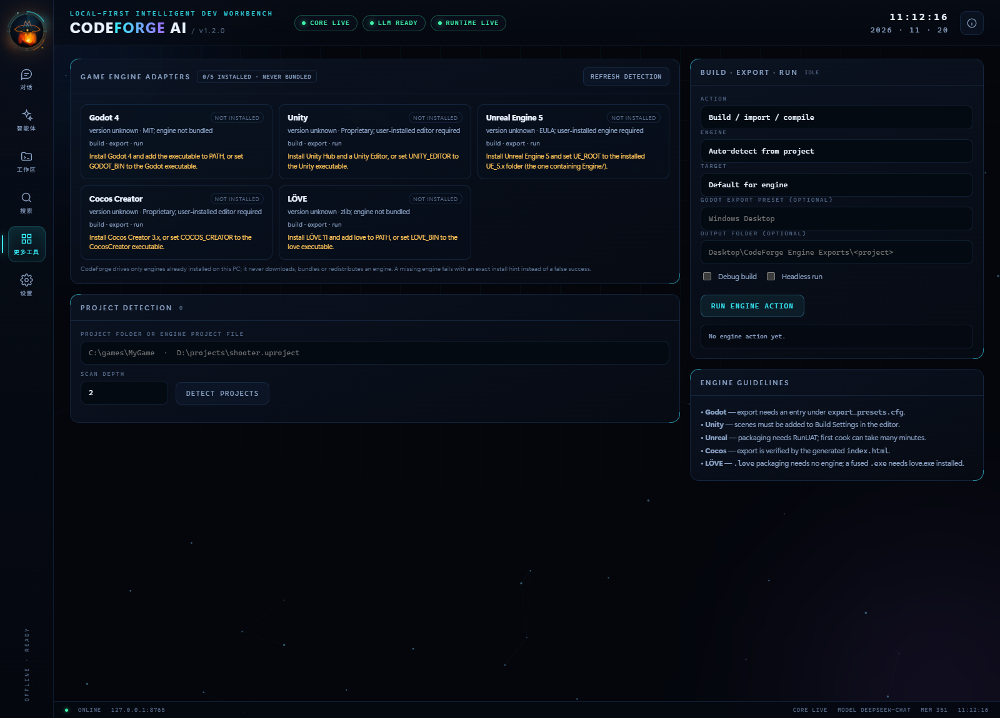

The **Engines** tab detects the engines installed on this machine, finds game projects in any folder and drives each engine through its own command-line tools. CodeForge never downloads, installs or bundles an engine; when one is missing, the response contains the exact install hint and the action stops instead of pretending to succeed.

| Engine | Detection | Project marker | Build / export |
|---|---|---|---|
| Godot 4 | `GODOT`, `GODOT_BIN`, PATH, standard folders | `project.godot` | Headless import + export with a named preset |
| Unity | `UNITY`, Unity Hub, `Program Files\Unity` | `ProjectSettings/ProjectVersion.txt` + `Assets/` | `-batchmode -executeMethod` player build |
| Unreal Engine 5 | `UE_ROOT`, Epic Games launcher, `C:\Program Files\Epic Games\UE_*` | `*.uproject` | `RunUAT BuildCookRun` |
| Cocos Creator | `COCOS`, PATH | `package.json` with Cocos Creator version + `assets/` | Creator CLI build; verifies `index.html` |
| LÖVE | `LOVE`, PATH | `main.lua` | `.love` ZIP packaging, optional fused `.exe` |

- **Detection** — `GET /api/engines` reports engine version, install path, install hint and project count for all five adapters; `POST /api/engines` with `{"action":"detect","path":"C:\\games","depth":2}` scans a folder for projects.
- **Actions** — `detect`, `build`, `export`, `run` and `status`. Export targets are validated per engine, Godot presets are read from `export_presets.cfg`, and Unity/Unreal/Cocos exports point at the real artifact rather than echoing a command.
- **Honest results** — a missing engine fails with `install_hint`; Cocos fails when no `index.html` appears; LÖVE packs and fuses only when `love.exe` exists. `engine_not_bundled` is always reported.
- **Console** — the Engines view shows installed engine cards, detected projects, action forms, export presets and a live log, and the agent receives the same adapter data in its system prompt.

## Offline model library

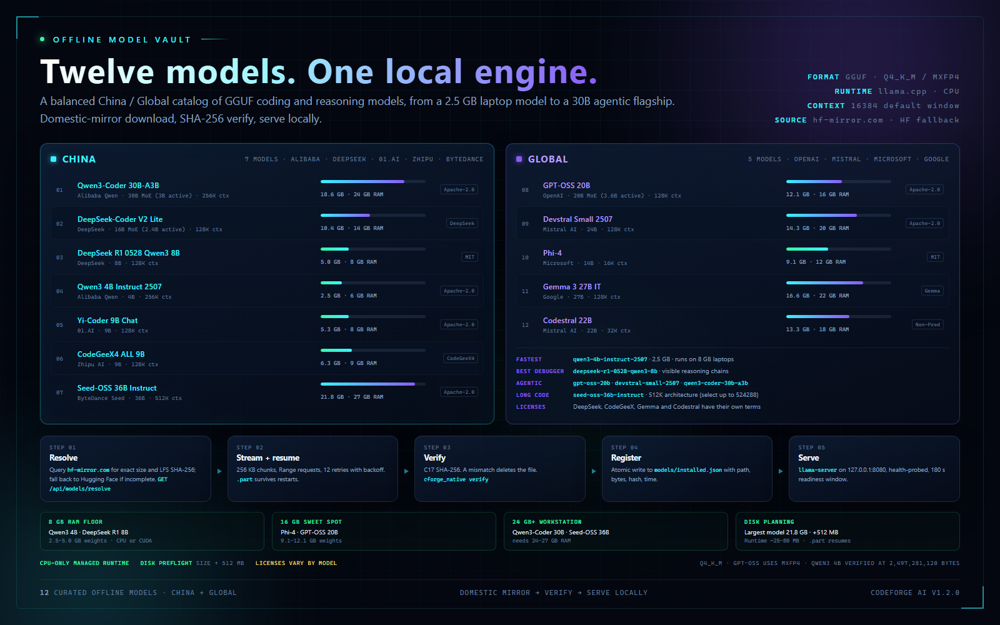

| Model | Origin | Params | Approx. size | Min RAM |
|---|---|---|---|---|
| Qwen3-Coder 30B-A3B | China · Alibaba | 30B MoE (3B active) | 18.6 GB | 24 GB |
| DeepSeek-Coder V2 Lite | China · DeepSeek | 16B MoE (2.4B active) | 10.4 GB | 14 GB |
| DeepSeek R1 0528 Qwen3 8B | China · DeepSeek | 8B | 5.0 GB | 8 GB |
| Qwen3 4B Instruct 2507 | China · Alibaba | 4B | 2.5 GB | 6 GB |
| Yi-Coder 9B Chat | China · 01.AI | 9B | 5.3 GB | 8 GB |
| CodeGeeX4 ALL 9B | China · Zhipu AI | 9B | 6.3 GB | 9 GB |
| Seed-OSS 36B Instruct | China · ByteDance | 36B | 21.8 GB | 27 GB |
| GPT-OSS 20B | Global · OpenAI | 20B MoE (3.6B active) | 12.1 GB | 16 GB |
| Devstral Small 2507 | Global · Mistral AI | 24B | 14.3 GB | 20 GB |
| Phi-4 | Global · Microsoft | 14B | 9.1 GB | 12 GB |
| Gemma 3 27B IT | Global · Google | 27B | 16.6 GB | 22 GB |
| Codestral 22B | Global · Mistral AI | 22B | 13.3 GB | 18 GB |

Full metadata, licenses, and upstream sources: [Model library](docs/MODELS.md).

All 12 offline models resolve through the domestic `hf-mirror.com` source by default, with `huggingface.co` as an automatic fallback. Set `llm.model_mirror` or `CODEFORGE_MODEL_MIRROR` to change the order; upstream repositories, filenames and SHA-256 hashes are unchanged.

## Platform packages

CodeForge is delivered for five platform targets. Only Windows ships prebuilt binaries; Linux, macOS, Android and iOS build the same source locally with one command, because a single x64 Windows build cannot run on those systems.

| Platform | Release artifact | Route | Build and launch |
|---|---|---|---|
| Windows 10/11 x64 | `CodeForge-AI-1.2.0-windows-x64.zip` | Full host, prebuilt `CodeForge.exe`, `CodeForgeCore.exe`, `cforge_native.exe`, server JAR | `native\bin\CodeForge.exe` |
| Linux (x64, ARM64, s390x, 32-bit) | `CodeForge-AI-1.2.0-linux-source.tar.gz` | Full host, native build | `python3 aux-python/bootstrap.py --all` then `--run` |
| macOS 12+ (Apple silicon / Intel) | `CodeForge-AI-1.2.0-macos-source.tar.gz` | Full host, native build | `python3 aux-python/bootstrap.py --all` then `--run` |
| Android (ARM64, ARMv7, x86_64) | `CodeForge-AI-1.2.0-mobile-source.zip` | Termux host, or Kotlin thin client to a LAN host | `pkg install ...` in Termux; `cd mobile/android && ./gradlew assembleDebug` |
| iOS / iPadOS 15+ | `CodeForge-AI-1.2.0-mobile-source.zip` | iSH host (experimental), or Swift thin client to a LAN host | `cd mobile/ios && xcodegen generate` |

**Same-platform device coverage**

- **Windows** — x64 is verified. Windows 11 ARM64 runs the x64 bundle under emulation, or builds natively with an ARM64 JDK and toolchain; the runtime installer then prefers `win-cpu-arm64`.
- **Linux** — x86_64, aarch64 and s390x have official llama.cpp CPU assets. 32-bit ARM/x86 and Alpine/musl build the core and a local `llama-server`; set `llm.llama_server` or `CODEFORGE_LLAMA_SERVER`.
- **macOS** — Apple silicon resolves `macos-arm64`; Intel resolves `macos-x64`. No Rosetta requirement for the native build.
- **Android** — ARM64 phones and tablets run the full stack in Termux and install the official `android-arm64` runtime. Other ABIs build llama.cpp locally, and every Android 8+ device can use the Kotlin APK as a client.
- **iOS / iPadOS** — the Swift app and iSH console are clients/control hosts; inference can stay on a PC, Mac or phone over the LAN via `llm.openai_url`.

Each platform-specific bundle (Windows, Linux, macOS, mobile) carries a quick start written for that target, next to the distro-specific package lists and device commands in the [Platform guide](docs/PLATFORMS.md). `SHA256SUMS.txt` and `manifest-1.2.0.json` sit beside the archives.

## Quick start


### Windows 10/11 (x64)

```bat
python aux-python\bootstrap.py --all
native\bin\CodeForge.exe
```

The control center starts the Java server, waits for readiness, and opens the console. A portable Temurin JDK 17 is downloaded automatically if no JDK 17+ is installed.

### Linux

```bash
sudo apt install -y build-essential cmake libcurl4-openssl-dev python3 openjdk-17-jdk
python3 aux-python/bootstrap.py --all
python3 aux-python/bootstrap.py --run
xdg-open http://127.0.0.1:8765/console/
```

### macOS

```bash
brew install cmake curl python@3.12 openjdk@17
python3 aux-python/bootstrap.py --all
python3 aux-python/bootstrap.py --run
open http://127.0.0.1:8765/console/
```

### Android and iOS

Two documented paths exist for each mobile platform:

1. **Terminal route** — run the full stack inside **Termux** (Android) or **iSH** (iOS). ARM64 Android installs the official `android-arm64` runtime; other ABIs use a local llama.cpp build.
2. **Native app route** — build the Kotlin or Swift thin client in [`mobile/`](mobile/) and connect it to a CodeForge server on the device or your LAN.

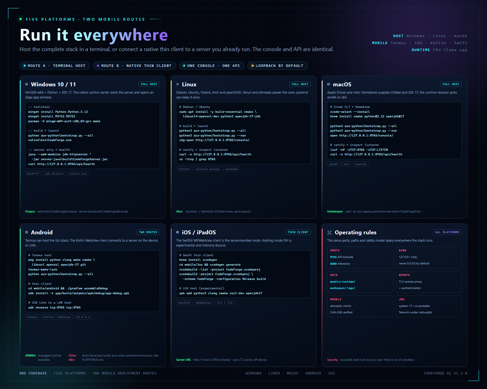

Every command, package list, and limitation is documented in [Platform guide](docs/PLATFORMS.md).

## Using the console

<table>
<tr>
<td width="50%">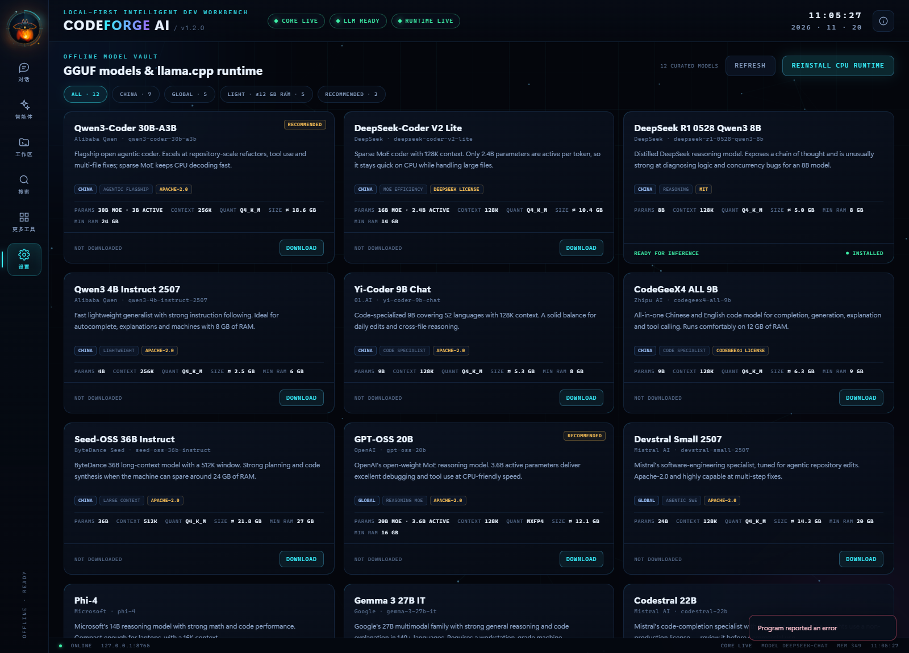</td>
<td width="50%"></td>
</tr>
<tr>
<td align="center"><em>Curated offline model library with region filters</em></td>
<td align="center"><em>Native control center with live readiness</em></td>
</tr>
<tr>
<td colspan="2">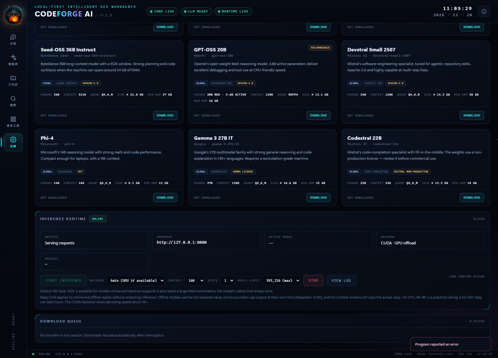</td>
</tr>
<tr>
<td colspan="2" align="center"><em>Inference runtime: select Auto, CPU or CUDA, and serve local models through the installed llama.cpp build</em></td>
</tr>
</table>

- **Chat** — ask about code, paste snippets, and get markdown answers with copyable code blocks, per-block RUN/PREVIEW/SAVE buttons, an **AUTO COMPILE** toggle, a provenance strip (brain route, memory/workspace hits, web sources) and clickable citations. Explicit `/run`, `/save`, `/copy`, `/move`, `/launcher`, `/install` and `/help` commands execute locally without a model; plain-language requests always go to the active model.
- **Debug** — paste code, choose the language, and let the agent compile, run, diagnose, and repair it.
- **Office** — open, preview, create, edit, search and delete Office/PDF/text documents; PDFs render as page images, spreadsheets as cell grids, slides as shape lists, and edits are saved through structured actions rather than free text.
- **Files** — browse drives and folders, search by name or content, and create/rename/copy/move/trash/delete files or folders once **Full filesystem access** is enabled in Settings; all operations are audited and deletes go to trash by default.
- **Downloads** — download by URL or let the server search and rank candidates, then follow live progress, cancel, pick a different candidate, copy the hash and open the destination folder. Starting the same target again resumes from its `.part` file.
- **Mail** — store SMTP settings with an encrypted password, test the connection, and send plain-text or HTML mail with Cc/Bcc and attachments.
- **Models** — filter by region or size, download with resume, install the llama.cpp runtime, start/stop inference, inspect logs.
- **Keys** — add, test, switch and delete OpenAI-compatible provider keys; the online brain is switchable while every saved key stays local and masked.
- **Inspect** — scan any file or project, review per-file reports and risk indicators, browse the quarantine vault, proof-check before/after hashes, and optionally shred quarantine copies after the report. JSON and Markdown reports are always written.
- **Engines** — see which of Godot 4, Unity, Unreal Engine 5, Cocos Creator and LÖVE are installed, scan any folder for game projects, and build, export or run them with the engine's own CLI. Missing engines show an install hint, and nothing is ever downloaded or bundled.
- **Publish** — detect GitHub/GitCode credentials, choose the release folder, tag, title and notes, create the repository or release and upload every asset, with overwrite and delete-older controls.
- **Environment** — verify the C/C++ core, toolchains (with INSTALL buttons and live download progress), local API, host telemetry, dual-brain route, memory store and workspace index; place the project anywhere, create a launcher anywhere and write any file to any path. The **Command Agent** panel shows detected commands, installed applications and auto-provisionable tools, edits step/timeout/auto-download/auto-learn/publish settings, and runs a command locally without involving a model.

Step-by-step walkthrough: [User manual](docs/MANUAL.md).

## Repository layout

```text
core/            C++17 main core (LLM client, runners, debugger, HTTP, process supervisor)
native-c/        C17 helper (SHA-256, sysinfo) and portable hashing
client/          Win32 control center and console launcher
server-java/     Java 17 REST server, model manager, runtime manager, web console
aux-python/      bootstrap, build automation, mock LLM, release packaging
mobile/android/  Kotlin thin client (WebView)
mobile/ios/      SwiftUI thin client (WKWebView, XcodeGen spec)
docs/            manual, platform guide, architecture, API, security, model library
QUICKSTART-*.txt per-platform checklists (Windows, Linux, macOS, mobile)
runtime/         installed llama.cpp runtime (generated)
models/          downloaded GGUF models (generated)
workspace/       per-run compile/execute workspaces (generated)
memory/          persistent memory and workspace index (generated)
```

## Documentation

| Document | Contents |
|---|---|
| [User manual](docs/MANUAL.md) | Installation, every screen, workflows, CLI, configuration, troubleshooting |
| [Platform guide](docs/PLATFORMS.md) | Windows, Linux, macOS, Termux, iSH, Android and iOS build/run commands |
| Platform quick starts | `QUICKSTART-WINDOWS.txt`, `QUICKSTART-LINUX.txt`, `QUICKSTART-MACOS.txt`, `QUICKSTART-MOBILE.txt` |
| [Architecture](docs/ARCHITECTURE.md) | Components, data flow, threading, timeouts, design decisions |
| [API reference](docs/API.md) | Every endpoint with request and response examples |
| [Security](docs/SECURITY.md) | Local-first guarantees, LAN exposure, sandboxing limits, model licenses |
| [Model library](docs/MODELS.md) | All 12 models, sizes, licenses, runtime requirements |
| [Release notes](CHANGELOG.md) | Changes and fixes in the current release |

## Build from source

```bash
# POSIX (Linux / macOS / Termux / iSH)
./build.sh

# Windows
python aux-python\bootstrap.py --build

# Server only
python aux-python/bootstrap.py --build --run
```

C/C++ compilation requires GCC/Clang/C++17 and libcurl on POSIX. The Java server requires JDK 17+ and uses the JDK's built-in `com.sun.net.httpserver`; Apache POI, PDFBox and Jakarta Mail ship in `server-java/lib/` and are merged into the fat jar by `aux-python/build_jar.py`.

## Privacy and security


- The server binds to **127.0.0.1 only** by default.
- No analytics, no accounts. Outbound traffic is limited to actions you enable — model/runtime downloads, web research, the optional online brain — plus the release-index check that powers update notices (release metadata only, no prompt, file, key or usage data; turn it off with `"updates": {"enabled": false}`). Inference prompts are sent to the online API only when it is configured and reachable.
- The **Inspect** tab is static-only: samples are read as bytes, never executed, and the report proves original hashes did not change. Arbitrary code you run through **Run**, **Debug** or the agent still runs as your user with process-tree timeouts; it is **not** an OS-level sandbox. Review [Security](docs/SECURITY.md) before running untrusted code.
- LAN access requires an explicit reverse proxy or tunnel and is your responsibility.

## License

Original source code is released under the [MIT License](LICENSE). Downloaded models retain their own licenses — check each entry in [Model library](docs/MODELS.md) before commercial use.

<div align="center">
<sub>Built for developers who want their intelligence local.</sub>
</div>
