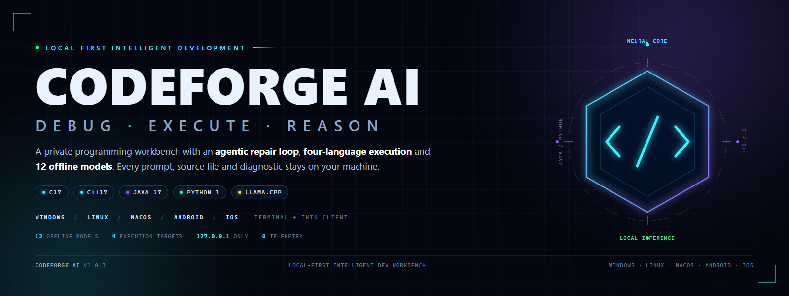
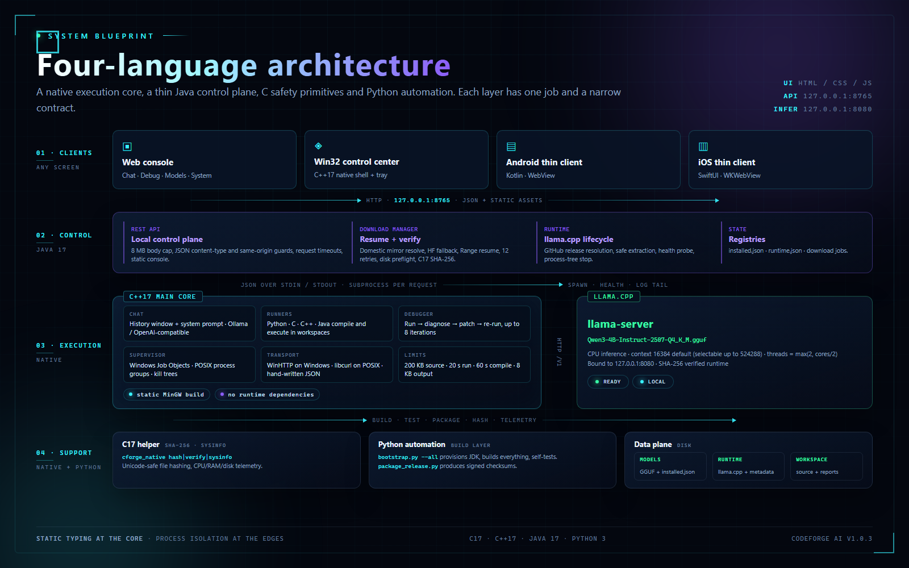
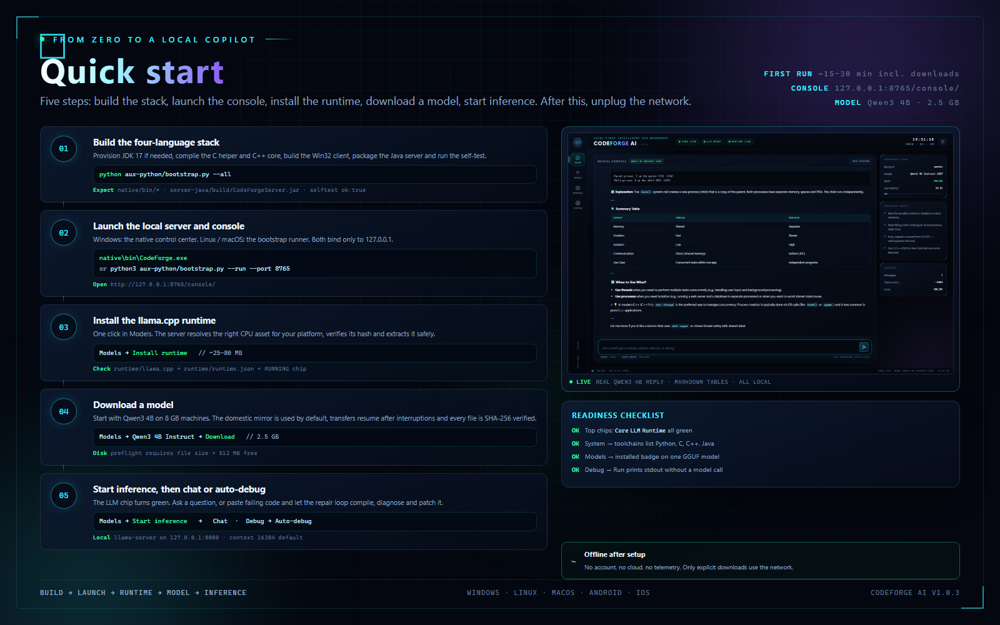
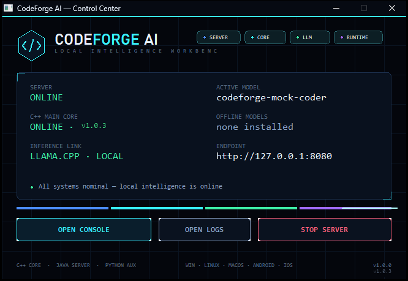
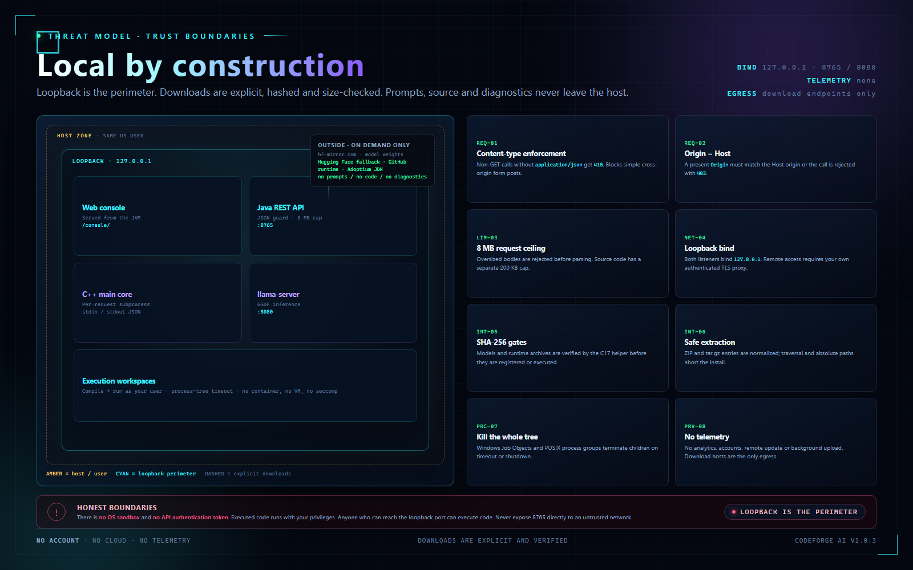

<div align="center">

# CodeForge AI

**A local-first intelligent programming workbench — dual-brain reasoning, agentic debugging, and memory that survives disconnection.**

C/C++ core · Java server · Python automation · Windows · Linux · macOS · Android · iOS

**Version 1.0.3 · 2026-11-16**

[](LICENSE)
[](#architecture)
[](#architecture)
[](docs/MODELS.md)
[](docs/SECURITY.md)

</div>

## Download

**Windows 10/11 (x64), one click:** [`CodeForge-AI-1.0.3-windows-x64.zip`](https://github.com/IAMMEZSH/CodeForge-AI/releases/download/v1.0.3/CodeForge-AI-1.0.3-windows-x64.zip) — prebuilt `CodeForge.exe`, core binaries, server JAR and JDK bootstrap. GitCode mirror: [`CodeForge-AI-1.0.3-windows-x64.zip`](https://gitcode.com/gcw_So3EkhfR/CodeForge-AI/releases/download/v1.0.3/CodeForge-AI-1.0.3-windows-x64.zip).

| Platform | Release artifact | GitHub | GitCode |
|---|---|---|---|
| Windows 10/11 x64, prebuilt | `CodeForge-AI-1.0.3-windows-x64.zip` | [Download](https://github.com/IAMMEZSH/CodeForge-AI/releases/download/v1.0.3/CodeForge-AI-1.0.3-windows-x64.zip) | [Download](https://gitcode.com/gcw_So3EkhfR/CodeForge-AI/releases/download/v1.0.3/CodeForge-AI-1.0.3-windows-x64.zip) |
| Linux x64 / ARM64 / s390x / 32-bit, source | `CodeForge-AI-1.0.3-linux-source.tar.gz` | [Download](https://github.com/IAMMEZSH/CodeForge-AI/releases/download/v1.0.3/CodeForge-AI-1.0.3-linux-source.tar.gz) | [Download](https://gitcode.com/gcw_So3EkhfR/CodeForge-AI/releases/download/v1.0.3/CodeForge-AI-1.0.3-linux-source.tar.gz) |
| macOS Apple silicon / Intel, source | `CodeForge-AI-1.0.3-macos-source.tar.gz` | [Download](https://github.com/IAMMEZSH/CodeForge-AI/releases/download/v1.0.3/CodeForge-AI-1.0.3-macos-source.tar.gz) | [Download](https://gitcode.com/gcw_So3EkhfR/CodeForge-AI/releases/download/v1.0.3/CodeForge-AI-1.0.3-macos-source.tar.gz) |
| Android / iOS / Termux / iSH, source | `CodeForge-AI-1.0.3-mobile-source.zip` | [Download](https://github.com/IAMMEZSH/CodeForge-AI/releases/download/v1.0.3/CodeForge-AI-1.0.3-mobile-source.zip) | [Download](https://gitcode.com/gcw_So3EkhfR/CodeForge-AI/releases/download/v1.0.3/CodeForge-AI-1.0.3-mobile-source.zip) |
| All platforms, source only | `CodeForge-AI-1.0.3-source.zip` | [Download](https://github.com/IAMMEZSH/CodeForge-AI/releases/download/v1.0.3/CodeForge-AI-1.0.3-source.zip) | [Download](https://gitcode.com/gcw_So3EkhfR/CodeForge-AI/releases/download/v1.0.3/CodeForge-AI-1.0.3-source.zip) |
| Documentation set | `CodeForge-AI-1.0.3-docs.zip` | [Download](https://github.com/IAMMEZSH/CodeForge-AI/releases/download/v1.0.3/CodeForge-AI-1.0.3-docs.zip) | [Download](https://gitcode.com/gcw_So3EkhfR/CodeForge-AI/releases/download/v1.0.3/CodeForge-AI-1.0.3-docs.zip) |

Both mirrors carry the same eight release assets: the six archives above, `SHA256SUMS.txt` and `manifest-1.0.3.json`. Names and SHA-256 hashes are identical on [GitHub](https://github.com/IAMMEZSH/CodeForge-AI/releases/tag/v1.0.3) and [GitCode](https://gitcode.com/gcw_So3EkhfR/CodeForge-AI/releases/tag/v1.0.3). Every archive contains the source, the English manual in `docs/MANUAL.md`, and the deployment checklists.

<div align="center">



</div>

---

## What it is

CodeForge AI is a self-contained programming assistant that runs on your own machine. It chats about code, executes programs in isolated workspaces, and **automatically repairs failing code** by combining compiler diagnostics with a large language model. Models are downloaded as GGUF files and served locally by `llama.cpp`.

Local inference stays on the machine. When you configure an **online brain** (any DeepSeek-compatible OpenAI API) and the device is connected, the router sends that request to the online model for maximum capability; if the network or the API fails, the request automatically falls back to the local model. Everything learned online — answers, web snippets, current legal sources — is written into a persistent local memory store, so the offline brain keeps the knowledge after the connection drops.

**Core capabilities**

- **Dual-brain routing** — online DeepSeek-class capability when configured and reachable, local offline inference otherwise, with automatic fallback and `route`/`route_error` reported on every request.
- **Persistent memory** — append-only JSONL memory with CJK bigram + Latin tokenization, SHA-256 deduplication, relevance scoring, kind weights, recency decay and pruning. Chat turns, web findings, debug outcomes and distilled online lessons are recalled offline.
- **Workspace index** — the server indexes project sources (up to 1,500 files, secret/config/build directories excluded) into `memory/project-index.jsonl`, so questions about your own repository are answered with real paths and excerpts.
- **Agentic debug loop** — run → collect diagnostics → ask the model for a patch → re-run, for up to eight iterations (default three), with full process-tree timeouts. RUN, PREVIEW, SAVE and placement work even when no model is running.
- **Multi-language execution** — Python, C, C++, Java, JavaScript, TypeScript, Go, Rust, PHP and C# are compiled and executed inside per-run workspaces with captured stdout/stderr. Missing runtimes are downloaded on demand from the official sources into `native/toolchains/<runtime>`, with live progress and no system PATH changes.
- **HTML/CSS live preview** — generated pages render in a sandboxed iframe served from a per-run session folder with a strict CSP.
- **Model-independent workbench** — compile/run buttons, **AUTO COMPILE**, save-to-any-path, language downloads, project placement and launcher creation are executed by the local server and the LOCAL OPS chat layer. A 4B offline model, a 30B model or an online API all get the same execution and placement capabilities; only the prose differs.
- **Any file, any path** — code blocks can be saved to the exact path you type (one path per file), missing folders are confirmed before creation, and nothing is silently renamed. The whole project can be copied to any folder, and a real launcher can be created anywhere (Windows `.lnk`, Linux `.desktop`, macOS `.command`).
- **Current-law compliance layer** — 13 non-disableable baseline prohibitions, 14 jurisdiction packs, network geolocation, automatic refreshes from official legal portals, bilingual refusals, a hashed audit log, and a guardrail (not legal advice) injected into every model prompt.
- **12 curated offline models** — a mix of Chinese and international models including Qwen3-Coder, DeepSeek, Seed-OSS, GPT-OSS, Devstral, Gemma, Phi and Codestral.
- **Domestic model downloads** — every offline model resolves through `hf-mirror.com` by default, with automatic `huggingface.co` fallback, resumable transfers and mandatory upstream SHA-256 verification. Override the source with `llm.model_mirror` or `CODEFORGE_MODEL_MIRROR`.
- **Managed llama.cpp runtime** — the server downloads the correct CPU runtime for your OS and CPU (Windows x64/ARM64, macOS arm64/x64, Linux x64/ARM64/s390x, Android ARM64), verifies SHA-256, and controls `llama-server` for you with a user-selectable 2K–512K context window (16K default).
- **Native control center** — a Win32 C++ app that starts the server, shows live readiness, and opens the console in an Edge app window.
- **One web console everywhere** — the same responsive futuristic UI works on desktop browsers, Android WebView, and iOS WKWebView.
- **Interruptible chat with a live reasoning trace** — every turn shows stage-by-stage execution (compliance screen, memory recall, workspace scan, live research, context assembly, generation, output screen), a live token counter with the measured decoding rate on the local runtime, a remaining-time estimate, and a progress bar. The send key becomes **INTERJECT** while the model is working: press it to stop the answer and send your correction immediately, or **STOP** to cancel with an empty box. Cancellation kills the core process on the server, frees the model, and does not write the aborted turn to memory.

## Architecture



- **C/C++ main core** — all orchestration, compilation, execution, diagnostics, model calls, and the debug loop.
- **Java server** — REST API, download manager with resume, archive extraction, runtime management.
- **Python auxiliary core** — environment bootstrap, portable JDK provisioning, build automation, packaging, and a mock LLM for testing.
- **Mobile thin clients** — Kotlin/WebView and Swift/WKWebView shells that connect to a CodeForge server on the device or LAN.

Deeper dives: [Architecture](docs/ARCHITECTURE.md) · [API reference](docs/API.md) · [Security model](docs/SECURITY.md).

## Request lifecycle


Every action is a bounded subprocess call with a JSON contract. Chat, debug, model download, runtime installation, and the four-language self-test all pass through the same loopback control plane. Timeouts, size caps, and on-disk state are listed in the diagram; exact request and response examples are in the [API reference](docs/API.md).

## Dual brain, memory and compliance

```jsonc
{
  "llm": {
    "backend": "auto",
    "online": {
      "enabled": true,
      "base_url": "https://api.deepseek.com",
      "api_key": "",
      "model": "deepseek-chat",
      "timeout_ms": 120000
    }
  },
  "memory": { "enabled": true, "retrieval_limit": 5, "max_entries": 4000 },
  "online": { "enabled": true, "research": "auto", "max_results": 3 },
  "compliance": { "enabled": true, "jurisdiction": "auto", "refresh_hours": 24 }
}
```

- **Routing** — the Java server asks for `online` only when a key is configured and the network probe succeeds; the C++ core probes the endpoint again and silently falls back to local inference on any failure. `meta.brain` returns the requested route, the actual route and the failure reason.
- **Learning loop** — online answers are distilled into `memory/memories.jsonl` as `lesson` entries, web findings as `web` entries, and debug outcomes as `note` entries. Retrieval combines token overlap, kind weights, recency and deduplication, then injects the top hits into the local system prompt.
- **Offline recall** — with the network disabled, the same questions still retrieve prior lessons and project facts. Verified in testing: a query answered online was recalled with 3 memory hits after switching the server to offline mode.
- **Law awareness** — every request detects the jurisdiction (request override → config → IP geolocation → locale → safe default), injects the applicable pack plus cached official sources, and refreshes stale briefs from official portals when online. The prompt includes an explicit “guardrail, not legal advice” notice.
- **Environment overrides** — `CODEFORGE_ONLINE_LLM`, `CODEFORGE_ONLINE_LLM_URL`, `CODEFORGE_ONLINE_LLM_MODEL`, `CODEFORGE_ONLINE_LLM_KEY`, `CODEFORGE_ONLINE_LLM_TIMEOUT_MS`, `CODEFORGE_ONLINE`, `CODEFORGE_RESEARCH`, `CODEFORGE_JURISDICTION`, `CODEFORGE_MEMORY`.

**Honest limits.** A 4B–36B GGUF model running on one machine cannot literally out-reason a frontier online model. “Smarter offline” means the local brain keeps durable project memory, distilled online lessons, workspace context, current-law retrieval and compile/run feedback that a stateless chat window does not have. When maximum raw reasoning matters, configure the online brain; when privacy or connectivity matters, the offline brain keeps working with everything it has learned.

## Agentic debug loop


Paste failing source, choose a language (or let the extension decide), and run **Auto-debug**. The core compiles and executes it, captures exit code, stderr, and timeout diagnostics, then asks the local model for a complete corrected file inside a fenced block. The loop repeats up to eight times (default three) and stops as soon as the program exits cleanly. `workspace/<job>/report.json` and the final source stay on disk for inspection.

## Offline model library


| Model | Origin | Params | Approx. size | Min RAM |
|---|---|---|---|---|
| Qwen3-Coder 30B-A3B | China · Alibaba | 30B MoE (3B active) | 18.6 GB | 24 GB |
| DeepSeek-Coder V2 Lite | China · DeepSeek | 16B MoE (2.4B active) | 10.4 GB | 14 GB |
| DeepSeek R1 0528 Qwen3 8B | China · DeepSeek | 8B | 5.0 GB | 8 GB |
| Qwen3 4B Instruct 2507 | China · Alibaba | 4B | 2.5 GB | 6 GB |
| Yi-Coder 9B Chat | China · 01.AI | 9B | 5.3 GB | 8 GB |
| CodeGeeX4 ALL 9B | China · Zhipu AI | 9B | 6.3 GB | 9 GB |
| Seed-OSS 36B Instruct | China · ByteDance | 36B | 21.8 GB | 27 GB |
| GPT-OSS 20B | Global · OpenAI | 20B MoE (3.6B active) | 12.1 GB | 16 GB |
| Devstral Small 2507 | Global · Mistral AI | 24B | 14.3 GB | 20 GB |
| Phi-4 | Global · Microsoft | 14B | 9.1 GB | 12 GB |
| Gemma 3 27B IT | Global · Google | 27B | 16.6 GB | 22 GB |
| Codestral 22B | Global · Mistral AI | 22B | 13.3 GB | 18 GB |

Full metadata, licenses, and upstream sources: [Model library](docs/MODELS.md).

All 12 offline models resolve through the domestic `hf-mirror.com` source by default, with `huggingface.co` as an automatic fallback. Set `llm.model_mirror` or `CODEFORGE_MODEL_MIRROR` to change the order; upstream repositories, filenames and SHA-256 hashes are unchanged.

## Platform packages

CodeForge is delivered for five platform targets. Only Windows ships prebuilt binaries; Linux, macOS, Android and iOS build the same source locally with one command, because a single x64 Windows build cannot run on those systems.

| Platform | Release artifact | Route | Build and launch |
|---|---|---|---|
| Windows 10/11 x64 | `CodeForge-AI-1.0.3-windows-x64.zip` | Full host, prebuilt `CodeForge.exe`, `CodeForgeCore.exe`, `cforge_native.exe`, server JAR | `native\bin\CodeForge.exe` |
| Linux (x64, ARM64, s390x, 32-bit) | `CodeForge-AI-1.0.3-linux-source.tar.gz` | Full host, native build | `python3 aux-python/bootstrap.py --all` then `--run` |
| macOS 12+ (Apple silicon / Intel) | `CodeForge-AI-1.0.3-macos-source.tar.gz` | Full host, native build | `python3 aux-python/bootstrap.py --all` then `--run` |
| Android (ARM64, ARMv7, x86_64) | `CodeForge-AI-1.0.3-mobile-source.zip` | Termux host, or Kotlin thin client to a LAN host | `pkg install ...` in Termux; `cd mobile/android && ./gradlew assembleDebug` |
| iOS / iPadOS 15+ | `CodeForge-AI-1.0.3-mobile-source.zip` | iSH host (experimental), or Swift thin client to a LAN host | `cd mobile/ios && xcodegen generate` |

**Same-platform device coverage**

- **Windows** — x64 is verified. Windows 11 ARM64 runs the x64 bundle under emulation, or builds natively with an ARM64 JDK and toolchain; the runtime installer then prefers `win-cpu-arm64`.
- **Linux** — x86_64, aarch64 and s390x have official llama.cpp CPU assets. 32-bit ARM/x86 and Alpine/musl build the core and a local `llama-server`; set `llm.llama_server` or `CODEFORGE_LLAMA_SERVER`.
- **macOS** — Apple silicon resolves `macos-arm64`; Intel resolves `macos-x64`. No Rosetta requirement for the native build.
- **Android** — ARM64 phones and tablets run the full stack in Termux and install the official `android-arm64` runtime. Other ABIs build llama.cpp locally, and every Android 8+ device can use the Kotlin APK as a client.
- **iOS / iPadOS** — the Swift app and iSH console are clients/control hosts; inference can stay on a PC, Mac or phone over the LAN via `llm.openai_url`.

Each platform bundle carries a `QUICKSTART.txt` written for that target, next to the distro-specific package lists and device commands in the [Platform guide](docs/PLATFORMS.md). `SHA256SUMS.txt` and `manifest-1.0.3.json` sit beside the archives.

## Quick start



### Windows 10/11 (x64)

```bat
python aux-python\bootstrap.py --all
native\bin\CodeForge.exe
```

The control center starts the Java server, waits for readiness, and opens the console. A portable Temurin JDK 17 is downloaded automatically if no JDK 17+ is installed.

### Linux

```bash
sudo apt install -y build-essential cmake libcurl4-openssl-dev python3 openjdk-17-jdk
python3 aux-python/bootstrap.py --all
python3 aux-python/bootstrap.py --run
xdg-open http://127.0.0.1:8765/console/
```

### macOS

```bash
brew install cmake curl python@3.12 openjdk@17
python3 aux-python/bootstrap.py --all
python3 aux-python/bootstrap.py --run
open http://127.0.0.1:8765/console/
```

### Android and iOS

Two documented paths exist for each mobile platform:

1. **Terminal route** — run the full stack inside **Termux** (Android) or **iSH** (iOS). ARM64 Android installs the official `android-arm64` runtime; other ABIs use a local llama.cpp build.
2. **Native app route** — build the Kotlin or Swift thin client in [`mobile/`](mobile/) and connect it to a CodeForge server on the device or your LAN.


Every command, package list, and limitation is documented in [Platform guide](docs/PLATFORMS.md).

## Using the console

<table>
<tr>
<td width="50%"></td>
<td width="50%"></td>
</tr>
<tr>
<td align="center"><em>Curated offline model library with region filters</em></td>
<td align="center"><em>Native control center with live readiness</em></td>
</tr>
</table>

- **Chat** — ask about code, paste snippets, and get markdown answers with copyable code blocks, per-block RUN/PREVIEW/SAVE buttons, an **AUTO COMPILE** toggle, a provenance strip (brain route, jurisdiction, memory/workspace hits, web sources) and clickable citations. Say “run it”, “save this to D:\path”, “place the project in E:\apps”, “install the Go environment” or `/help` — local ops execute without needing any model.
- **Debug** — paste code, choose the language, and let the agent compile, run, diagnose, and repair it.
- **Models** — filter by region or size, download with resume, install the llama.cpp runtime, start/stop inference, inspect logs.
- **Environment** — verify the C/C++ core, toolchains (with INSTALL buttons and live download progress), local API, host telemetry, dual-brain route, memory store, workspace index and cached legal brief; place the project anywhere, create a launcher anywhere and write any file to any path.

Step-by-step walkthrough: [User manual](docs/MANUAL.md).

## Repository layout

```text
core/            C++17 main core (LLM client, runners, debugger, HTTP, process supervisor)
native-c/        C17 helper (SHA-256, sysinfo) and portable hashing
client/          Win32 control center and console launcher
server-java/     Java 17 REST server, model manager, runtime manager, web console
aux-python/      bootstrap, build automation, mock LLM, release packaging
mobile/android/  Kotlin thin client (WebView)
mobile/ios/      SwiftUI thin client (WKWebView, XcodeGen spec)
docs/            manual, platform guide, architecture, API, security, model library
QUICKSTART-*.txt per-platform checklists (Windows, Linux, macOS, mobile)
runtime/         installed llama.cpp runtime (generated)
models/          downloaded GGUF models (generated)
workspace/       per-run compile/execute workspaces (generated)
memory/          persistent memory, workspace index and compliance audit (generated)
```

## Documentation

| Document | Contents |
|---|---|
| [User manual](docs/MANUAL.md) | Installation, every screen, workflows, CLI, configuration, troubleshooting |
| [Platform guide](docs/PLATFORMS.md) | Windows, Linux, macOS, Termux, iSH, Android and iOS build/run commands |
| Platform quick starts | `QUICKSTART-WINDOWS.txt`, `QUICKSTART-LINUX.txt`, `QUICKSTART-MACOS.txt`, `QUICKSTART-MOBILE.txt` |
| [Architecture](docs/ARCHITECTURE.md) | Components, data flow, threading, timeouts, design decisions |
| [API reference](docs/API.md) | Every endpoint with request and response examples |
| [Security](docs/SECURITY.md) | Local-first guarantees, LAN exposure, sandboxing limits, model licenses |
| [Model library](docs/MODELS.md) | All 12 models, sizes, licenses, runtime requirements |
| [Release notes](CHANGELOG.md) | Version history and verification status |

## Build from source

```bash
# POSIX (Linux / macOS / Termux / iSH)
./build.sh

# Windows
python aux-python\bootstrap.py --build

# Server only
python aux-python/bootstrap.py --build --run
```

C/C++ compilation requires GCC/Clang/C++17 and libcurl on POSIX. The Java server requires JDK 17+ and uses only the JDK's built-in `com.sun.net.httpserver` — no external Java dependencies.

## Privacy and security



- The server binds to **127.0.0.1 only** by default.
- No analytics, no accounts. Outbound traffic happens only for actions you enable: model/runtime downloads, web research, law refreshes, and the optional online brain. Inference prompts are sent to the online API only when it is configured and reachable.
- When online, CodeForge automatically checks the current law of the detected jurisdiction and refreshes cached official sources. The compliance layer is a guardrail, not legal advice.
- Executed code runs as your user with process-tree timeouts; it is **not** an OS-level sandbox. Review [Security](docs/SECURITY.md) before running untrusted code.
- LAN access requires an explicit reverse proxy or tunnel and is your responsibility.

## License

Original source code is released under the [MIT License](LICENSE). Downloaded models retain their own licenses — check each entry in [Model library](docs/MODELS.md) before commercial use.

<div align="center">
<sub>Built for developers who want their intelligence local.</sub>
</div>
