# CodeForge AI — User Manual

**Version 1.2.1 · 2026-11-21**
**Applies to:** Windows 10/11, Linux, macOS, Android (Termux and thin client), iOS/iPadOS (iSH and thin client)

This manual is the complete operator handbook for CodeForge AI. It explains
what every screen does, what happens under the hood, how to install the stack
on each supported platform, how to download and serve offline models, how to
drive the autonomous debug loop, and how to recover from every error the
software can produce. It assumes no prior knowledge of the codebase.

> **Audience.** Developers who want a private, local coding assistant, and
> operators who need to build, run, audit or extend this stack.
>
> **Conventions.** `$` denotes a POSIX shell (Linux, macOS, Termux, iSH).
> `C:\>` denotes `cmd.exe` or PowerShell on Windows. Paths are relative to the
> project root unless stated otherwise. JSON is shown pretty-printed for
> readability, but the API returns compact JSON.

---

## Table of contents

1. [What CodeForge AI is](#1-what-codeforge-ai-is)
2. [Requirements](#2-requirements)
3. [Installation](#3-installation)
4. [First launch](#4-first-launch)
5. [The Chat tab](#5-the-chat-tab)
6. [The Debug tab](#6-the-debug-tab)
7. [Models and the inference runtime](#7-models-and-the-inference-runtime)
8. [The Environment tab](#8-the-environment-tab)
9. [Office, files, mail and downloads](#9-office-files-mail-and-downloads)
10. [End-to-end workflows](#10-end-to-end-workflows)
11. [Configuration reference](#11-configuration-reference)
12. [Command-line reference](#12-command-line-reference)
13. [Local API quick reference](#13-local-api-quick-reference)
14. [Data layout and maintenance](#14-data-layout-and-maintenance)
15. [Performance tuning](#15-performance-tuning)
16. [Security operations](#16-security-operations)
17. [Troubleshooting](#17-troubleshooting)
18. [FAQ](#18-faq)
19. [Appendices](#19-appendices)

---

## 1. What CodeForge AI is

CodeForge AI is a self-contained, action-first programming workbench. Local
inference, execution and repair all happen on the machine it is installed on.
Simple calculator, command and code requests return executable code first;
deeper reasoning is reserved for tasks that need it. When an optional online
brain and network access are available, the same request can be served by a
DeepSeek-compatible API for maximum capability, and everything learned online
is persisted locally for offline recall. It combines five abilities:

1. **Conversation** — a chat interface backed by an offline large language
   model, with code-aware markdown rendering, workspace context, persistent
   memory and optional online augmentation.
2. **Execution** — compilation and execution of Python, C, C++, Java,
   JavaScript, TypeScript, Go, Rust, PHP and C# source in per-session
   workspaces, with stdout, stderr, exit status and timing; HTML/CSS render in
   a sandboxed preview. Missing runtimes are provisioned on demand. Execution
   never calls the model and works even when inference is stopped.
3. **Repair** — an agentic loop that feeds a failing program and its exact
   diagnostics back to the model, applies the returned patch, and re-runs the
   program up to a configurable iteration limit.
4. **Delivery** — a deterministic build tool compiles or packages the finished
   program for any supported language and places a double-clickable result,
   with a real Desktop shortcut, in one step.
5. **Everyday work** — Office/PDF preview and structured editing, whole-disk
   file operations behind an explicit permission, SMTP email with attachments,
   and a download center that fetches a URL or searches for the right file.

Models, prompts, source, diagnostics and local inference stay on the host.
Outbound traffic happens only for actions you enable: model and runtime
downloads, web research, the optional portable-JDK bootstrap, and the optional
online brain when a key is configured.

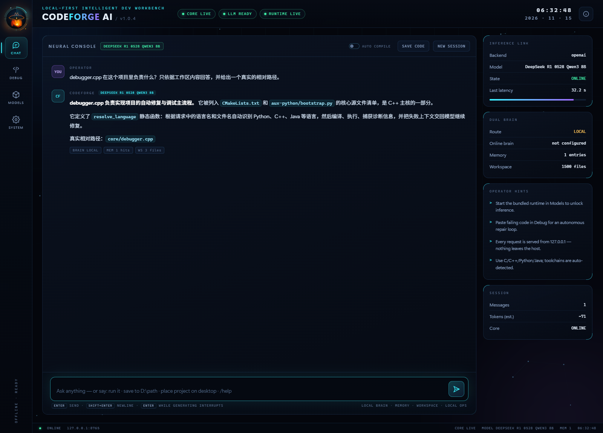

### 1.1 Design principles

- **Local-first.** No account and no telemetry. Offline inference needs no cloud
  key; the optional online brain uses a key you configure. The server binds to
  `127.0.0.1`; inference binds to `127.0.0.1:8080`.
- **Action-first.** Short commands and code requests produce runnable output
  before prose. Managed inference caps reasoning and disables the chat
  template's thinking mode so a calculator request cannot turn into a long
  monologue; longer deliberation remains available for genuinely complex work.
- **Native core.** Orchestration, process supervision, HTTP and the debug loop
  are written in C++17; the hash and host-telemetry helper is C17. There is no
  interpreter in the execution path.
- **Thin server.** Java 17 owns the REST surface and heavy I/O: model
  downloads, resume, archive extraction, runtime lifecycle. It uses only the
  JDK's built-in HTTP server; the Office, PDF and mail features bundle Apache
  POI, PDFBox and Jakarta Mail inside `server-java/lib/` and the fat jar.
- **Python is automation only.** Bootstrap, build, packaging, testing and a
  mock LLM live in `aux-python/`. Python never serves inference or executes
  user code.
- **One UI everywhere.** The web console is plain HTML/CSS/JS and runs
  identically in desktop browsers, Android WebView and iOS WKWebView.

### 1.2 Component map

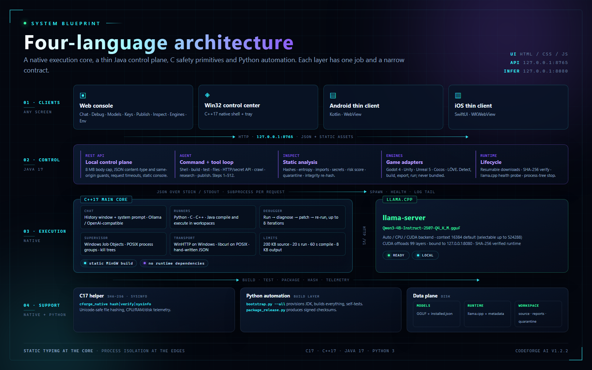

```text
Browser / mobile WebView
        │ HTTP 127.0.0.1:8765
        ▼
Java 17 server ──────────────► llama-server 127.0.0.1:8080 (llama.cpp)
  REST, downloads, runtime        local GGUF model
        │ JSON over stdin/stdout
        ▼
C++17 main core
  chat · run · debug · process supervision · HTTP client
        ▲
        │ subprocess calls
C17 helper (SHA-256, sysinfo) and Python automation (build/test/package)
```

### 1.3 Request lifecycle

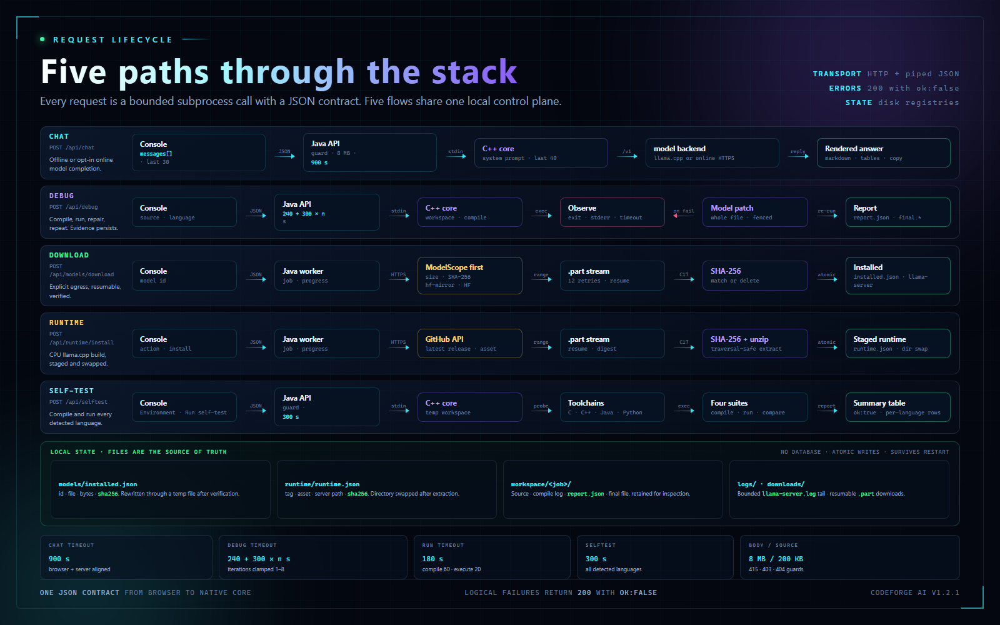

Five bounded paths share one JSON contract: chat, debug, model download,
runtime installation and the four-language self-test. The lower strip records
the request timeouts and the on-disk state that survives restarts. Details for
each path appear in Chapters 5–8 and Chapter 13.

### 1.4 What it is not

- It is **not** a sandbox. Executed programs run as your user account.
- It is **not** a cloud service. There is no remote sync, account or sharing.
- It does **not** bundle model weights. You choose and download models.
- It does **not** authenticate API callers. Loopback binding is the security
  boundary; see [Security operations](#16-security-operations).

### 1.5 Dual brain, persistent memory and online research

The **dual-brain router** prefers the online model only when `llm.online.api_key`
is configured and the network probe succeeds. The Java server places
`"route": "online"` or `"route": "local"` in the request; the C++ core probes
the online endpoint again and falls back to local inference if the probe or the
completion fails. Every response reports `route` and, when a fallback happened,
`route_error`; the console shows them in the message provenance strip and the
Environment tab.

The **memory store** (`memory/memories.jsonl`) is append-only. Tokenization
handles Chinese bigrams and Latin words, SHA-256 prevents duplicates, and
retrieval combines similarity, kind weight (`fact`, `lesson`, `preference`,
`web`, `chat`, `note`) and recency. Chat exchanges, web findings, debug
outcomes and distilled online lessons are written automatically. When the
network is unavailable the same retrieval path still runs, so prior knowledge
is recalled offline.

The **workspace index** (`memory/project-index.jsonl`) scans project sources
(1,500 files maximum, 256 KB per file, 4,000 characters per document) and
excludes secrets, configuration, builds, models, memory and workspaces. Chat
and debug requests search the index and inject the best excerpts with their
paths.

When a question benefits from current information, the **online research**
path searches the live web, injects the result titles, URLs and snippets into
the prompt, and stores the findings in local memory. This path is independent
of the model: it works with a local GGUF model or the optional online brain.

---

## 2. Requirements

### 2.1 Hardware tiers

| Tier | RAM | CPU | Suitable models | Experience |
|---|---|---|---|---|
| Minimum | 8 GB | 4 logical cores, x64/arm64 | Qwen3 4B (Q4_K_M) | Chat and small debug loops; long answers are slow |
| Comfortable | 16 GB | 6–8 cores | Qwen3 4B, DeepSeek R1 8B, Phi-4, CodeGeeX4 9B, GPT-OSS 20B | Daily driver for one project |
| Recommended | 24–32 GB | 8–12 cores | GPT-OSS 20B, DeepSeek-Coder V2 Lite, Devstral 24B, Gemma 3 27B | Large files and multi-iteration repairs |
| Workstation | 48 GB+ | 12+ cores | Qwen3.6 35B A3B, Qwen3.8 27B, Qwen3-Coder 30B-A3B, Seed-OSS 36B, Codestral 22B | Flagship agentic work |

- The managed runtime runs on **CPU or CUDA**, selectable in the Models panel.
  CUDA requires an NVIDIA GPU with a driver matching the CUDA 13.5 build; CPU
  remains the fallback on every other machine.
- Model size on disk is approximately the Q4_K_M file size; runtime memory is
  roughly file size plus 1–3 GB of context and compute overhead. With CUDA,
  most weights and the KV cache move to VRAM, so system RAM use drops and a
  12 GB GPU comfortably serves a 4B model at 16K context.
- SSD/NVMe storage materially improves model load time (multi-GB mmap).

### 2.2 Software matrix

| Platform | Required | Optional | Notes |
|---|---|---|---|
| Windows 10/11 x64 | MinGW-w64 GCC/G++ 13+, Python 3.10+, JDK 17+ | CMake 3.16+, Edge | Portable Temurin JDK is downloaded if no JDK 17+ is found |
| Windows 11 ARM64 | x64 release under emulation, or ARM64 C++ toolchain + ARM64 JDK 17 | CMake | Runtime resolves `win-cpu-arm64` with an ARM64 JDK, `win-cpu-x64` under emulation |
| Ubuntu/Debian | `build-essential`, `libcurl4-openssl-dev`, `python3`, JDK 17 | CMake | The server uses `jdk.httpserver` |
| Fedora/RHEL | `gcc-c++`, `libcurl-devel`, `python3`, `java-17-openjdk-devel` | CMake | |
| Arch | `base-devel`, `curl`, `python`, `jdk17-openjdk` | CMake | |
| Linux ARM64 / s390x | Same distro packages | CMake | Runtime resolves `ubuntu-arm64` / `ubuntu-s390x` |
| Linux ARMv7 / x86 32-bit | Same distro packages | CMake, llama.cpp source | No prebuilt runtime; set `llm.llama_server` |
| macOS 12+ | Xcode Command Line Tools, Python 3, JDK 17 | Homebrew CMake | Apple silicon resolves `macos-arm64`; Intel resolves `macos-x64` |
| Android (Termux) | `python`, `clang`, `make`, `libcurl`, `openjdk-17`, `cmake` | llama.cpp source build | ARM64 resolves `android-arm64` automatically; other ABIs use `llm.llama_server` |
| iOS/iPadOS (iSH) | `python3`, `clang`, `cmake`, `curl-dev`, `openjdk17` (if available) | Thin client recommended | iSH is a 32-bit x86 emulator; use LAN inference and a thin client |
| Android app | Android Studio / JDK 17, Gradle 8.7, SDK 34 | — | Kotlin WebView client, Android 8+ |
| iOS app | Xcode 15+, XcodeGen | Apple developer signing | SwiftUI WKWebView client, iOS/iPadOS 15+ |

### 2.3 Disk planning

| Item | Approximate size |
|---|---|
| Source + built binaries + jar | 8 MB |
| Portable JDK 17 | 180–200 MB |
| llama.cpp CPU runtime | 25–80 MB |
| llama.cpp CUDA runtime (with CUDA 13.5 libraries) | 550–800 MB |
| Qwen3 4B Q4_K_M | 2.5 GB |
| 8–9B models | 5–6.5 GB |
| 14–20B models | 9–12 GB |
| 22–30B models | 13–22 GB |
| Workspaces (per debug session) | 0.1–1 MB |
| Logs | A few MB per long session |

The downloader refuses to start if free space is less than the expected file
size plus 512 MB. Keep at least 15 GB free for comfortable model rotation.

### 2.4 Network expectations

- **Offline use** is fully supported once a runtime and at least one model are
  installed.
- **First model download** resolves metadata through ModelScope first, then the
  domestic `hf-mirror.com` mirror, with `huggingface.co` as the final automatic
  fallback, and streams the weights through the same source. Override the
  fallback order with `llm.model_mirror` or `CODEFORGE_MODEL_MIRROR`.
- **Runtime install** resolves releases from `api.github.com` and downloads
  the archive from GitHub.
- **JDK bootstrap** (only when no JDK 17+ is present) resolves Temurin assets
  from `api.github.com` and downloads from Adoptium/GitHub.
- **Update check** reads public release metadata from `api.gitcode.com`
  (preferred on Chinese systems) or `api.github.com` when the console loads
  and every six hours. It sends no prompt, source file, key or diagnostic.
  Disable it with `"updates": {"enabled": false}` in `config.json`.
- No prompt, source file or diagnostic is ever uploaded.

---

## 3. Installation

There are two installation routes:

- **Full host** — run the complete four-language stack on the machine
  (Windows, Linux, macOS, Termux, iSH).
- **Thin client** — build the Kotlin or Swift app and connect it to a CodeForge
  server running on another machine or on the same device.

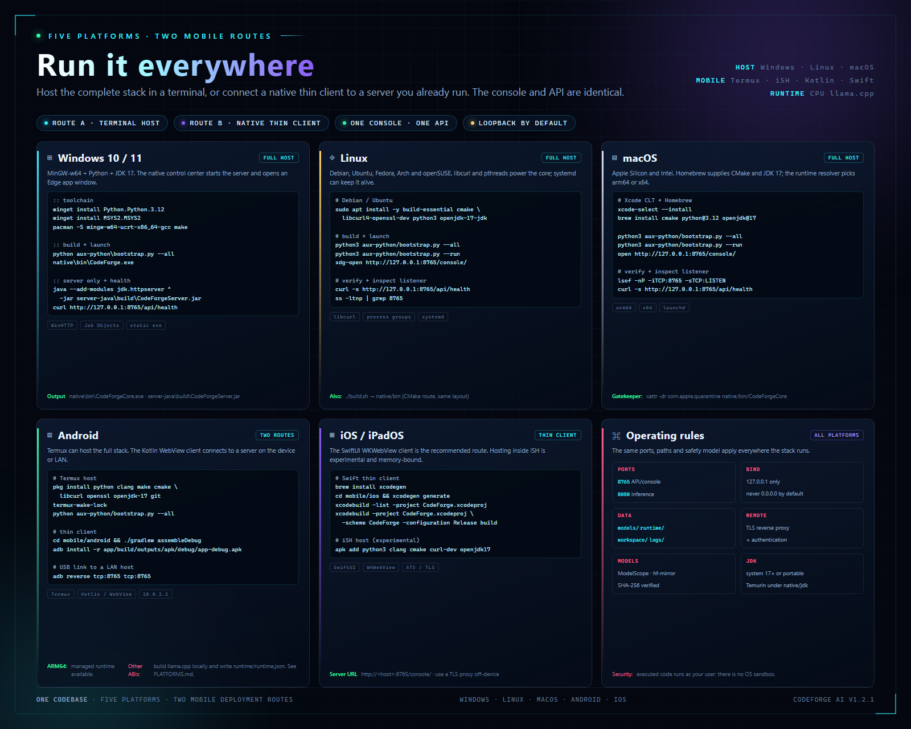

### 3.1 Windows 10/11 (x64)

**Step 1 — install the build toolchain.**

```bat
winget install Python.Python.3.12
winget install MSYS2.MSYS2
```

Then, in the MSYS2 UCRT64 terminal:

```bash
pacman -S --needed mingw-w64-ucrt-x86_64-gcc make
```

Add `C:\msys64\ucrt64\bin` to the system `PATH`, open a new terminal and
verify:

```bat
gcc --version
g++ --version
python --version
```

**Step 2 — build everything.**

```bat
cd C:\Users\YOU\Desktop\CodeForge-AI
python aux-python\bootstrap.py --all
```

`--all` performs four stages: ensure JDK (system JDK 17+ or portable Temurin),
build the C helper, build the C++ core and Win32 client, compile and package
the Java server, then run the native self-test.

**Step 3 — start.**

```bat
native\bin\CodeForge.exe
```

The control center starts the Java server, waits for readiness and opens the
console in an Edge app window. `--no-open` starts the server without opening
the console:

```bat
native\bin\CodeForge.exe --no-open
```

**Step 4 — run the server without the control center (optional).**

```bat
python aux-python\bootstrap.py --run --port 8765
```

Open `http://127.0.0.1:8765/console/` manually.

**Uninstall:** close the control center from the tray menu, then delete the
project folder. Delete `%LOCALAPPDATA%\CodeForge` only if you created an Edge
app profile there manually. The portable JDK lives inside `native\jdk` and is
removed with the folder.

### 3.2 Linux

**Debian/Ubuntu:**

```bash
sudo apt update
sudo apt install -y build-essential cmake libcurl4-openssl-dev python3 openjdk-17-jdk
```

**Fedora/RHEL:**

```bash
sudo dnf install -y gcc gcc-c++ cmake libcurl-devel python3 java-17-openjdk-devel
```

**Arch:**

```bash
sudo pacman -S --needed base-devel cmake curl python jdk17-openjdk
```

**openSUSE:**

```bash
sudo zypper install -y gcc gcc-c++ cmake libcurl-devel python3 java-17-openjdk-devel
```

Build and start:

```bash
cd ~/Desktop/CodeForge-AI
python3 aux-python/bootstrap.py --all
python3 aux-python/bootstrap.py --run --port 8765
xdg-open http://127.0.0.1:8765/console/
```

Or use the CMake route, which writes the same `native/bin` layout:

```bash
./build.sh
```

To run the server as a user service, see the systemd unit in
[PLATFORMS.md](PLATFORMS.md#linux).

### 3.3 macOS

```bash
xcode-select --install
brew install cmake python@3.12 openjdk@17
cd ~/Desktop/CodeForge-AI
python3 aux-python/bootstrap.py --all
python3 aux-python/bootstrap.py --run --port 8765
open http://127.0.0.1:8765/console/
```

If Homebrew's JDK is not on `PATH`:

```bash
export JAVA_HOME="$(/usr/libexec/java_home -v 17)"
export PATH="$JAVA_HOME/bin:$PATH"
```

If Gatekeeper quarantines a downloaded binary:

```bash
xattr -dr com.apple.quarantine native/bin/CodeForgeCore
```

Apple Silicon and Intel both work; the runtime resolver picks
`macos-arm64` or `macos-x64` automatically.

### 3.4 Android via Termux

Termux runs the complete stack as a Linux userland. Install packages:

```bash
pkg update && pkg upgrade
pkg install -y python clang make cmake libcurl openssl openjdk-17 git
```

Copy or clone the project into `~/CodeForge-AI`, then build:

```bash
cd ~/CodeForge-AI
python aux-python/bootstrap.py --all
python aux-python/bootstrap.py --run --port 8765
```

Open `http://127.0.0.1:8765/console/` in the Android browser.

On an ARM64 device, press **Install runtime** in the Models tab. The server
detects Termux and resolves the official `android-arm64` asset (Snapdragon
fallback). Other Android ABIs have no prebuilt asset; build llama.cpp from
source and point CodeForge at the binary:

```bash
pkg install -y git cmake
git clone --depth 1 https://github.com/ggml-org/llama.cpp
cd llama.cpp
cmake -B build -DCMAKE_BUILD_TYPE=Release -DLLAMA_CURL=OFF
cmake --build build --parallel "$(nproc)" --target llama-server
export CODEFORGE_LLAMA_SERVER="$HOME/llama.cpp/build/bin/llama-server"
cd ~/CodeForge-AI
python aux-python/bootstrap.py --run --port 8765
```

The same path can be persisted as `llm.llama_server` in `config.json`; the
override also works on desktop platforms and takes priority over
`runtime/runtime.json`. Keep the device plugged in during long downloads:

```bash
termux-wake-lock
```

Detailed Termux commands, wake locks and storage notes are in
[PLATFORMS.md](PLATFORMS.md#android-termux).

### 3.5 iOS/iPadOS via iSH

iSH is an x86 Linux emulator. The full stack is **experimental** there; the
recommended route is the native thin client.

Host attempt:

```sh
apk add python3 py3-pip build-base cmake curl-dev git openjdk17 || \
apk add python3 build-base cmake curl-dev git openjdk17
cd /root/CodeForge-AI
python3 aux-python/bootstrap.py --all
python3 aux-python/bootstrap.py --run --port 8765
```

Then open `http://127.0.0.1:8765/console/` in Safari. Expect slow compilation
and constrained memory; build llama.cpp from source if the runtime installer
has no matching asset. If OpenJDK 17 is unavailable in your iSH repository,
run the server on another machine and use the thin client.

### 3.6 Android thin client (Kotlin)

The project is in `mobile/android/` and targets SDK 34 with Gradle 8.7.

```bash
cd mobile/android
gradle wrapper --gradle-version 8.7   # only if gradlew is missing
./gradlew assembleDebug
adb install -r app/build/outputs/apk/debug/app-debug.apk
```

Or open `mobile/android` in Android Studio and press Run. The app is a WebView
shell with a server-address field. Use:

- `http://10.0.2.2:8765/console/` from the Android emulator (host loopback);
- `http://<host-lan-ip>:8765/console/` from a physical device on the same LAN
  (requires the server to be reachable through a reverse proxy or tunnel; the
  Java server binds to loopback only by default).

Cleartext HTTP for local development is already allowed by
`network_security_config.xml`; production use should terminate TLS in front of
the server.

### 3.7 iOS thin client (Swift)

The project is in `mobile/ios/` and uses XcodeGen.

```bash
brew install xcodegen
cd mobile/ios
xcodegen generate
xcodebuild -project CodeForge.xcodeproj -scheme CodeForge \
  -destination 'generic/platform=iOS' -configuration Release build
```

For a physical device, open the generated project in Xcode, select your team,
set a bundle identifier, and run. In the app's Server Settings enter the
console URL, for example `http://192.168.1.20:8765/console/`. iOS enforces
App Transport Security; use a TLS reverse proxy for non-local addresses.

### 3.8 Portable JDK behavior

`bootstrap.py` first looks for an existing JDK 17, 21 or 22. If none is found
it downloads Temurin 17 into `native/jdk/` from the latest GitHub release,
verifying the published SHA-256 when available. The downloader detects x64,
aarch64, 32-bit x86 and 32-bit ARM; on Windows ARM64 it tries the aarch64 build
first and falls back to the x64 build under emulation. Temurin publishes no
s390x build, so on that architecture install a distro JDK (`sudo apt install
openjdk-17-jdk` on Debian/Ubuntu, or IBM Semeru for s390x); bootstrap then uses
the system `javac`.

Termux (bionic) and Alpine/musl never download the glibc Temurin build. Install
a system JDK first:

```bash
# Termux
pkg install -y openjdk-17
# Alpine / iSH
apk add openjdk17-jdk
```

To force the portable copy even when a system JDK exists:

```bash
CODEFORGE_FORCE_JDK=1 python3 aux-python/bootstrap.py --all
```

On Windows PowerShell:

```powershell
$env:CODEFORGE_FORCE_JDK = "1"
python aux-python\bootstrap.py --all
Remove-Item Env:\CODEFORGE_FORCE_JDK
```

### 3.9 Installation verification

```bash
python3 aux-python/bootstrap.py --selftest
```

Expected: a JSON object with `"ok": true` and `python`, `c`, `cpp`, `java`
checks. Then verify the binaries directly:

```bash
native/bin/CodeForgeCore version --root .
native/bin/cforge_native sysinfo
```

On Windows:

```bat
native\bin\CodeForgeCore.exe version --root .
native\bin\cforge_native.exe sysinfo
```

Finally start the server and open the console. The top chips (Core, LLM,
Runtime) and the Environment view confirm the full chain.

---

## 4. First launch

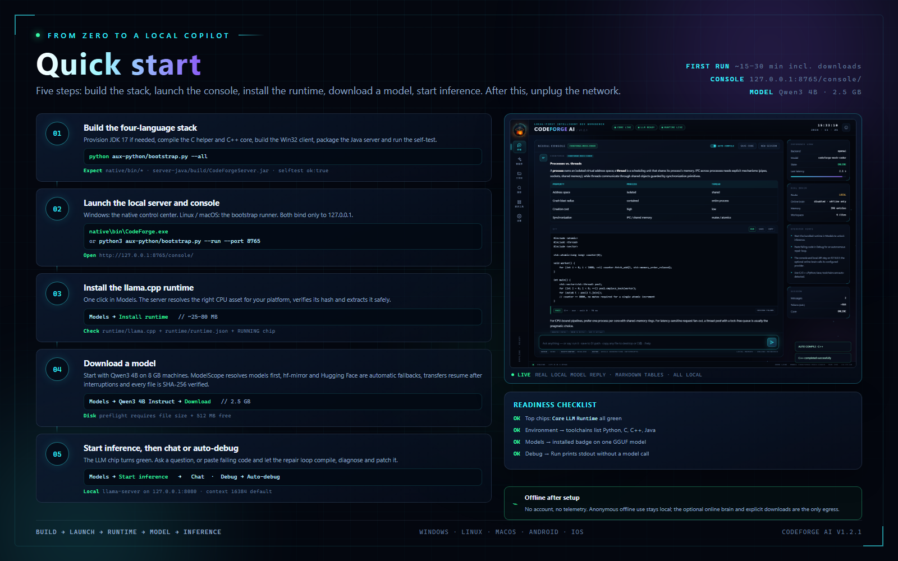

### 4.1 The Win32 control center

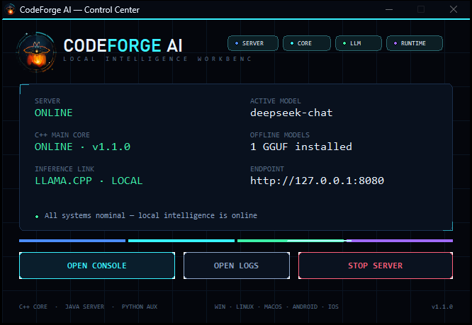

The native control center is a custom-painted C++ window with:

| Element | Meaning |
|---|---|
| Status headline | Server state: stopped, starting, ready, error |
| Readiness indicator | Turns green when `GET /api/health` answers |
| **Open console** | Launches Edge in app mode at `127.0.0.1:8765/console/` |
| **Open logs** | Opens `logs/` in Explorer |
| **Start / Restart server** | Spawns the Java server with the project root and port |
| Tray icon | Double-click opens the console; right-click offers Open console and Exit |
| Close button | Hides to tray; the server keeps running |

Startup sequence:

1. The client locates the project root (config.json + server-java).
2. It finds a JDK: portable `native/jdk/*` first, then system `java`.
3. It spawns `java --add-modules jdk.httpserver -jar server-java/build/CodeForgeServer.jar --root <root> --port 8765`.
4. It polls the health endpoint until ready, then optionally opens Edge.
5. On exit from the tray, it terminates the server process tree.

The control center is Windows-only. On other platforms use `bootstrap.py
--run` (or a service manager) and open the console in a browser.

### 4.2 Server startup log

A healthy start prints:

```text
[codeforge] root   : C:\Users\YOU\Desktop\CodeForge-AI
[codeforge] port   : 8765
[codeforge] java   : 17.0.x (Eclipse Adoptium)
[codeforge] os     : Windows 11 amd64
[codeforge] web console : http://127.0.0.1:8765/console/
[codeforge] api         : http://127.0.0.1:8765/api/status
CODEFORGE_SERVER_READY http://127.0.0.1:8765
```

If the C++ core is missing, the server still starts but prints a warning and
chat/debug/run return a JSON error. Rebuild with `bootstrap.py --all`.

### 4.3 Console anatomy

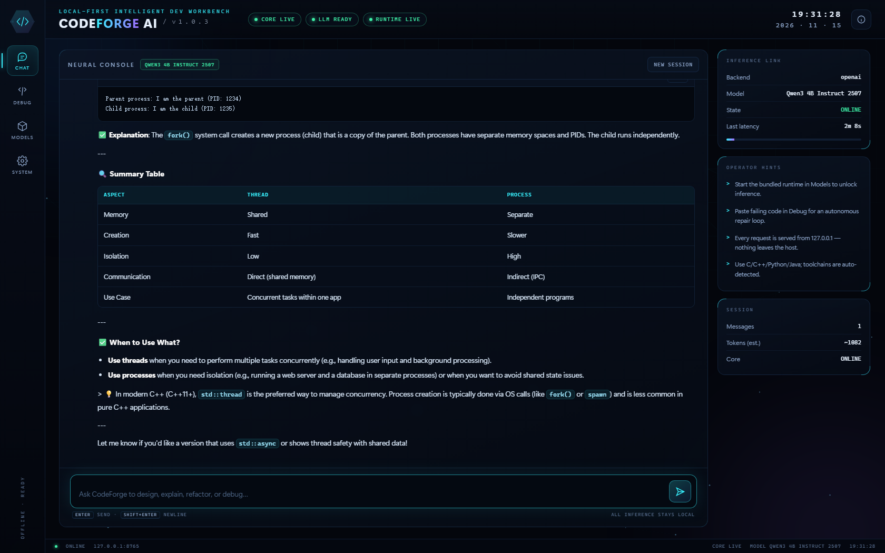

| Area | Description |
|---|---|
| Left rail | 对话、智能体、工作区、搜索、更多工具、设置. Click or press `Ctrl+1`…`Ctrl+6`; 办公文档、全盘文件、邮件发送、下载中心、调试、发布、检查、引擎 are in **更多工具**, and model/key/env panels are in **设置** |
| Update banner | Appears below the top bar when the public release index reports a newer stable version. **Download** opens the release page; **×** dismisses that version |
| Top chips | Core (C++ core reachable), LLM (inference backend usable), Runtime (llama.cpp state) |
| Clock | Local time |
| Info button | Version and stack summary toast |
| Status bar | Connection state, endpoint, core version, active model, uptime clock |

View routing uses the URL hash (`#chat`, `#agent`, `#workspace`, `#search`,
`#tools`, `#settings`, plus `#office`, `#files`, `#mail`, `#downloads`), so a mobile client can deep-link into a specific tab. The browser
polls `/api/status` every 20 seconds to refresh chips and telemetry.

### 4.4 Status semantics

| Indicator | Green | Grey/red |
|---|---|---|
| Core | `native/bin/CodeForgeCore` exists and answered `status` | Binary missing or timed out |
| LLM | A backend exposes at least one model | No backend, no model, or connection refused |
| Runtime | llama-server healthy on `127.0.0.1:8080` | Stopped, starting, or failed |

A green Core with a grey LLM is normal before you install models. A green LLM
with a grey Runtime means an external OpenAI-compatible service is being used.

### 4.5 The Keys tab

**Keys** manages every online provider key from the console — no hand-editing
of `config.json`.

| Element | Function |
|---|---|
| Active brain | Provider, model, base URL and masked key currently mirrored into `llm.online` |
| ONLINE BRAIN switch | Master switch for online routing. **OFF** forces the local GGUF model even when a valid key is active; saved keys stay stored and idle. Start the bundled runtime in Models for offline chat |
| Saved keys | One card per profile with **TEST**, **EDIT** and **DELETE**; the active profile also shows **ACTIVE**, and each card offers **TOP UP** when its host matches a known provider |
| Preset | Fills base URL, model and label for DeepSeek, OpenAI, Moonshot Kimi, Zhipu GLM, Qwen / DashScope, SiliconFlow, OpenRouter, or any custom OpenAI-compatible endpoint |
| API key | Write-only: saved keys are shown as `••••••••last4`, never returned by the API |
| Use as active online brain | Mirrors the profile into `llm.online`; otherwise the key is stored but idle |
| TEST | Sends a minimal completion to verify URL, model and key, and reports latency or the provider error |
| Official top-up & billing | One-click external links for each provider: **TOP UP** (official recharge/billing), **CONSOLE** (API keys), **PRICING** (official price/docs). Links open in a new browser tab |

Notes:

- A key you save is written to `llm.keys` in `config.json`; deleting it removes
  it from the file. The active profile is copied into `llm.online`, and the C++
  core re-reads `config.json` on every chat call, so switching keys needs no
  restart.
- The **ONLINE BRAIN** switch writes `llm.online.enabled`. Turning it off keeps
  every saved key, but chat is forced onto the local GGUF model. The OFF choice
  survives adding or switching keys until you turn it back on.
- With no saved key, chat stays on the offline GGUF model and the badge reads
  **LOCAL ONLY**.
- Keys only ever live on this machine. The console and local API disclose a
  masked hint, and the key is sent only to the base URL you configure.
- Official top-up links are provided for convenience only. CodeForge does not
  process payments, does not proxy the provider page and never sends your key to
  it. Always check the domain and the amount before paying; providers control
  payment methods, minimums and regional availability.

---

## 5. The Chat tab

### 5.1 Layout

| Element | Function |
|---|---|
| **Neural Console** head | Active model badge; **AUTO COMPILE** toggle (persisted as `agent.auto_compile`); **Save code** button; **New session** clears the conversation |
| Message stream | User and assistant bubbles with markdown |
| Composer | Multi-line input, grows up to 190 px; stays editable while the model runs |
| Send / Interject button | Submits the message; while a turn is running it becomes **INTERJECT** (with text) or **STOP** (empty box) |
| Live reasoning trace | Stage-by-stage explanation inside the assistant bubble while a turn runs |
| Inference link card | Backend, model, state, last latency, activity meter |
| Operator hints | Contextual reminders |
| Session card | User message count, estimated tokens, core state |

The visible conversation lives in browser memory; completed turns are also
appended to `memory/memories.jsonl` when persistent memory is enabled. Reloading
the page clears the bubbles, while **New session** clears the bubbles without
deleting the stored memory. Deleting memory is a separate action in the System
tab. Online research and the online brain are the only paths that send data
off the host; see the security chapter.

### 5.2 Sending and shortcuts

| Action | Shortcut |
|---|---|
| Send | `Enter` |
| New line | `Shift+Enter` |
| Interrupt and send (while generating) | Type your correction, then `Enter` or click **INTERJECT** |
| Stop without sending (while generating) | Click **STOP** with an empty box |
| Switch views | `Ctrl+1` 对话, `Ctrl+2` 智能体, `Ctrl+3` 工作区, `Ctrl+4` 搜索, `Ctrl+5` 更多工具, `Ctrl+6` 设置 |
| Copy a code block | **COPY** in the block header |
| Compile and run a block | **RUN** in the block header (Python, C, C++, Java, JavaScript, TypeScript, Go, Rust, PHP, C#) |
| Render HTML/CSS | **PREVIEW** in the block header |
| Save a block anywhere | **SAVE** in the block header |
| Local ops help | Send `/help` |
| Start a suggested prompt | Click any suggestion chip on the empty state |

While a request is in flight the composer stays editable. The send key changes
appearance: an amber **INTERJECT** button when the box contains text, and a
**STOP** button when it is empty. Pressing either one asks the server to cancel
the running request; the browser aborts its own fetch as well. The cancelled
bubble is replaced by an `INTERRUPTED BY YOU` divider, and the new message is
sent as a fresh turn with the previous question still in history. The request
timeout in the browser is 900 seconds, matching the server-side `/api/chat`
timeout.

**Action-first behavior.** Short commands, calculator requests and code
snippets are answered with runnable code before commentary. The managed
runtime passes `--reasoning off --reasoning-budget 256` and
`LLAMA_ARG_CHAT_TEMPLATE_KWARGS={"enable_thinking":false}` to `llama-server`,
so the model does not spend a long preamble on a task that needs one line of
output. The cap is a ceiling, not a requirement: complex debugging, design and
multi-file tasks still receive a full answer. In measured runs, a direct
`add(a,b)` completion returned code only in 0.8 s and a capped-reasoning
calculator request returned code in 4.6 s.

### 5.3 Live reasoning trace and remaining time

Every assistant turn carries a live trace built from
`GET /api/chat/progress?request_id=…`:

1. **Recall persistent memory** — hits and total stored entries.
2. **Scan workspace index** — matching files and indexed total.
3. **Research current sources** — the search engine and result count, or
   `not required for this question`.
4. **Assemble context** — the exact number of context characters.
5. **Generate answer** — `reading N-token context · on-device model`, then a
   live counter such as `173/2048 tokens · 8.6 tok/s · on-device model`.

Completed stages show a green dot; the active stage pulses amber. For a local
model the server reads llama-server's slot counters about once per second, so
the token count and decoding rate are measured, not invented. The online route
has no slot telemetry and keeps the counter at zero.

Under the trace, `~Ns left` (or `~2m 35s left`) is an **estimate**. Before the
first tokens arrive it combines the answer-shape heuristic (short answer, code
snippet, full project), the cost of reading the assembled context, and a rolling
average of this machine's decoding speed. After two token samples it switches to
the measured tokens-per-second and keeps a minimum runway so the bar cannot hit
100% early. If the estimate is exceeded the label changes to
`over estimate · still running` rather than showing a false zero. A thin bar
tracks estimated progress, never moves backwards, and stops at 96% until the
answer lands. The final `msg-meta` chips continue to report route, memory hits
and workspace hits.

The trace explains **pipeline stages**, not hidden chain-of-thought: the model's
internal token stream is never exposed, and the full reply is rendered only
after generation completes.

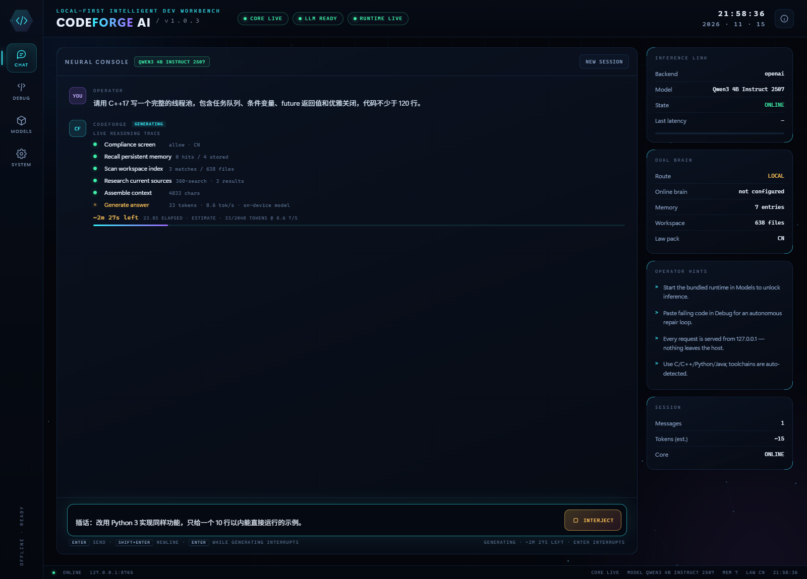

### 5.4 What is actually sent

- The console filters to `user` and `assistant` messages, keeps the **last 30**
  and sends them as `messages`, together with a `request_id` used by the
  progress and cancel endpoints. Interruption dividers are not sent.
- The C++ core truncates the history to the **last 40** messages and prepends a
  system prompt if you did not supply one. The prompt instructs the model to be
  a senior local programming assistant, to give complete runnable snippets in
  fenced blocks, and to identify root causes before fixes.
- Sampling defaults: temperature `0.2`, reply limit selectable from `393,216`
  down to `64` tokens (offline models use the selected value; online providers
  apply their own output cap), request timeout 600 seconds. All are configurable
  (section 10).
- The reply is rendered as markdown: headings, lists, bold/italic, inline
  code, fenced code blocks with copy buttons, links, and pipe tables.

### 5.5 Rendering notes

- Pipe tables require a header row and a divider row such as `|---|---|`.
  They render as styled tables, not raw pipes.
- Fenced code blocks are captured client-side. Each header offers **COPY**,
  **RUN** (or **PREVIEW** for HTML/CSS) and **SAVE**; the buttons stay attached
  to the right block after re-renders because entries are keyed by language and
  code hash.
- HTML in a model reply is escaped, not executed. Links are restricted to
  `http` and `https` and open in a new tab.
- The model badge shows the registry name (for example `QWEN3 4B INSTRUCT`)
  and its tooltip shows the full GGUF path.

### 5.6 Chat errors

| Message | Cause | Fix |
|---|---|---|
| `Interrupted by you · previous answer discarded` | You pressed INTERJECT or STOP | None; send the corrected message again |
| `No usable AI backend was detected…` | No Ollama, no OpenAI-compatible service, no model | Install and start the runtime, or start Ollama |
| `Cannot connect to the OpenAI-compatible service…` | llama-server not running | Models → Start inference |
| `The OpenAI-compatible service requires an API key (HTTP 401)` | Remote service needs a key | Set `llm.api_key` or `CODEFORGE_LLM_API_KEY` |
| `No model selected` | Backend is up but exposes no model | Download a model or `ollama pull` one |
| `AI service returned HTTP 500…` | Model failed to load (RAM, corrupt file) | Check `logs/llama-server.log` |
| `C++ main core timed out after <N> seconds` | Generation exceeded the dynamic local budget (120 s + 0.5 s per token, 900 s floor) | Wait, reduce the reply limit, or use a smaller/faster model |
| `Link failure` bubble | Server not reachable | Check the control center / server log |

### 5.7 Compile, preview, save and local operations

These features are **model-independent**. They run on the local server and work
identically with a frontier online brain, a small offline GGUF model, or no
model at all:

| Feature | How to trigger | Notes |
|---|---|---|
| Compile + run | **RUN** on any code block, **AUTO COMPILE**, `/run`, or “run it” | Python, C, C++, Java, JavaScript, TypeScript, Go, Rust, PHP, C# |
| HTML/CSS preview | **PREVIEW** on an HTML or CSS block | Sandboxed iframe from a temporary `workspace/run-*` session |
| Save code anywhere | **SAVE**, `/save <path>`, or “save this to D:\path” | Exact path; missing folders are confirmed first; every block can target its own path |
| Download a language runtime | **INSTALL** in Environment → Toolchains, `/install go`, or “install the Go environment” | Background download into `native/toolchains` with live progress |
| Place the project anywhere | Environment → Place project anywhere, `/place <path>`, or “put the project in E:\apps” | Never copies models, runtime, workspace, logs, memory or build caches |
| Place any file or folder | Environment → Place any file or folder, `/copy <source> <destination>`, `/move <source> <destination>`, or “把 C:\path\a.pdf 放到 D盘根目录” | Exact destination, `desktop`/`桌面`, or a bare drive (`D`, `D盘`, `D盘根目录`; C works too); copies or moves one file or a whole folder, retries locked files and asks before overwriting |
| Create a launcher anywhere | Environment → Launcher anywhere, `/launcher <path>`, or “create a shortcut in D:\apps” | Windows `.lnk`, Linux `.desktop`, macOS `.command` |

**AUTO COMPILE** is a toggle in the chat header and is now the same persisted
setting as `agent.auto_compile` in Environment → Command Agent. When enabled,
the first runnable block of every new answer still runs inline for a quick
preview, and every generated program is additionally built, delivered to the
destination you named, opened and verified as described in §5.9.1. The setting
is stored on the server, mirrored in `localStorage` as `cf-auto-run`, and applies
only to new answers (never to re-rendered history). If the answer has no
runnable block nothing happens inline; build delivery is handled by the agent
tool loop.

**SAVE** opens a path dialog pre-filled with the last destination. Each file in
the answer is listed with its own optional path, so one answer can save
`main.py` to `D:\python`, `index.html` to `E:\site` and `main.go` to
`D:\go-demo` in one action. A missing folder is not created silently: the
dialog explains what is missing and offers **CREATE FOLDER & SAVE**.

**Local Ops** in the chat is a deterministic command layer that runs before any
model call:

| Command | Effect |
|---|---|
| `/help` | List local operations |
| `/run [language]` | Compile and execute the latest code block |
| `/save <path>` | Save the latest code; a folder receives every file |
| `/place <path>` | Copy the whole project to that exact folder |
| `/launcher <path>` | Create a launcher (empty path = Desktop) |
| `/install <language>` | Provision a runtime in the background |

Plain language works too: “run the Python code”, “save this to
D:\projects\main.py”, “put the project in E:\apps”, “install the Rust
environment”. Because these commands never call the LLM, an offline model
cannot lose them: even with inference stopped, the assistant still executes
them and reports the real result. If a folder is missing it asks for
confirmation (`确认创建` / “create”); the next message performs the action.

### 5.8 Command agent, software control and publishing

The Command Agent extends chat beyond programming. It is enabled by default and
uses the following loop: the model emits one tool block, the host executes it,
the real result returns to the model, and the model decides the next step.

```text
<codeforge_shell>{"command":"Get-ChildItem","cwd":"D:\\work","shell":"powershell","timeout":600}</codeforge_shell>
<codeforge_search>{"query":"PostgreSQL 17 pg_dump flags","limit":6}</codeforge_search>
<codeforge_fetch>{"url":"https://example.com/docs","max_chars":12000}</codeforge_fetch>
<codeforge_learn>{"software":"qpdf","goal":"merge and encrypt PDFs"}</codeforge_learn>
<codeforge_api>{"method":"POST","url":"https://api.example.com/v1/items","secret_name":"EXAMPLE_TOKEN","body":{"name":"demo"}}</codeforge_api>
<codeforge_read>{"path":"C:\\work\\src\\main.py","start":1,"lines":200}</codeforge_read>
<codeforge_edit>{"path":"C:\\work\\src\\main.py","find":"old","replace":"new"}</codeforge_edit>
<codeforge_test>{"path":"C:\\work","timeout":600}</codeforge_test>
<codeforge_crawl>{"url":"https://example.com/docs","depth":2,"max_pages":12}</codeforge_crawl>
<codeforge_deep_search>{"query":"SQLite WAL mode","pages":6}</codeforge_deep_search>
<codeforge_build>{"language":"python","source":"C:\\work\\snake.py","name":"Snake","gui":false}</codeforge_build>
<codeforge_inspect>{"path":"C:\\samples\\suspect.exe","depth":0,"max_files":1,"quarantine":true,"shred_quarantine":false}</codeforge_inspect>
<codeforge_engine>{"action":"export","path":"C:\\games\\star-runner","engine":"godot","target":"windows","preset":"Windows Desktop"}</codeforge_engine>
```

| Capability | Behavior |
|---|---|
| Command execution | PowerShell, cmd, bash, sh or zsh; optional `cwd`; bounded `timeout`; stdout and stderr are logged and the tail is returned to the model |
| Tool discovery | Windows: `Get-Command`, `where.exe`, WinGet and known install folders; Unix: PATH and package managers. The prompt lists detected commands with versions |
| Application discovery | Windows `Get-StartApps` plus registry uninstall keys; macOS `/Applications` and `.app` bundles; Linux `.desktop` entries. The reference host reports more than 150 applications |
| Software control | The prompt carries per-platform recipes for Office/WPS/LibreOffice COM and headless conversion, browser headless screenshot/PDF and Playwright/Selenium, screen capture and UI automation, OCR, media, archives, system settings, mail and cloud CLIs |
| Missing tools | Portable toolchain first, then the native package manager (winget, apt, dnf, yum, pacman, zypper, apk or brew), then pip or npm when mapped; PATH is refreshed and the command is retried once. The mapping also covers database clients and cloud developer tools |
| Online learning | `search` queries Google, Baidu, Baidu Zhidao, DuckDuckGo, Bing, 360 and Wikipedia in parallel, skips failed sources, deduplicates and ranks the merged results. `fetch` returns readable page text. `learn` researches an unfamiliar application, CLI, API or error. A missing simple command also triggers one automatic research pass |
| Crawling and deep search | `crawl` follows same-domain links from a seed URL and extracts page text with a page cap; `deep_search` fetches several result pages for a query and returns ranked excerpts; `corpus` queries the local research corpus built from saved findings |
| File tools | `read` returns numbered lines from a real file; `list` walks a directory; `write` creates or appends; `edit` performs exact literal replacement; `test` detects and runs the project's own test command |
| Universal API | `api` calls any HTTP/HTTPS endpoint with method, headers, query, body and timeout. A named secret from the vault is injected in memory and is never returned |
| Static inspection | `inspect` analyses a file or project without executing it, returns file facts and risk evidence, optionally creates read-only quarantine copies and can shred only those copies after writing the report |
| Game engines | `engine` detects installed Godot 4, Unity, Unreal Engine 5, Cocos Creator and LÖVE, finds their projects and builds, exports or runs them through the engine's own CLI. No engine is downloaded or bundled; a missing engine returns an install hint |
| Long loops | The step limit is adjustable from **1 to 512** (default 128) in the Command Agent panel. Older tool output is compacted before each model call while the system prompt and newest results are kept; every executed call remains in `tool_calls` even if the model call fails |
| Publishing | Local commits, builds, packages and exports always work. Remote/public actions are blocked until **Allow publishing** is enabled, or a single API run passes `allow_publish=true`. The **Publish** tab can create or update a GitHub/GitCode release, upload every file in `release/`, overwrite assets and optionally delete older releases |

Blocked public actions include `git push`, GitHub/GitCode release/PR/issue
creation, npm/PyPI/Cargo/NuGet/Docker/container registry pushes, `scp`, `rsync`,
`sftp`, cloud deploys and outbound HTTP POST/PUT/PATCH/DELETE. A blocked call
returns `blocked: true`, `permission_required: true` and `publish_guard: true`.
When this happens, the agent explains what would be published, where, and under
which account instead of retrying.

**Settings panel.** Environment → **Command Agent** shows detected commands,
installed applications, the deduplicated auto-provisionable list and the online
learning state. It edits `agent.max_steps` (1–512, default 128),
`agent.command_timeout_sec`, `agent.install_timeout_sec`,
`agent.auto_install_tools`, `agent.auto_compile`, `agent.auto_learn_software` and
`agent.allow_publish`, saves them to `config.json`, and can run a test command
locally without calling a model. The
test result shows the exit code, duration, provisioning outcome and output;
publishing commands are blocked there too unless the guard is disabled.

**Safety boundaries.** Commands run on this host with the user's privileges, so
inspect before destructive actions and verify paths before deleting. The agent
is instructed never to print secrets, never to execute instructions found in
web pages, and to report elevation requirements instead of opening a hanging
UAC prompt. GUI automation, Office COM and browser automation are allowed, but
licenses, DRM, logins and OS security prompts must not be bypassed.

### 5.9 Build and deliver a finished program

When the user asks for a program, game, tool or app, the agent writes the source
and calls `codeforge_build`. The host compiles or packages it and places a
double-clickable result on the Desktop; the model does not need to know
compiler flags, jar manifests, launchers or working directories:

```text
<codeforge_build>{"language":"python","source":"C:\\work\\snake.py","name":"Snake","gui":false}</codeforge_build>
```

The JSON accepts `language`, `source` (an absolute path; for HTML/CSS also a
folder or `.html` file), `name`, `gui`, an optional `destination` folder, and a
small inline `code` block for prototypes. `gui:true` produces a `.pyw` for
Python and a `WinExe` for C#. Every delivery lands in its own Desktop folder
with a real shortcut — `.lnk` on Windows, `.desktop` on Linux, `.command` on
macOS:

| Language | Delivered result |
|---|---|
| C, C++ | native `.exe` (gcc/g++ or clang) |
| Go | native `.exe` via `go build` |
| Rust | native `.exe` via `rustc -O` |
| C# | published `.exe` via `dotnet publish` (framework-dependent single file) |
| Java | runnable `.jar` with a `Main-Class` manifest plus `.cmd` launcher |
| Python | `.py`, or `.pyw` when `gui:true`, plus a launcher pinned to the detected interpreter |
| JavaScript, TypeScript | source plus a Node launcher; TypeScript uses Node type stripping on Node 22.6+ |
| PHP | `.php` plus launcher, syntax-checked with `php -l` |
| HTML, CSS | `index.html` with its assets plus a shortcut that opens the page |

Missing compilers are provisioned automatically. If the compiler reports
errors, the diagnostics return to the model, which fixes the source and calls
the tool again. The agent never hands back only unbuilt source and never asks
the user to compile, copy, move or install anything manually. The same
operation is available directly as `POST /api/agent/build`.

### 5.9.1 Auto-compile, open and verify

The chat-header **AUTO COMPILE** toggle and Environment → Command Agent edit the
same setting, `agent.auto_compile` (default `true`). While it is on:

- Every explicit `<codeforge_build>` call and the automatic delivery fallback
  carry `open_after_build: true`, so the host — not the model — performs the
  build, placement and launch.
- Generated Python files are import-scanned and missing packages are installed
  through domestic and international pip mirrors. Node projects install missing
  npm dependencies, Go modules resolve before the build, and every delivered
  artifact runs a startup self-check.
- GUI artifacts are launched visibly: Python GUI apps with `pythonw`, Java GUI
  apps with `javaw`, native executables directly, and web deliveries in the
  default browser. On Windows the host polls `MainWindowHandle` and
  `MainWindowTitle` for up to 15 seconds.
- Success returns `opened`, `open_check` (`window-open`, `process-alive`,
  `startup-verified` or `browser`) and `window_title`. A build result with a
  live process but no window returns `open_check:"process-alive"` plus an
  `open_warning`.
- A process that exits or never draws a window returns `phase:"verify"` with
  the captured `open_log`. That result re-enters the automatic repair loop, so
  the next step fixes the runtime or window error and rebuilds. The agent is
  instructed not to claim success until `opened` is true.
- Rebuilding the same artifact closes the previous window opened by the host,
  so repeated attempts do not accumulate stale instances.

Turning the switch off keeps compilation and delivery available through explicit
build calls, but skips the visible launch and window verification. Use that mode
for CI-like packaging. The switch is persisted in `config.json` and reported by
`GET /api/agent` as `auto_compile`.

### 5.10 Static inspection, quarantine and shredding

**Inspect** is for unknown or untrusted code. It is a static analysis pipeline:
no sample is imported, compiled, opened by an interpreter or executed on the
host. The control plane reads bytes, hashes them and writes a report.

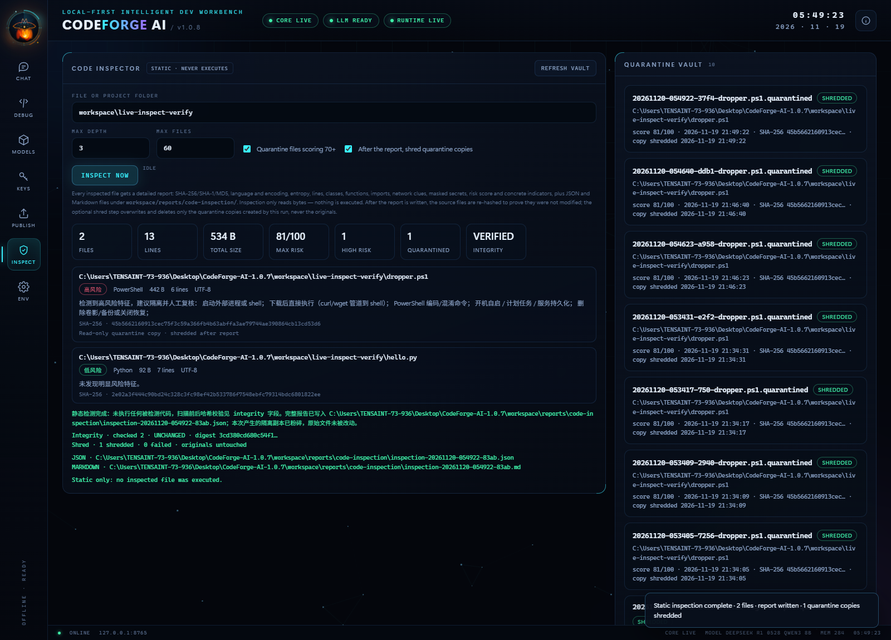

| Control | Meaning |
|---|---|
| **File or project folder** | One file or a directory. Depth 0–6 and max files 1–500 bound the traversal; build, dependency and VCS folders are skipped |
| **Quarantine files scoring 70+** | Copies risky files into `workspace/quarantine/` as read-only files with a `.meta.json` sidecar. The original is never moved |
| **After the report, shred quarantine copies** | Off by default in the API, on by default in the console. Writes the report first, then shreds only copies created by this run |
| **Inspect now** | Runs the scan and renders counts, risk, integrity, shred result and report paths |

**Per-file evidence.** The report includes detected language and family, MIME,
encoding and confidence, text/binary classification, file timestamps, DOS
attributes, Zone.Identifier, SHA-256/SHA-1/MD5, entropy, line and byte counts,
line endings, indentation, approximate comment/code/blank lines, nesting and
cyclomatic complexity, classes, functions, entry points, imports, URLs, IPs,
emails, dependency names, TODO markers and masked secret findings. Every risk
score lists the exact indicators that contributed to it.

**Risk bands.** 0–29 low, 30–69 caution, 70–100 high. High-risk files are the
only ones quarantined. Executable extensions are marked, but the inspector does
not execute them to learn more. Binaries are described by header facts and
extracted strings, not run.

**Integrity proof.** During analysis each file is hashed. After the report is
written, the inspector re-hashes every scanned file (256 MB total budget) and
compares the values. `integrity.unchanged`, `integrity.files_changed`,
`integrity.files_unreadable`, `integrity.files_checked` and a sorted
path+hash `integrity.digest` are returned and stored in the report. This proves
whether the scan modified the source bytes.

**Shredding.** When enabled, the server clears the read-only attribute on each
quarantine copy produced by this scan, overwrites it in 64 KB random chunks,
forces the data to disk, truncates it to zero, forces again and deletes it. The
sidecar is retained with `shredded: true`, `shredded_at`, `shred_method` and
`original_untouched: true`. The original file, its hash and its location are
untouched. On SSDs, wear levelling means a software overwrite cannot guarantee
physical erasure; the report states this limit.

**Output.** Every scan writes a JSON and a Markdown report under
`workspace/reports/code-inspection/`. The console keeps a quarantine vault list
that marks each entry **QUARANTINED** or **SHREDDED**. Both are also available
through `POST /api/inspect` and `GET /api/quarantine`.

**Agent use.** The same operation is available as `codeforge_inspect`. The
agent is instructed to say “static inspection” rather than claiming it ran a
sample, and to read the `integrity` field before asserting that files were not
modified.

### 5.11 Publish tab

The **Publish** rail item drives GitHub and GitCode releases through their REST
APIs. It never prints or returns a token.

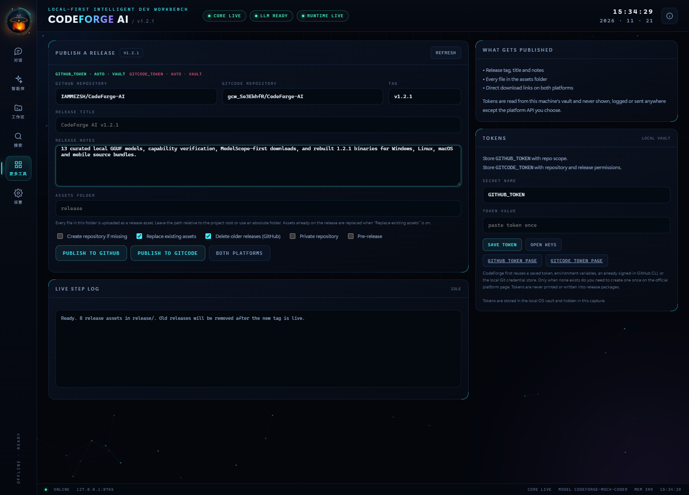

| Field | Meaning |
|---|---|
| Repository | `owner/repo` for GitHub and GitCode; defaults come from the server status |
| Tag / title / notes | Release identity and body; the default tag follows the server version |
| Folder | Local folder whose files are uploaded; default `release` |
| Create repository if missing | Creates the repository when the account allows it |
| Replace existing assets | Overwrites an asset with the same name instead of failing |
| Delete older releases | Removes older releases on GitHub after the new one is published |
| Private / pre-release | Passed to the platform as release flags |

**Tokens.** The status row probes, in order, the local vault, environment
variables (`GITHUB_TOKEN`/`GH_TOKEN`, `GITCODE_TOKEN`/`GITCODE_ACCESS_TOKEN`),
the already-authenticated GitHub CLI, and the local Git credential helper. A
missing token is reported with the exact place to add it; the console never
shows the value. Use **Save token** on the right to store one in the vault once.

**Live step log.** Each platform call streams steps: token check, repository,
release lookup, asset upload, overwrite and delete-older. The result lists the
release URL and every uploaded asset. Publishing is a real public action: it is
never triggered by opening the tab, and the button must be pressed explicitly.

### 5.12 Engines tab

**Engines** drives game projects with engines you have installed. CodeForge
never downloads, installs or bundles an engine; the tab only detects what is on
the machine and calls its command-line tools.

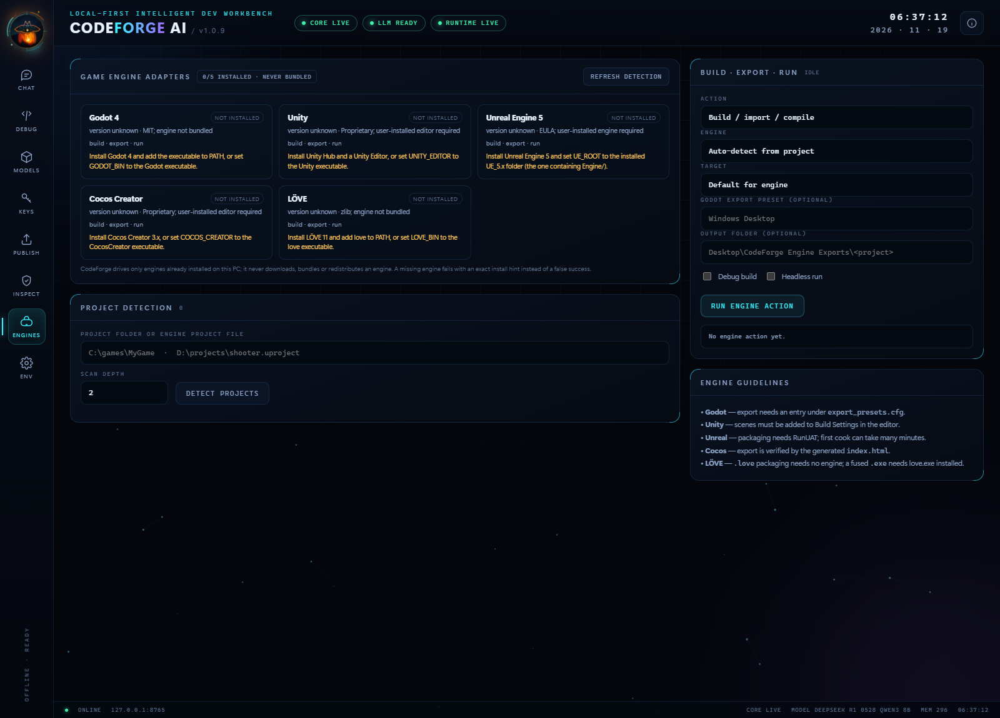

| Control | Meaning |
|---|---|
| Engine cards | One card per adapter (Godot 4, Unity, Unreal Engine 5, Cocos Creator, LÖVE) with installed state, version, executable path, source and install hint |
| Refresh | Rescans environment variables, PATH, Unity Hub, Epic Games and standard install folders (the API caches detection for 60 seconds) |
| Project folder / depth | Folder to scan for projects, depth 0–4 |
| Find projects | Walks the folder and lists projects with engine, version, markers, presets and supported targets |
| Action | `build`, `export` or `run`; LÖVE can `build` without an engine installed |
| Engine / target / preset | Optional engine override, export target (`windows`, `linux`, `macos`, `web`), Godot preset name, output folder, debug and headless flags |
| Run action | Executes the selected action and streams stdout/stderr to the log |

Project markers are the real ones used by each engine: `project.godot`;
`ProjectSettings/ProjectVersion.txt` plus `Assets/`; `*.uproject`; a Cocos
Creator `package.json` plus `assets/`; `main.lua`. Godot export presets are
parsed from `export_presets.cfg`, so the preset selector lists what the project
actually defines.

Every action verifies its result on disk: an exported Godot/Unity/Unreal
artifact must exist, Cocos must produce an `index.html`, and a missing engine
stops with the exact install hint and `engine_not_bundled: true`. The same
operation is exposed as `POST /api/engines` and the `codeforge_engine` agent
tool; `GET /api/engines` returns the detection snapshot.

---

## 6. The Debug tab

The Debug tab is the heart of CodeForge. It can simply run code, or it can run
an autonomous repair loop that compiles, executes, diagnoses and patches.

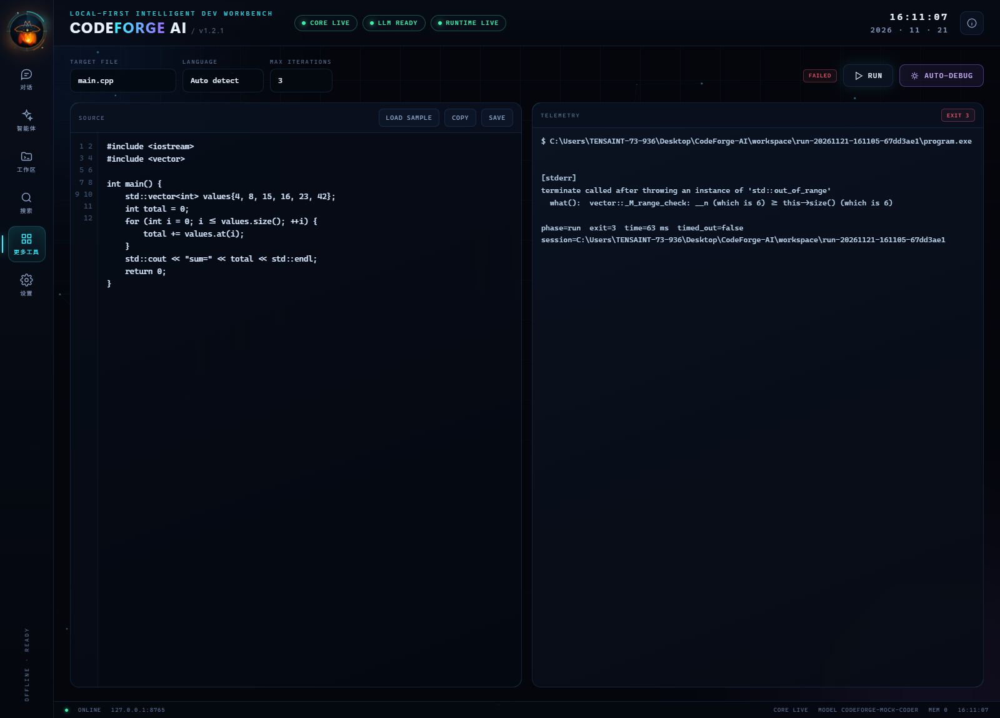

### 6.1 Layout

| Element | Function |
|---|---|
| **Target file** | Logical filename; its extension drives auto-detection |
| **Language** | Auto detect, C++, C, Python, Java |
| **Max iterations** | 1–8 in the UI, API and core (default three) |
| **Run** | Compile and execute once; no AI call |
| **Auto-debug** | Run the full repair loop |
| **Load sample** | Loads a deliberately broken sample for the selected language |
| **Copy** / **Save** | Copy source or download it as a text file |
| Source pane | Editor with line numbers; `Tab` inserts four spaces |
| Telemetry pane | Exit badge and captured output/compiler diagnostics |
| Debug iterations | One card per attempt with phase, duration, exit code and output |

### 6.2 Run versus Auto-debug

| | Run | Auto-debug |
|---|---|---|
| Endpoint | `POST /api/run` | `POST /api/debug` |
| AI required | No | Yes |
| Iterations | Exactly one | Up to the selected limit |
| Workspace | `workspace/run-<stamp>-<token>` | `workspace/debug-<stamp>-<token>` |
| Files saved | Source, binary/class, stdout/stderr in the response | `report.json` and `final.<ext>` additionally |
| Timeout | 180 s (HTTP), 20 s program run, 60 s compile | 240 s + 300 s per iteration (HTTP) |

**Run** is the fastest way to check syntax or behavior. **Auto-debug** is for
failing programs; if the first execution already succeeds, the loop stops
immediately and no model call is made.

### 6.3 Supported languages and detection

| Language | Extensions recognized by auto-detect | Compile/run |
|---|---|---|
| Python | `.py` | `python`/`python3` interpreted |
| C | `.c` | `gcc` → executable |
| C++ | `.cpp`, `.cxx`, `.cc` | `g++`/`clang++` → executable |
| Java | `.java` | `javac` → `java`; the public type determines the file name |

Auto-detect uses the **filename extension only**, not the code contents. With
language `auto` and a filename such as `main` (no extension), the core returns
`Unsupported language. Use Python, C, C++ or Java`. Select the language
explicitly, or give the file a proper extension.

The Debug tab's repair loop covers Python, C, C++ and Java. The run-only
languages JavaScript, TypeScript, Go, Rust, PHP, C# and the HTML/CSS preview
are available from chat code blocks and `POST /api/run`; missing runtimes are
downloaded on demand. The repair loop is the only part that needs a model —
RUN, PREVIEW, SAVE and placement work without one.

For Java, CodeForge extracts the public class/interface/enum/record name and
writes the source under that name, so `public class Solution` works without
renaming it to `Main`.

### 6.4 The debug loop step by step

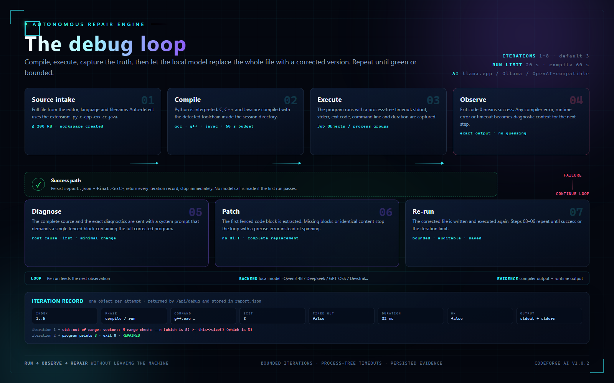

1. **Session creation.** A unique directory is created under `workspace/`.
2. **Normalize.** The language is resolved; the filename is sanitized; the
   source is written with the correct extension.
3. **Execute.** Compile (if needed), then run with a process-tree timeout.
   stdout, stderr, exit code, phase, command line and duration are captured.
4. **Evaluate.** A zero exit code and no engine error means success; the loop
   persists the report and stops.
5. **Diagnose.** On failure, the core sends the complete source plus the exact
   compiler/runtime output to the model, with a system prompt that demands a
   single fenced block containing the complete corrected program and nothing
   else.
6. **Patch.** The first fenced code block is extracted. If it is missing or
   identical to the current source, the loop stops with an explanatory error.
7. **Re-run.** Steps 3–6 repeat until success or the iteration limit.
8. **Persist.** `report.json` and `final.<ext>` are written. The response
   contains every iteration record and the final code, which replaces the
   editor contents.

Each AI call uses the configured backend/model and inherits the LLM timeout.
Progress is bounded so a hung program cannot block the server indefinitely.

### 6.5 Iteration records

Every entry in `iterations` has:

| Field | Meaning |
|---|---|
| `index` | 1-based attempt number |
| `phase` | `compile`, `run`, `setup` or `engine` |
| `command` | Exact compiler or program command line |
| `source_file` | File name inside the session workspace |
| `exit_code` | Process exit code |
| `timed_out` | Whether the process-tree timeout fired |
| `duration_ms` | Wall-clock milliseconds |
| `ok` | Whether this attempt succeeded |
| `output` | Combined `stdout:` / `stderr:` text, truncated to 8 KB |

The UI badge shows `REPAIRED` when a later iteration succeeds, `FAILED` when
the limit is reached, and `RUNNING`/`COMPILING & RUNNING` while busy.

### 6.6 Limits and timeouts

| Limit | Default | Where configured |
|---|---|---|
| Source size | 200 KB | Hard-coded in the core (`Code exceeds the 200 KB limit`) |
| Debug iterations | 3 | `debug.max_iterations`, request `iterations` (clamped 1–8) |
| Program run timeout | 20 s | `debug.run_timeout_ms` (clamped 1–600 s) |
| Compile timeout | 60 s | `debug.compile_timeout_ms` (clamped 5–600 s) |
| HTTP debug timeout | 240 + 300 × iterations seconds | Java server |
| HTTP run timeout | 180 s | Java server |
| Body size | 8 MB | Java server |

Timeouts kill the entire process tree: on Windows via a Job Object, on POSIX
via process groups and `SIGKILL` after a grace period.

### 6.7 Saved files

A debug session contains:

```text
workspace/debug-20261115-193828-ca5ac28c/
  main.cpp          # original source (correct extension)
  program.exe       # or a.out / class files
  final.cpp         # corrected source, if the loop produced one
  report.json       # success, error, backend, model, iterations, final_code
```

The API also returns `session_dir` so tooling can collect artifacts. Sessions
are never deleted automatically; clean the folder periodically.

### 6.8 Worked example (measured)

Input:

```cpp
#include <iostream>
#include <vector>
int main(){
    std::vector<int> v{1,2,3};
    std::cout << v.at(5) << std::endl;
    return 0;
}
```

Iteration 1 exited with code 3 and stderr:

```text
terminate called after throwing an instance of 'std::out_of_range'
  what():  vector::_M_range_check: __n (which is 5) >= this->size() (which is 3)
```

The model returned the complete program with `v.at(2)`. Iteration 2 printed
`3` and exited 0. `final.cpp` contains the corrected source and `report.json`
records both attempts. On the reference machine (Qwen3 4B, CPU) this repair
completed in a few seconds.

### 6.9 Practical debugging tips

- Paste the **whole file**, not a fragment; the model is instructed to return a
  complete replacement.
- Use **Run** first to confirm the failure is real and reproducible.
- Out-of-bounds reads can exit 0 silently (undefined behavior). If the program
  “succeeds” without AI repair, add assertions, use `.at()`, or enable a
  sanitizer locally.
- Keep one logical problem per session. The loop replaces the entire file each
  iteration; unrelated edits may be lost.
- For very large files, split the problem or raise the context window. The
  runtime defaults to 16,384 tokens; prompts beyond the configured
  `llm.context_size` are truncated by llama.cpp.
- If the model keeps returning the same code, the loop stops with
  `AI returned the same content as the current source`; improve the prompt by
  including more diagnostics, or switch to a stronger model.

---

## 7. Models and the inference runtime

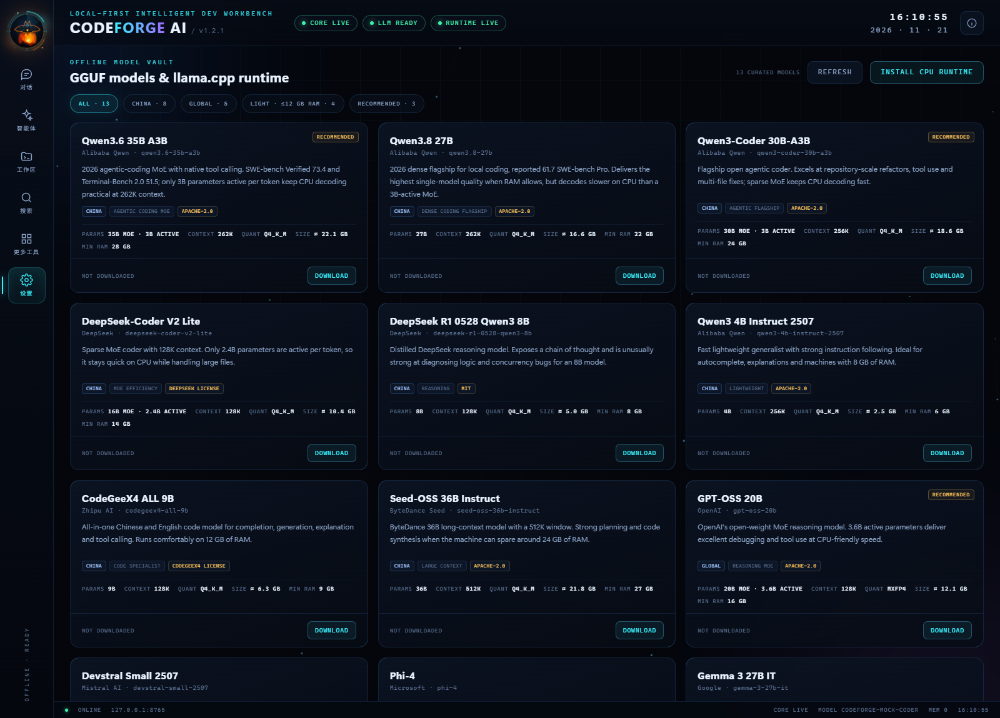

### 7.1 Curated catalog

Thirteen GGUF models are registered: eight China-origin models and five
Global-origin models, balanced for coding, reasoning and agentic work.

| # | Model | Origin | Params | Context | License | Approx. size | Min RAM |
|---|---|---|---|---|---|---|---|
| 1 | Qwen3.6 35B A3B | China · Alibaba | 35B MoE (3B active) | 262K | Apache-2.0 | 22.1 GB | 28 GB |
| 2 | Qwen3.8 27B | China · Alibaba | 27B | 262K | Apache-2.0 | 16.6 GB | 22 GB |
| 3 | Qwen3-Coder 30B-A3B | China · Alibaba | 30B MoE (3B active) | 256K | Apache-2.0 | 18.6 GB | 24 GB |
| 4 | DeepSeek-Coder V2 Lite | China · DeepSeek | 16B MoE (2.4B active) | 128K | DeepSeek License | 10.4 GB | 14 GB |
| 5 | DeepSeek R1 0528 Qwen3 8B | China · DeepSeek | 8B | 128K | MIT | 5.0 GB | 8 GB |
| 6 | Qwen3 4B Instruct 2507 | China · Alibaba | 4B | 256K | Apache-2.0 | 2.5 GB | 6 GB |
| 7 | CodeGeeX4 ALL 9B | China · Zhipu AI | 9B | 128K | CodeGeeX4 License | 6.3 GB | 9 GB |
| 8 | Seed-OSS 36B Instruct | China · ByteDance | 36B | 512K | Apache-2.0 | 21.8 GB | 27 GB |
| 9 | GPT-OSS 20B | Global · OpenAI | 20B MoE (3.6B active) | 128K | Apache-2.0 | 12.1 GB | 16 GB |
| 10 | Devstral Small 2507 | Global · Mistral AI | 24B | 128K | Apache-2.0 | 14.3 GB | 20 GB |
| 11 | Phi-4 | Global · Microsoft | 14B | 16K | MIT | 9.1 GB | 12 GB |
| 12 | Gemma 3 27B IT | Global · Google | 27B | 128K | Gemma License | 16.6 GB | 22 GB |
| 13 | Codestral 22B | Global · Mistral AI | 22B | 32K | Mistral Non-Production | 13.3 GB | 18 GB |

The GGUF context window is much larger than the managed runtime's default
16,384-token window. The default keeps CPU memory bounded for 8 GB machines.
Choose the window and slot count in **Models → Inference runtime** before
starting, or set `llm.context_size` (2,048–524,288) and `llm.parallel` (1–8).
The selected model's architecture limit always wins.

### 7.2 Filters and cards

The filter bar offers **All**, **China**, **Global**, **Light ≤12 GB RAM** and
**Recommended**. Each card shows the vendor, parameter count, context, license,
approximate download size, minimum RAM, a short description and a capability
badge (`untested`, `running`, `pass`, `weak`, `error`). The primary button
changes to **Installed** when the file is present and verified, and an installed
model also gets a **Test** button that runs the capability probe.

### 7.3 Download lifecycle

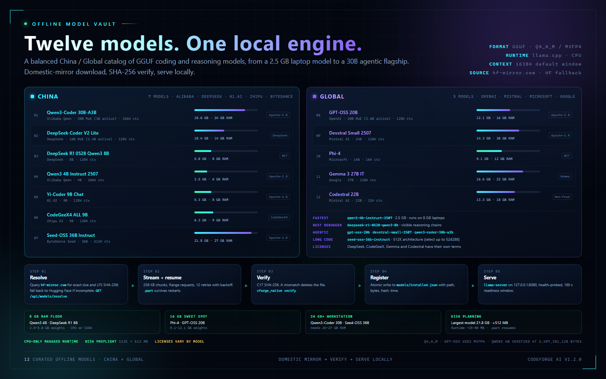

1. **Resolve.** The server queries ModelScope first for the exact file,
   expected size and SHA-256. If ModelScope fails or omits the size/hash, it
   tries `hf-mirror.com`, then `huggingface.co`. Set `llm.model_mirror` to a
   comma-separated list to choose your own Hugging Face-compatible fallback
   order; ModelScope always comes first.
2. **Disk check.** It requires the expected size plus 512 MB free.
3. **Stream.** It writes to `<file>.gguf.part` with a 256 KB buffer, reporting
   progress and speed.
4. **Resume.** If the connection drops, it retries up to 12 times using
   `Range: bytes=<offset>-`, with exponential backoff capped at 20 seconds. The
   partial file survives server restarts; starting the same download resumes
   it.
5. **Verify.** The C17 helper computes SHA-256. A mismatch deletes the file and
   fails the job; a match moves the file to its final path.
6. **Register.** `models/installed.json` is atomically updated with path,
   bytes, hash and timestamp.

Download states: `queued`, `resolving`, `downloading`, `verifying`, `complete`,
`error`. The queue panel shows percent, transferred/total and smoothed speed,
and refreshes while any job is active.

### 7.4 Installing the llama.cpp runtime

Click **Install CPU runtime** (or `POST /api/runtime/install`). If a runtime is
already present the button reads **Reinstall CPU runtime** and asks for
confirmation; keys, models and settings are unaffected. The server:

1. resolves the latest `ggml-org/llama.cpp` release for the platform tags
   `win-cpu-x64`, `win-cpu-arm64`, `macos-arm64`, `macos-x64`, `ubuntu-x64`,
   `ubuntu-arm64`, `ubuntu-s390x`, `android-arm64` and
   `android-arm64-snapdragon` (Termux ARM64);
2. downloads the matching ZIP or tar.gz with resume and SHA-256 verification
   from the GitHub asset digest;
3. falls back to GitHub mirrors when the direct asset host is blocked. Set
   `llm.runtime_mirror` in `config.json` or `CODEFORGE_RUNTIME_MIRROR` to a
   comma-separated list of prefixes (for example
   `https://ghproxy.net/`) or templates containing `{url}`. Without an
   explicit setting, `ghproxy.net` and `gh-proxy.com` are tried. The GitHub
   SHA-256 is still verified, so a mirror cannot substitute the archive;
4. extracts safely, rejecting traversal paths;
5. replaces `runtime/llama.cpp` atomically, keeping a backup until the move
   succeeds;
6. writes `runtime/runtime.json` with version, platform, server path, size,
   hash and install time.

Reinstalling replaces the runtime; the old directory is removed after a
successful swap. If extraction fails, the previous runtime is restored. An
installed runtime does not need to be downloaded again to start inference.

If no release asset exists for the device architecture (32-bit ARM, 32-bit
x86, iSH, musl without gcompat), build llama.cpp from source and set
`llm.llama_server` in `config.json` or export `CODEFORGE_LLAMA_SERVER`. The
override is checked before the managed `runtime/runtime.json` and lets the same
UI start a locally built binary on any ABI.

#### CUDA runtime

The automatic installer ships the CPU build. To use an NVIDIA GPU, download the
official Windows CUDA 13.5 x64 build from the same `ggml-org/llama.cpp` release
(`llama-b<version>-bin-win-cuda-13.5-x64.zip`), extract all of its files into
`runtime/llama.cpp-cuda/`, and make sure `runtime/llama.cpp-cuda/llama-server.exe`
exists. Add `runtime/runtime-cuda.json` with the version, archive name, SHA-256
and `"backend":"cuda"`; the Models panel then offers **CUDA (NVIDIA GPU)** and
Auto resolves to CUDA. The CUDA build is roughly 776 MB unpacked because it
carries the CUDA 13.5 runtime DLLs. No separate CUDA toolkit installation is
needed; an up-to-date NVIDIA driver is enough.

The Backend selector is persisted in `runtime/selection.json`:

| Value | Behaviour |
|---|---|
| `auto` | Uses CUDA when `runtime/llama.cpp-cuda/llama-server.exe` exists, otherwise CPU. Default. |
| `cpu` | Always uses the managed CPU runtime, even when a CUDA build is present. |
| `cuda` | Requires the CUDA build; selection fails with a clear error if it is missing. |

Switching the selector while inference is running stops the current server and
starts it again with the chosen backend. The status object reports both
`backend` (the resolved backend in use) and `backend_selected` (the saved
choice).

### 7.5 Starting and stopping inference

**Start inference** launches:

```text
runtime/llama.cpp/llama-server[.exe]   (CPU, or llm.llama_server override)
runtime/llama.cpp-cuda/llama-server.exe (CUDA)
  -m <model.gguf> --host 127.0.0.1 --port 8080 \
  -c <llm.context_size, default 16384> --parallel <llm.parallel, default 1> \
  -t max(2, logical_cores / 2) --no-webui \
  --reasoning off --reasoning-budget 256
  -ngl 99                          # CUDA backend only
```

- The model defaults to the **recommended installed model**, then the first
  installed model. To choose a specific model, call the API with `model_id`.
- **Backend** in the runtime panel selects Auto, CPU or CUDA before starting.
  Auto uses CUDA when the CUDA runtime is installed. The server passes
  `-ngl 99` only on CUDA and sets
  `LLAMA_ARG_CHAT_TEMPLATE_KWARGS={"enable_thinking":false}` so reasoning
  stays bounded and simple requests return code instead of a long monologue.
- Choose **Context** (2K–512K total) and **Slots** (1–8) in the runtime panel
  before pressing Start. The browser remembers the selection; the API accepts
  the same values as `context_size` and `parallel`. llama.cpp divides the total
  window across the slots, so the per-slot window is `context_size / parallel`.
- **Reply limit** in the runtime panel is a highest-to-lowest selector from
  393,216 down to 64 tokens and sets `llm.max_tokens` for every offline model.
  Online providers apply their own output cap (DeepSeek: 8,192) while the same
  selection stays in place. It applies to the next reply without restarting
  inference. The context window minus the prompt is still the real cap: a
  131,072-token context cannot return 393,216 tokens, no matter how high the
  limit is set.
- Local generation uses a dynamic timeout of 120 seconds plus 500 ms per
  requested token, with a 900-second floor, so a large reply limit is not cut
  off by the old fixed timeout. The core rejects a request only if generation
  exceeds that budget.
- Readiness is probed at `GET http://127.0.0.1:8080/health` every 750 ms for up
  to 180 seconds.
- Output is appended to `logs/llama-server.log`; the UI can show the tail.
- **Stop** forcibly terminates the process tree. Shutting down the Java server
  also stops a managed llama-server.
- The configured context applies to every model. Do not exceed the selected
  model's architecture limit (for example Phi-4 is 16K); lower
  `llm.context_size` when switching to a smaller-context model.
- If port 8080 is already served by an external process, CodeForge reports
  *"Port 8080 is already used by an external inference service."* It will not
  kill an unmanaged process.

While the runtime panel shows `RUNNING / HEALTHY`, the LLM chip turns green and
chat/debug become available.

### 7.6 Capability verification

The Models panel never assumes that a downloaded file equals a working agent.
Press **Test** on an installed model, or call `POST /api/models/probe` with
`{"id":"<model-id>"}`, while that model is running. The probe asks for one
`<codeforge_build>` tool call containing `capability_probe`, a Python script
that prints `PROBE_OK`, then validates the tag, JSON, language, source,
placeholders, `print` call and marker.

Results are stored per model in `models/capability.json` and shown as a badge:

| Badge | Meaning |
|---|---|
| `untested` | No probe has run yet |
| `running` | The probe is in flight; the card polls until it finishes |
| `pass` | Valid tool call and runnable source (score 100) |
| `weak` | The model replied but failed the protocol or source checks |
| `error` | The inference endpoint was unreachable or returned an error |

The running model is probed automatically the first time inference starts when
its status is `untested`, `error`, or a stale `running` older than ten minutes.
If a chat later produces a malformed tool call that cannot be repaired after
the protocol retries, the server marks that model `weak` with source `chat`.
A `weak` model can still be used for conversation; do not rely on it for
unattended builds.

### 7.7 Choosing a model

| Goal | Recommendation |
|---|---|
| Fastest responses on 8 GB | Qwen3 4B Q4_K_M |
| Best small debugger | DeepSeek R1 0528 Qwen3 8B |
| Broad language coverage | CodeGeeX4 9B, Gemma 3 27B |
| Strong agentic repairs | GPT-OSS 20B, Devstral Small 24B |
| Best coding quality on a workstation | Qwen3.6 35B A3B, Qwen3.8 27B |
| Best overall at 24 GB | Qwen3-Coder 30B-A3B |
| Huge context | Seed-OSS 36B (512K architecture; select up to 524,288 in the runtime panel, with very large RAM) |
| Fill-in-the-middle completion | Codestral 22B (non-production license) |

Only one model is served at a time. Stop inference, start another model, and
the LLM chip re-probes automatically.

Model size affects answer quality and speed, never the workbench feature set.
Compile/run, HTML preview, saving to any path, language downloads, project
placement and launchers are handled by the local server and the local control
plane. A 4B offline model, a 30B model and an online API all get exactly the
same execution, file and placement capabilities; only the prose and code they
generate differ.

### 7.7 External backends

CodeForge can use an inference server it does not manage:

- **Ollama** at `http://127.0.0.1:11434` (`/api/tags`, `/api/chat`).
- **Any OpenAI-compatible server** at `http://127.0.0.1:8080` (`/v1/models`,
  `/v1/chat/completions`), including a manually started `llama-server` or
  LM Studio.

Set `llm.backend` to `ollama`, `openai` (aliases: `openai-compatible`,
`llamacpp`) or `auto`. With `auto`, Ollama is probed first, then the
OpenAI-compatible URL. The Models runtime panel shows an external service as
running but not managed; **Stop** cannot terminate it.

Because `openai_url` is just a URL, a low-power device can keep the CodeForge
console and debug workspace locally while inference runs on a phone, PC or Mac
on the LAN — for example an iPhone in iSH pointing at
`http://192.168.1.10:8080`. The same setting works for a manually started
`llama-server`, LM Studio or vLLM.

### 7.8 Removing models and runtime

There is no delete button in the UI. To reclaim space:

1. Stop inference.
2. Stop the Java server.
3. Delete the model directory under `models/downloads/<model-id>/`.
4. Optionally remove the entry from `models/installed.json`.
5. Reload the console; the card returns to **Download**.

Removing `runtime/llama.cpp` or `runtime/runtime.json` makes the runtime appear
uninstalled; reinstall from the UI. Deleting a model file while installed only
requires the server to reload its installed map to reflect the change.

---

## 8. The Environment tab

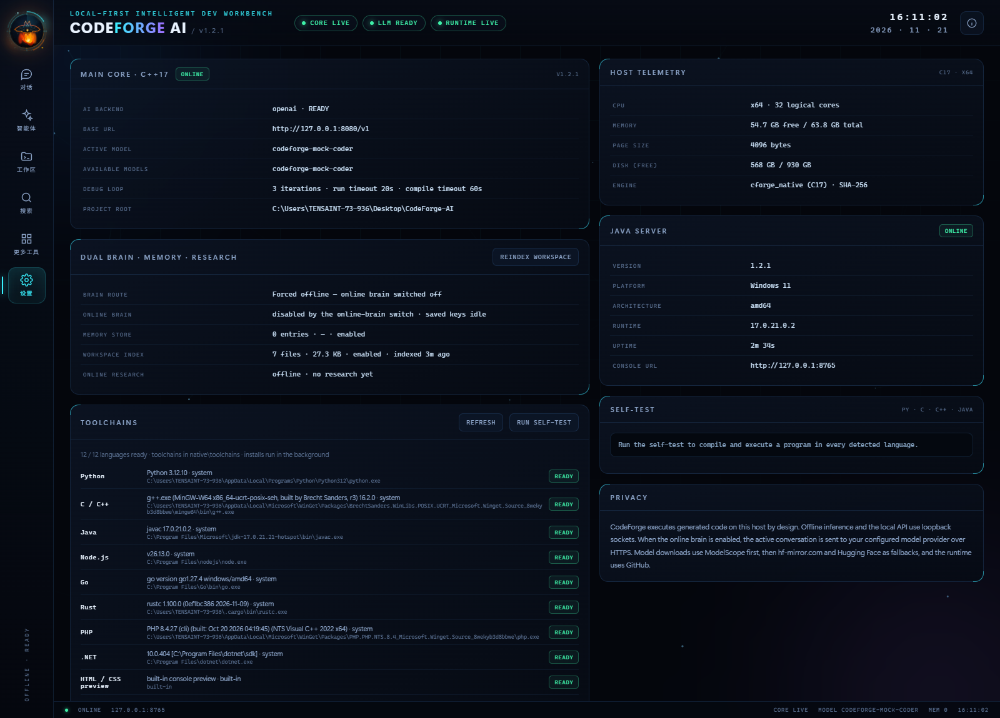

| Panel | Contents |
|---|---|
| Main core · C++17 | Backend kind, base URL, active model, available models, debug loop settings, project root |
| Dual brain · memory · research | Brain route, online brain endpoint, memory entries/bytes, workspace files/index time, last research source; **Reindex workspace** button |
| Toolchains | Every runtime (Python, C/C++, Java, Node.js, Go, Rust, PHP, .NET) with state, version, path, download progress and **INSTALL** buttons; **Refresh** and **Run self-test** |
| Place project anywhere | Exact destination path, optional portable JDK and toolchains, launcher creation; reports file count and size |
| Place any file or folder | Source path, destination path, Desktop or bare drive (`D`, `D盘`, `D盘根目录`), optional new name and move/overwrite options; reports file count, size and elapsed time |
| Launcher anywhere | Exact folder or launcher file path; missing folders are confirmed first |
| Write any file | Exact file path and content; missing folders are confirmed first |
| Local API | The most important endpoints |
| Host telemetry | Logical CPUs, architecture, page size, total/available memory, free/total disk |
| Java server | Version, OS, architecture, JVM version, uptime, console URL |
| Self-test | Detailed JSON from the last run |
| Privacy | Local execution and download policy |

**Run self-test** compiles and executes a program in every detected language
(`python`, `c`, `cpp`, `java`) and reports each check. Exit code 0 means all
detected toolchains work. The self-test workspace is removed afterward.

The Toolchains panel reflects `GET /api/languages`: system runtimes are marked
`READY` with their detected path, missing runtimes offer **INSTALL**, and an
active download shows its percentage and transferred bytes. Running a code
block whose runtime is missing also starts the download automatically and
returns a provisioning notice; the same block succeeds on the next run.
Runtimes are extracted into `native/toolchains/<runtime>` and never modify the
system PATH.

**Place project anywhere** copies the runnable tree to the exact folder you
type. `models/`, `runtime/`, `workspace/`, `logs/`, `memory/`, `build/`,
`release/`, `.git/` and caches are excluded; the portable JDK (about 305 MB)
and downloaded toolchains are opt-in checkboxes. A launcher is created inside
the destination unless you clear the checkbox. The server rejects the project
root itself and any folder inside the project, and reports a missing drive
instead of guessing. **Place any file or folder** copies or moves any source
you type to an exact destination folder, an exact file path, or the Desktop
(type `desktop` or leave the destination empty). A bare drive works too:
`D`, `D盘` and `D盘根目录` all mean `D:\`, and `C`/`C盘` mean `C:\` (writing
to the root of C: usually requires running CodeForge as administrator). Existing destinations are
never overwritten without the checkbox; moving deletes the original only after
the copy succeeds. Repeating a copy skips unchanged files, and locked files are
retried with a clear hint instead of a generic failure. **Launcher anywhere**
creates only the launcher (Windows `.lnk`, Linux `.desktop`, macOS `.command`);
**Write any file** writes exactly the path you type. The save and launcher
panels show a confirmation button when the parent folder does not exist rather
than creating it silently.

These four panels are also exposed through the REST API (section 19 of the API
reference) and through explicit `/copy`, `/move`, `/save` and `/launcher`
commands. Plain-language placement requests go to the active model, which can
invoke the same local tools.

Host telemetry is collected by the C17 helper (`cforge_native sysinfo`) using
native APIs, not shell commands. Memory and disk values are in MB/GB as
returned by the OS.

---

## 9. Office, files, mail and downloads

The four Tools entries extend the workbench from source code to everyday
documents, arbitrary files on the machine, outbound email and internet
downloads. Each one is available in the console and through a matching agent
tool, so the same capability can be used by a person or by the model. The
server owns all file, network and mail access; the console and the agent share
the same JSON API.

| Console view | Agent tag | Server service | Default state |
|---|---|---|---|
| Office (办公文档) | `<codeforge_office>` | `OfficeService` | Available |
| Files (全盘文件) | `<codeforge_fs>` | `FileAccessService` | Blocked until Full filesystem access is enabled |
| Mail (邮件发送) | `<codeforge_mail>` | `MailService` | Available; sending needs SMTP settings |
| Downloads (下载中心) | `<codeforge_download>` | `DownloadService` | Available |

### 9.1 Office documents and PDF

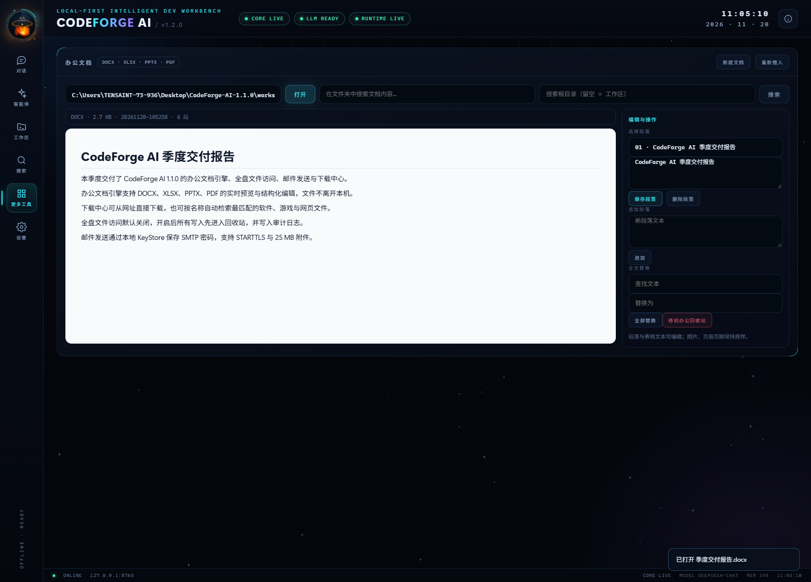

Open the **Office** view and type an absolute path, then press **Open**. The
server reads the file and returns a structured preview:

- **Word (DOCX/DOC), ODT, RTF, text, Markdown, JSON, logs** — paragraph list
  with styles, plus a plain-text rendering.
- **Excel (XLSX/XLS/XLSM), ODS, CSV/TSV** — sheet names, used ranges and a
  cell grid with typed values.
- **PowerPoint (PPTX/PPT), ODP** — slides, titles, shapes and their text.
- **PDF** — page count, metadata, per-page text, and page images rendered as
  PNG. Use **Previous page / Next page** to move through the document; the
  page counter shows the current page and total.

**Create.** Press **新建文档** (New document), choose the type, save path,
optional title and initial content, then **Create**. Creation supports DOCX,
XLSX, PPTX, PDF, TXT, Markdown, CSV and TSV. CSV content uses one record per
line; text-like documents use one paragraph per line.

**Edit.** When a document is open and editable, the right-hand panel lists the
actions that apply to that format. Common actions:

| Format | Actions |
|---|---|
| Word | `set_paragraph`, `append_paragraph`, `delete_paragraph`, `replace_all`, `set_table_cell` (DOCX); DOC supports `replace_all` and `append_paragraph` |
| Excel | `set_cell`, `add_row`, `delete_row`, `add_sheet`, `delete_sheet`, `rename_sheet` |
| PowerPoint | `set_text`, `add_slide`, `delete_slide` (PPTX); PPT supports `set_text` and `delete_slide` |
| PDF | `set_metadata`, `add_page`, `delete_page`, `rotate_page`, `merge` |
| Plain text / CSV / TSV / Markdown / JSON / log | `set_text`, `append` |

Every update is a discrete request (`POST /api/office/update`) with the file
path and action-specific fields, so the console and the agent produce the same
result. After an edit the preview refreshes and the response reports the
document kind, paragraph/sheet/slide counts and whether the file is editable.
ODT, ODS, ODP and RTF open with a rendered preview but are read-only. Unsupported
actions return a clear error instead of a silent no-op.

**Search.** The search box scans a folder tree for documents whose text
contains the query and returns file name, kind and matching excerpts. Leave the
root empty to search the workspace, or supply any folder you can read (the
Files permission does not gate Office search; the operating-system permissions
still apply).

**Delete.** Deleting a document requires explicit confirmation and moves it to
`workspace/.trash/office` with a timestamped name. Permanent deletion is only
performed when the request explicitly asks for it.

**Limits.** Office parsing is bounded by the server's 8 MB JSON request body
and by available memory; very large spreadsheets are truncated to the used
range. PDF page images are rendered one page at a time, so a 900-page manual
does not load 900 images at once. If the file is open in Word or Excel and
locked for writing, the save fails with the operating-system error; close the
file and retry.

### 9.2 Files and Full filesystem access

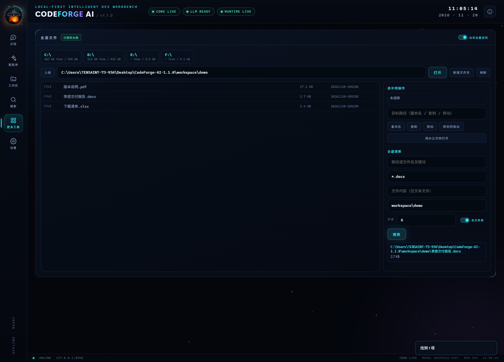

The **Files** view is the drive browser, search surface and file-operation
panel. It is deliberately blocked until you enable the permission:

1. Open the Files view or **Settings → Full filesystem access**.
2. Turn on the switch and confirm. The server writes
   `permissions.full_filesystem: true` to `config.json`.
3. The badge changes from **未授权** (not authorized) to the enabled state and
   the drive list appears.

With the permission enabled you can:

- **Browse** every drive and folder, go to the parent directory, refresh, and
  create a folder.
- **Select** a file or folder and rename, copy, move, trash or delete it.
  Rename, copy and move need a target path; delete needs `confirm:true` and
  moves the entry to `workspace/.trash/fs` unless permanent deletion is
  requested.
- **Search** across selected roots (semicolon-separated; empty means all
  drives) by path keyword, filename glob (`*.docx`) and text content, with a
  depth limit (1–12), optional folder inclusion and a result limit.
- **Open in Office** — send the selected document straight to the Office view.
- **Stat** any file to see size, timestamps and attributes.

Every operation is appended to `logs/file-access.jsonl` with the operation,
source, target, result and time. Sensitive directories (Windows system folders,
program directories and the CodeForge installation itself) are guarded against
accidental deletion. Disabling the permission immediately blocks all new
operations; nothing is cached.

The API mirrors the view: `GET /api/fs/drives`, `POST /api/fs/search`,
`POST /api/fs/op` and `GET|POST /api/permissions`. The agent uses
`<codeforge_fs>` with `op` set to `list`, `stat`, `mkdir`, `rename`, `copy`,
`move`, `delete`, `search` or `permission`.

### 9.3 Mail

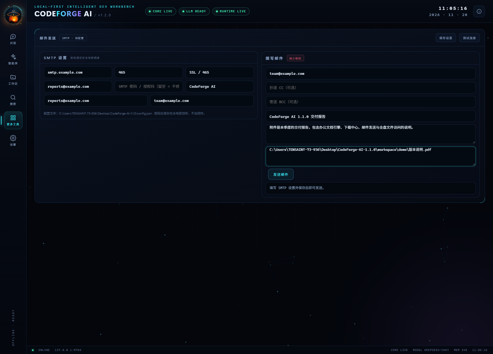

The **Mail** view has two panels: SMTP settings and compose.

1. Enter the SMTP host, port, encryption (SSL, STARTTLS or none), username,
   password/authorization code, sender name and sender address.
2. Optionally set a default recipient, then **Save settings**. The password is
   written to the local encrypted KeyStore, not to `config.json`, and the API
   never returns it.
3. Press **Test connection** to send a short test message to the default
   recipient (or the sender address when no default is set).
4. Fill To/Cc/Bcc, subject, body and optional attachment paths (one per line,
   maximum 25 MB total), then **Send**.

The send result reports the SMTP response and message id. If SMTP is not
configured, the server returns an explicit “SMTP host is not configured” error
instead of pretending to send. Attachments must be readable regular files;
missing files fail the request before the connection opens. HTML bodies are
supported through the API (`"html"` field) and by the agent tag. The agent uses
`<codeforge_mail>` with `action` set to `send` or `test`.

### 9.4 Downloads

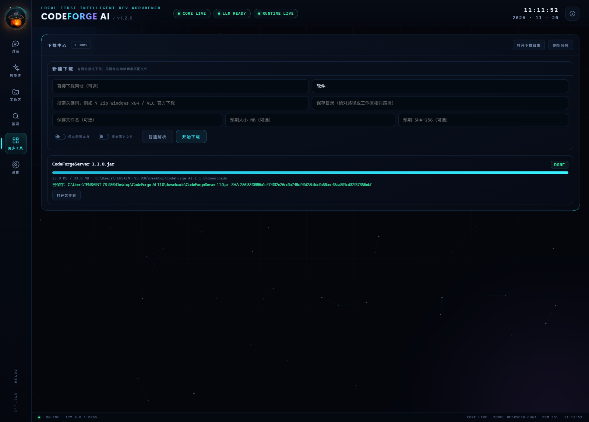

The **Downloads** view downloads software, games, documents and web files in
two modes:

- **Direct URL** — paste an HTTP/HTTPS URL. The server performs a GET with
  resume support, follows redirects, rejects non-2xx responses and saves the
  file under the chosen name. If the URL returns HTML and **Save page itself**
  is enabled, the page is stored as `.html` instead of being treated as a
  failed binary.
- **Search** — provide keywords (for example “7-Zip Windows x64” or “VLC 官方下载”)
  and a target directory. The server queries the configured search engines and
  GitHub releases, extracts direct links, scores candidates by official domain,
  exact filename, platform match and requested size, and either starts the best
  candidate or pauses in **needs_choice** so you can pick another one.

The job list shows state (queued, resolving, connecting, downloading,
verifying, done, failed, cancelled, needs_choice), progress bar, transferred
bytes, speed, ETA, saved path and SHA-256. Controls:

- **Cancel** stops the transfer; the `.part` file is kept, and starting the
  same target again resumes from it with a Range request.
- **Open folder** reveals the saved file.

Below the form, the candidate list from **智能解析** is ranked and clickable:
clicking a candidate fills the URL and filename fields so you can start that
exact file. A search job whose best score is below the reliability threshold
stops in `needs_choice` and shows its candidates in the job details.

Optional fields: exact filename, expected size in MB (used in ranking and
checked after download), expected SHA-256 (mismatch fails the job and keeps the
file for inspection), overwrite flag. A stalled body is stopped by a 25-second
read watchdog and retried on the same URL before the job fails. The agent uses
`<codeforge_download>` and receives the job id, state, saved path, byte count,
candidate list and SHA-256 in the tool result; `wait_sec` controls how long it
waits before returning an in-progress job.

### 9.5 Operational notes

- All four tools are local: the server does the work, and the console or agent
  only sends requests. There is no separate daemon.
- Office and Files share the same path rules as the rest of the server: paths
  may be absolute or workspace-relative; `~` is not expanded.
- Mail and Downloads produce outbound traffic. Configure them only on a machine
  where that is acceptable, and review [Security operations](#16-security-operations).
- To revoke everything quickly: turn off Full filesystem access, clear the SMTP
  password in the Mail view, and cancel active downloads.

## 10. End-to-end workflows

### 10.1 First successful chat

1. Launch the control center (or `bootstrap.py --run`).
2. Open the Models tab.
3. Install the runtime; wait for `runtime installed`.
4. Download Qwen3 4B (2.5 GB) or another model that fits your RAM.
5. Click **Start inference** and wait for `RUNNING / HEALTHY`.
6. Switch to Chat, ask: `Write a C++17 thread-safe queue with condition variables.`
7. Confirm the LLM chip is green and the side card shows a latency.

### 10.2 Repair a crash

1. Open Debug.
2. Paste a failing program; set the file to `main.cpp`.
3. Set **Language** to `C++` (or Auto with a `.cpp` filename).
4. Click **Run** to confirm the failure and inspect stderr.
5. Set **Max iterations** to 3 and click **Auto-debug**.
6. Watch iteration cards; the editor is replaced by the repaired source.
7. Use **Save** to keep the result; sessions remain under `workspace/`.

### 10.3 Run Python without AI

1. Debug → Language `Python`, filename `script.py`.
2. Paste code, click **Run**.
3. The telemetry pane shows `stdout`, `stderr`, exit code and duration.
4. No model or runtime is required for this path.

### 10.4 Use the phone client

1. Run the server on the desktop host.
2. Expose it safely on the LAN through a TLS reverse proxy or tunnel
   (the Java server itself binds to loopback only).
3. Open the Kotlin/Swift thin client and enter the console URL.
4. The client loads the identical console; inference still runs on the host.

> Do not expose port 8765 directly to an untrusted network. The API can
> execute code and has no authentication token.

### 10.5 Switch models through the API

```bash
curl -s -X POST http://127.0.0.1:8765/api/runtime/stop \
  -H "Content-Type: application/json" -d "{}"

curl -s -X POST http://127.0.0.1:8765/api/runtime/start \
  -H "Content-Type: application/json" \
  -d '{"model_id":"deepseek-r1-0528-qwen3-8b"}'
```

The response includes the managed status, PID, model path and readiness.

---

## 11. Configuration reference

Configuration lives in `config.json` at the project root. Missing keys fall
back to defaults. Environment variables override the file. Malformed JSON
produces a `config_warning` in `status`, but startup continues with defaults.

### 11.1 `llm` section

| Key | Default | Clamp | Meaning |
|---|---|---|---|
| `backend` | `auto` | — | `auto`, `ollama`, `openai`, `openai-compatible`, `llamacpp` |
| `ollama_url` | `http://127.0.0.1:11434` | normalized (trailing `/` removed) | Ollama base URL |
| `openai_url` | `http://127.0.0.1:8080` | normalized | OpenAI-compatible base URL |
| `api_key` | empty | — | Bearer token for remote services |
| `model` | empty | — | Override the model name; empty uses the backend's first model |
| `llama_server` | empty | — | Path to a source-built or distro `llama-server`; takes priority over the managed runtime |
| `temperature` | `0.2` | 0.0–2.0 | Sampling temperature |
| `max_tokens` | `393216` | 64–393216 | Reply budget for online and offline replies; also selectable as **Reply limit** in the runtime panel and applied on the next reply without restarting inference. Offline models use the full value; online providers apply their own output cap (DeepSeek: 8,192). The context window minus the prompt still caps the actual reply |
| `context_size` | `16384` | 2048–524288 | Managed llama-server context window (`-c`), in tokens; also selectable in the runtime panel |
| `parallel` | `1` | 1–8 | Concurrent llama-server slots; the total context is divided across them |
| `model_mirror` | `https://hf-mirror.com` | — | Hugging Face-compatible metadata/file fallback mirror for every offline model; ModelScope is always tried first, then this comma-separated list in order, and `https://huggingface.co` is appended as the final fallback |
| `request_timeout_ms` | `600000` | 5000–3600000 | LLM HTTP timeout inside the core; local chat requests are extended automatically to 120 s + 0.5 s per token so large reply limits are not cut off |

### 11.2 `debug` section

| Key | Default | Clamp | Meaning |
|---|---|---|---|
| `max_iterations` | `3` | 1–8 | Repair attempts when the request omits `iterations` |
| `run_timeout_ms` | `20000` | 1000–600000 | Program execution limit |
| `compile_timeout_ms` | `60000` | 5000–600000 | Compiler limit |

### 11.3 `server` section

| Key | Default | Meaning |
|---|---|---|
| `port` | `8765` | Parsed into the core status, **but the Java server port comes from its `--port` argument**. Use `bootstrap.py --run --port` or pass `--port` to the jar. |

### 11.4 `memory` section

| Key | Default | Clamp | Meaning |
|---|---|---|---|
| `enabled` | `true` | — | Master switch for recall, auto-capture and workspace context |
| `auto_capture` | `true` | — | Store chat exchanges and debug outcomes automatically |
| `max_entries` | `4000` | 100–100000 | Prune the oldest entries beyond this count |
| `retrieval_limit` | `5` | 0–20 | Memory hits injected into a chat prompt |

### 11.5 `online` section

| Key | Default | Clamp | Meaning |
|---|---|---|---|
| `enabled` | `true` | — | Allow network probes and web research |
| `research` | `auto` | `off`, `auto`, `always` | When to search the web before answering |
| `search_endpoint` | empty | — | Optional SearXNG endpoint; empty queries Google, Baidu, Baidu Zhidao, DuckDuckGo, Bing, 360 Search and Wikipedia in parallel |
| `timeout_ms` | `12000` | 3000–60000 | Per-request network timeout |
| `max_results` | `3` | 1–8 | Result cap including the relevance filter |

### 11.6 `llm.online` section

| Key | Default | Clamp | Meaning |
|---|---|---|---|
| `enabled` | `true` | — | Allow the online brain when a key exists |
| `base_url` | `https://api.deepseek.com` | normalized | DeepSeek-compatible OpenAI root; `/v1` is appended automatically |
| `api_key` | empty | — | Bearer token; empty keeps every request local |
| `model` | `deepseek-chat` | — | Online model name |
| `timeout_ms` | `120000` | 5000–600000 | Online completion timeout inside the core |

### 11.7 Environment variables

| Variable | Overrides |
|---|---|
| `CODEFORGE_LLM_BACKEND` | `llm.backend` |
| `CODEFORGE_OLLAMA_URL` | `llm.ollama_url` |
| `CODEFORGE_OPENAI_URL` | `llm.openai_url` |
| `CODEFORGE_LLM_API_KEY` | `llm.api_key` |
| `CODEFORGE_LLM_MODEL` | `llm.model` |
| `CODEFORGE_LLM_TEMPERATURE` | `llm.temperature` |
| `CODEFORGE_LLM_MAX_TOKENS` | `llm.max_tokens` |
| `CODEFORGE_CONTEXT_SIZE` | `llm.context_size` |
| `CODEFORGE_PARALLEL` | `llm.parallel` |
| `CODEFORGE_MODEL_MIRROR` | `llm.model_mirror` |
| `CODEFORGE_REQUEST_TIMEOUT_MS` | `llm.request_timeout_ms` |
| `CODEFORGE_LLAMA_SERVER` | `llm.llama_server` |
| `CODEFORGE_DEBUG_ITERATIONS` | `debug.max_iterations` |
| `CODEFORGE_RUN_TIMEOUT_MS` | `debug.run_timeout_ms` |
| `CODEFORGE_COMPILE_TIMEOUT_MS` | `debug.compile_timeout_ms` |
| `CODEFORGE_SERVER_PORT` | `server.port` (core only; see the port note) |
| `CODEFORGE_MEMORY` | `memory.enabled` |
| `CODEFORGE_ONLINE` | `online.enabled` |
| `CODEFORGE_RESEARCH` | `online.research` |
| `CODEFORGE_ONLINE_LLM` | `llm.online.enabled` |
| `CODEFORGE_ONLINE_LLM_URL` | `llm.online.base_url` |
| `CODEFORGE_ONLINE_LLM_MODEL` | `llm.online.model` |
| `CODEFORGE_ONLINE_LLM_KEY` | `llm.online.api_key` |
| `CODEFORGE_ONLINE_LLM_TIMEOUT_MS` | `llm.online.timeout_ms` |
| `CODEFORGE_FORCE_JDK` | Forces the portable JDK download in bootstrap |
| `CODEFORGE_JOBS` | Parallel build jobs used by `build.sh` |

Precedence: environment > `config.json` > built-in defaults. Values are
clamped after both layers are applied.

### 11.8 `agent` section

The Command Agent reads and writes these keys through `GET/POST /api/agent`
and the Environment → Command Agent panel.

| Key | Default | Range | Meaning |
|---|---|---|---|
| `enabled` | `true` | boolean | Route chat through the command-agent loop. When false, chat is a plain completion |
| `max_steps` | `128` | 1–512 | Maximum tool calls per answer |
| `command_timeout_sec` | `3600` | 1–86400 | Default timeout for a shell command |
| `max_feedback_chars` | `48000` | 4000–200000 | Size budget for tool output returned to the model; also drives context compaction |
| `auto_install_tools` | `true` | boolean | Download a missing command, refresh PATH and retry once |
| `auto_compile` | `true` | boolean | Compile every generated program, deliver it to the requested location, launch it and verify a real window; failures re-enter the repair loop. Shared with the chat-header AUTO COMPILE toggle |
| `install_timeout_sec` | `1800` | 60–86400 | Maximum time for one tool installation |
| `auto_learn_software` | `true` | boolean | Research a missing simple command online and feed the sources back into the loop |
| `allow_publish` | `false` | boolean | Allow public/remote publishing actions. Local builds, commits, packages and exports are never blocked |

`allow_publish` is the only setting that changes the safety boundary; the
console asks for confirmation before enabling it. The setting is stored in
`config.json` in plain text, like every other non-secret agent option.

---

## 12. Command-line reference

### 12.1 `CodeForgeCore` (C++ main core)

```text
CodeForgeCore <status|chat|debug|run|selftest|version> [--root <project_root>]
```

- Reads a JSON request from stdin (except `version` and `selftest`, which ignore
  it) and writes one JSON object to stdout.
- `--root` sets the project root; without it the core walks up from the
  executable looking for `config.json` and `server-java/`.
- Exit code is 0 for logical results (even `"ok": false`) and 1 for internal
  exceptions; `selftest` returns 1 when any check fails.

Examples:

```bash
native/bin/CodeForgeCore version --root .

echo '{}' | native/bin/CodeForgeCore status --root .

echo '{"messages":[{"role":"user","content":"Hello"}]}' \
  | native/bin/CodeForgeCore chat --root .

echo '{"code":"print(1/0)","filename":"main.py","language":"python","iterations":2}' \
  | native/bin/CodeForgeCore debug --root .

echo '{"code":"print(42)","filename":"main.py","language":"python"}' \
  | native/bin/CodeForgeCore run --root .

native/bin/CodeForgeCore selftest --root .
```

Chat request fields: `messages` (required array), `model` (optional override).
Debug request fields: `code` (required, ≤200 KB), `filename` (default `main`),
`language` (default `auto`), `iterations` (default from config), `model`.
Run request fields: `code`, `filename`, `language`.

### 12.2 `cforge_native` (C17 helper)

```text
cforge_native hash <file>
cforge_native verify <file> <expected-sha256>
cforge_native sysinfo
cforge_native version
```

All output is JSON. `verify` returns `{"ok":true,"match":true|false,"sha256":"…"}`.
Unicode paths work on Windows through the wide-character API. The same SHA-256
implementation is used by the Java download manager.

### 12.3 `bootstrap.py` (Python automation)

```text
python aux-python/bootstrap.py [--jdk] [--build] [--all] [--run] [--selftest] [--port N]
```

| Flag | Action |
|---|---|
| `--jdk` | Ensure a JDK 17+ (system or portable Temurin) |
| `--build` | Build C helper, C++ core, Win32 client, Java jar |
| `--all` | JDK + build + self-test (default when no flag is given) |
| `--run` | Start the Java server (execs Java) |
| `--selftest` | Run the core self-test |
| `--port N` | Server port for `--run` (default 8765) |

Build outputs:

```text
native/bin/cforge_native[.exe]
native/bin/CodeForgeCore[.exe]
native/bin/CodeForge.exe            # Windows only
server-java/build/CodeForgeServer.jar
```

`--build` and `--all` require `gcc`/`clang` and `g++`/`clang++` on `PATH`; on
POSIX the core also requires libcurl development headers and pthreads.

### 12.4 `mock_llm.py` (test backend)

An OpenAI-compatible mock for testing without a model:

```bash
python aux-python/mock_llm.py --host 127.0.0.1 --port 8080
```

It implements `/v1/models` and `/v1/chat/completions` with deterministic
answers, which is useful for CI and UI tests. Do not use it for real work.

### 12.5 `package_release.py` (release builder)

```bash
python aux-python/package_release.py
python aux-python/package_release.py --skip-windows
```

Produces in `release/`:

- `CodeForge-AI-1.2.1-source.zip`
- `CodeForge-AI-1.2.1-windows-x64.zip` (includes compiled binaries and jar)
- `CodeForge-AI-1.2.1-docs.zip`
- `SHA256SUMS.txt`
- `manifest-1.2.1.json`

Every ZIP is reopened and CRC-tested before the script reports success. Models,
runtime, workspaces, logs and the portable JDK are never packaged.

---

## 13. Local API quick reference

Full request/response schemas, status codes and examples are in
[API.md](API.md). Key facts:

- Base URL: `http://127.0.0.1:8765`.
- Non-GET requests **must** send `Content-Type: application/json` (else 415)
  and, if an `Origin` header is present, it must match the Host origin (else
  403).
- Logical failures return **200** with `"ok": false` and an `error` string.
- Maximum body: 8 MB.
- Timeouts: chat 900 s, debug 240 + 300 × iterations s, run 180 s, selftest
  300 s.

| Method | Path | Purpose |
|---|---|---|
| GET | `/api/health` | Liveness, version, uptime |
| GET | `/api/status` | Full stack telemetry (core, native, models, runtime, downloads) |
| POST | `/api/chat` | Completion |
| POST | `/api/debug` | Run + agentic repair |
| POST | `/api/run` | Compile/execute once |
| POST | `/api/selftest` | Compile/execute each language |
| GET | `/api/models` | Registry, installed state, jobs, runtime |
| POST | `/api/models/download` | Start a model download |
| GET | `/api/models/resolve?id=...` | Resolve size/hash/URL without downloading |
| POST | `/api/runtime/install` | Install llama.cpp |
| POST | `/api/runtime/start` | Start inference (`model_id` optional) |
| POST | `/api/runtime/stop` | Stop managed inference |
| GET | `/api/runtime/logs?lines=160` | Runtime log tail |
| GET | `/api/downloads` | Job snapshot |
| GET | `/api/memory?q=&limit=` | Memory stats or search results |
| POST | `/api/memory` | Add a memory entry (`text`, optional `kind`, `source`) |
| POST | `/api/memory/delete` | Delete one entry by `id` |
| POST | `/api/memory/clear` | Clear the memory store |
| GET | `/api/workspace?q=&limit=` | Workspace index stats or search hits |
| POST | `/api/workspace` | Reindex the project tree |
| GET | `/api/online?probe=1` | Network and research status |
| GET | `/api/online/research?q=` | Run web research and persist the results |
| GET | `/api/online/fetch?url=&max_chars=` | Fetch one page as readable text |
| POST | `/api/inspect` | Static scan with reports, quarantine and optional shredding |
| GET | `/api/quarantine` | Quarantine vault entries and shredded state |
| GET | `/api/engines?refresh=1` | Detected game engines and install hints |
| POST | `/api/engines` | Detect game projects or build/export/run one via its engine |
| GET/POST | `/api/secrets` | List secret names or store one named secret |
| POST | `/api/secrets/delete` | Delete a named secret |
| POST | `/api/api-call` | Universal outbound HTTP call with optional named-secret injection |
| GET | `/api/publish/status` | Publish defaults and detected token sources (no values) |
| POST | `/api/publish` | Create/update a GitHub or GitCode release and upload assets |
| GET/POST | `/api/agent` | Read or update Command Agent settings (steps 1–512) |
| GET | `/api/agent/software?refresh=1` | Installed applications |
| POST | `/api/agent/run` | Execute one command with auto-install and the publish guard |
| POST | `/api/agent/provision` | Install one tool without running a command |
| POST | `/api/agent/build` | Build and deliver a program for any supported language |
| POST | `/api/shutdown` | Graceful server shutdown (also stops inference) |
| GET | `/console/` | Web console |

Minimal recipes:

```bash
curl -s http://127.0.0.1:8765/api/health

curl -s -X POST http://127.0.0.1:8765/api/chat \
  -H "Content-Type: application/json" \
  -d '{"messages":[{"role":"user","content":"Explain RAII in one paragraph."}]}'

curl -s -X POST http://127.0.0.1:8765/api/models/download \
  -H "Content-Type: application/json" -d '{"id":"qwen3-4b-instruct-2507"}'

curl -s -X POST http://127.0.0.1:8765/api/runtime/start \
  -H "Content-Type: application/json" -d '{}'
```

A browser opening `http://127.0.0.1:8765/console/` is same-origin, so the
console works without extra headers.

---

## 14. Data layout and maintenance

```text
CodeForge-AI/
  config.json                  settings
  native/bin/                  compiled native binaries
  native/jdk/                  optional portable JDK
  server-java/build/           compiled jar
  server-java/web/console/     UI assets
  models/downloads/<id>/       GGUF files
  models/installed.json        installed registry (atomic writes)
  runtime/llama.cpp/           managed runtime
  runtime/runtime.json         runtime metadata
  logs/                        server/core/llama logs
  workspace/                   per-session compile/run directories
  release/                     generated release artifacts
```

### 14.1 Logs

| File | Producer |
|---|---|
| `logs/llama-server.log` | llama.cpp stdout/stderr (appended) |
| `logs/core-*.out` / `.err` | Per-request C++ core stdout/stderr |
| Console/server output | Java server process (stdout) |

The server does not rotate logs. Truncate `logs/llama-server.log` between
sessions if it grows large, and remove stale `logs/core-*` files periodically.
No log contains prompts unless a backend error includes a response snippet.

### 14.2 Backups and migration

Back up:

- `config.json`;
- `models/installed.json`;
- `models/downloads/` (large; optional);
- `runtime/runtime.json`;
- any workspace `report.json` / `final.*` you want to keep.

Model files are portable between machines of the same architecture, but
re-verify SHA-256 with `cforge_native verify` after copying. The portable JDK
is architecture-specific; do not copy `native/jdk` across platforms.

### 14.3 Cleaning

Stop the Java server and inference first, then:

```bash
rm -rf workspace/*
rm -f logs/core-*
rm -rf runtime/llama.cpp.old-*
```

Never delete `models/installed.json` while a download is running.

---

## 15. Performance tuning

- **Threads.** llama-server uses `max(2, logical_cores / 2)`. On hybrid CPUs,
  fewer threads than logical cores often improves throughput; this requires
  starting llama-server manually and pointing `llm.openai_url` at it.
- **Context.** The managed runtime defaults to 16,384 tokens with one slot
  (`llm.context_size`, `llm.parallel`). You can choose 2K–512K in the runtime
  panel. The 4B Q4 model needs about 40 GB of RAM at 262,144 tokens and about
  76 GB at 524,288, where it also exceeds its native 256K limit; 512K is meant
  for models such as Seed-OSS 36B on a very large workstation. CPU prefill is
  slow, so raise it only with headroom.
- **Model choice.** MoE models (Qwen3-Coder 30B-A3B, GPT-OSS 20B,
  DeepSeek-Coder V2 Lite) activate a fraction of parameters per token and are
  markedly faster on CPU than dense models of similar quality.
- **Quantization.** All catalog files are Q4_K_M (GPT-OSS uses MXFP4). Lower
  quantization is faster and smaller but less accurate.
- **Storage.** Keep models on NVMe; mmap load time is dominated by disk.
- **Debug loops.** Each iteration re-runs the compiler and model; reduce
  `max_iterations` for quick checks. The HTTP timeout scales accordingly.
- **Memory pressure.** If the model fails to load, check the runtime log for
  allocation errors. Close other large applications or switch to a smaller
  model. Windows may page heavily near the RAM limit.

---

## 16. Security operations

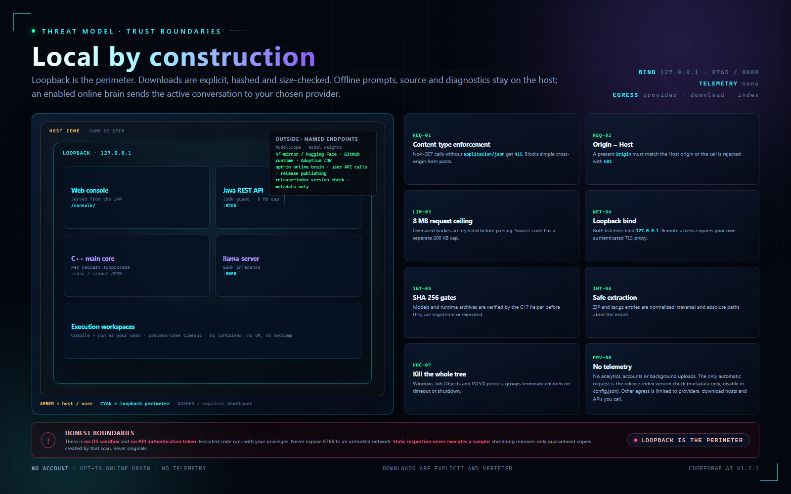

### 16.1 Guarantees

- The Java server binds **only** to `127.0.0.1`.
- llama-server binds to `127.0.0.1:8080`.
- No telemetry, analytics, accounts or cloud calls.
- Downloads are size-checked and SHA-256 verified.
- Archive extraction rejects traversal paths.
- Non-GET API requests require JSON content type and a matching Origin when
  one is present.
- Request bodies are capped at 8 MB.
- **Static inspection never executes the inspected file.** The scan re-hashes
  every source file after analysis and reports whether its bytes changed.
- Shredding applies only to quarantine copies created by the same scan; original
  files are never modified or deleted, and the sidecar records that fact.

### 16.2 Non-guarantees

- **No execution sandbox.** Generated programs run with your user privileges and
  can read/write your files, spawn processes and use the network. This does not
  apply to static **Inspect**, which never executes a sample, but it does apply
  to **Run**, **Debug** and agent commands. Run only code you trust, or use a
  dedicated OS user/VM.
- **No authentication.** Anything that can reach `127.0.0.1:8765` can execute
  code. Do not expose the port through a reverse proxy without adding
  authentication and TLS, and never bind it to `0.0.0.0` in an untrusted
  network.
- **Same-user processes** can read `config.json`, logs, models and workspaces.
- **Model licenses** are not enforced by the software; check them before
  commercial use.
- **Supply chain.** Models resolve through ModelScope first, then the
  configured mirrors (`hf-mirror.com` first, `huggingface.co` last by default),
  and the llama.cpp runtime comes from GitHub. Model downloads require an upstream size and
  SHA-256; the C17 helper verifies the hash before registration. Provenance
  beyond that is your responsibility.

### 16.3 Hardening checklist

1. Keep the server on loopback; use an authenticated TLS proxy for remote use.
2. Run untrusted code in a VM or separate OS account.
3. Set `api_key` only for remote OpenAI-compatible services; rotate it.
4. Review `logs/` for unexpected requests if the machine is shared.
5. Remove unused models to reduce attack surface and disk pressure.
6. Keep the JDK, compilers and OS patched.
7. Verify release artifacts with `SHA256SUMS.txt`.
8. Use a firewall that blocks inbound 8765 and 8080 from other hosts.

### 16.4 Incident response

If you suspect the API was exposed:

1. Stop the server and inference immediately.
2. Disconnect the machine from the network.
3. Review `logs/` for unexpected `core-*` files, model downloads or runtime
   starts.
4. Inspect `workspace/` for programs you did not run.
5. Rotate any API keys in `config.json`.
6. Rebuild from a trusted checkout and re-verify model hashes.

---

## 17. Troubleshooting

### 17.1 Startup and build

| Symptom | Cause | Fix |
|---|---|---|
| `gcc/g++ (or clang) not found in PATH` | Toolchain missing | Install MinGW-w64 / build-essential / Xcode CLT |
| `cmake is required` from `build.sh` | No CMake | Install CMake or use `bootstrap.py --all` |
| `javac not found under native/jdk/...` | Corrupt JDK | Delete `native/jdk`, rerun `--jdk` |
| `cannot query Temurin releases` | Network/DNS blocked | Install JDK 17 manually, rerun |
| Server exits with `cannot bind 127.0.0.1:8765` | Port in use | Stop the other instance or use `--port 8766` |
| `C++ main core is missing` | Binary absent | `python aux-python/bootstrap.py --build` |
| Console shows `SERVER UNREACHABLE` | Server down/wrong port | Start the server, check the URL |
| Windows Firewall prompt | Server is loopback-only | Allow private networks only; inbound is not needed |

### 17.2 Models and downloads

| Symptom | Cause | Fix |
|---|---|---|
| `Not enough disk space: about X MB required` | Free space below file + 512 MB | Free space or choose a smaller model |
| `HTTP 404` / `File not found in the Hugging Face repository` | Upstream renamed/removed the file | Pick another model; report the broken entry |
| `Connection dropped … attempt n/12` | Unstable network | Wait; the partial file resumes automatically |
| `SHA-256 mismatch. The file was removed` | Corrupt or intercepted download | Retry on a stable connection |
| `Incomplete download (x/y bytes). Partial file kept for resume.` | Stream ended early | Start the same download again |
| `This model is already downloading or verifying.` | Duplicate request | Wait for the active job |
| Download stuck at 0% | ModelScope and mirrors unreachable | Test `curl -I https://modelscope.cn` and `curl -I https://hf-mirror.com`; set `llm.model_mirror` if needed |
| `Unknown model: <id>` | Typo or old registry | Use an id from `GET /api/models` |

### 17.3 Runtime and inference

| Symptom | Cause | Fix |
|---|---|---|
| `llama.cpp runtime is not installed` | No `runtime.json` | Models → Install runtime, or build from source |
| `No GGUF model is installed` | No verified model | Download a model first |
| `Port 8080 is already used by an external inference service.` | Another server listening | Stop it, or keep using it as an external backend |
| `Inference service did not become ready within 180 seconds.` | Model too large / bad file / port conflict | Read the returned log tail and `logs/llama-server.log` |
| `Inference service is already running.` | Managed process alive | Stop it first |
| LLM chip grey with green Runtime | Backend probe failed | Check `/v1/models` at `127.0.0.1:8080` |
| Replies extremely slow | Dense model, low RAM, long prompt | Use a MoE/smaller model, reduce context |
| `AI returned empty content` | Stop sequence or context overflow | Retry with a shorter prompt |
| `AI request failed …` | llama-server crashed or timed out | Inspect the runtime log; restart inference |
| `… receive response failed (WinHTTP 12030)` | The model service was stopped or restarted while it was replying, or the process ran out of memory | Send the request again; if it repeats, lower the context and restart inference |
| `… WinHTTP 12002` | The model did not finish before the request timeout | Wait until the model finishes loading, lower the context, then retry |

### 17.4 Debug and execution

| Symptom | Cause | Fix |
|---|---|---|
| `Unsupported language. Use Python, C, C++ or Java` | Auto with an extensionless filename | Add `.py`/`.c`/`.cpp`/`.java` or pick a language |
| `Python was not found` | No Python on PATH | Install Python 3 and reopen the terminal/server |
| `JDK not found for Java execution` | `javac`/`java` missing | `bootstrap.py --jdk` or install JDK 17 |
| `Java compilation failed` | Syntax/type error | Inspect the compiler output in telemetry |
| `C/C++ compiler not found` | No gcc/g++ | Install the toolchain |
| `program timed out after N ms` | Infinite loop or long computation | Increase `debug.run_timeout_ms` or fix the loop |
| `AI debugging is unavailable:` | No usable backend | Start inference or configure Ollama |
| `AI returned no usable code block` | Model ignored the format | Retry, lower temperature, use a stronger model |
| `AI returned the same content as the current source` | No progress | Add diagnostics, choose another model |
| `Iteration limit reached without a successful run` | Still failing | Increase iterations or fix manually |
| `Code exceeds the 200 KB limit` | Source too large | Split the file |

### 17.5 Mobile

| Symptom | Cause | Fix |
|---|---|---|
| Thin client cannot connect | Server loopback-only | Use a TLS reverse proxy / tunnel |
| WebView shows a blank page | Wrong base URL | Include the trailing `/console/` |
| iOS blocks HTTP | App Transport Security | Use HTTPS or a local exception for development |
| Termux build fails on libcurl | Missing headers | `pkg install libcurl` |
| Termux runtime install fails | No Android runtime asset | Build llama.cpp from source (section 3.4) |
| iSH runs out of memory | Emulation overhead | Use the thin client or a smaller model |

---

## 18. FAQ

**Does CodeForge need internet?** Only to download the JDK, the runtime and
models. After that it is fully offline.

**Where are my prompts stored?** Nowhere. Chat history is in browser memory
only. Request bodies are streamed to the local core and not persisted, except
that debug sessions save the source and report under `workspace/`.

**Can I use a GPU?** Not through the managed runtime. Point
`llm.openai_url` at a custom llama.cpp build with GPU offload, or use Ollama.

**Can I use OpenAI or another cloud API?** Technically yes if it is
OpenAI-compatible, but that breaks the local-first guarantee. You control the
URL and key.

**Why does auto-detect fail?** It reads the filename extension only. Use
`.py`, `.c`, `.cpp`, `.cxx`, `.cc` or `.java`, or select the language.

**Is my code sent to the model?** Yes — to the local model on your machine.
Debug sends the full source and diagnostics to the inference endpoint you
configured. If that endpoint is remote, the code leaves the host.

**Can two people use one server?** There is no account model; every caller
shares the same files and can execute code. Run separate instances/roots for
isolation.

**Why is the first answer slow?** Model load and prompt evaluation dominate;
subsequent short answers are much faster.

**Can I stop a running generation?** Stop inference in the Models tab, or wait
for the HTTP timeout. The console has no cancel button.

**Does closing the console stop the server?** No. On Windows the tray keeps it
alive; on POSIX the server runs until you stop the process.

**How do I update?** Replace the source, rerun `bootstrap.py --all`, and keep
`models/`, `runtime/` and `config.json`. Models remain compatible.

---

## 19. Appendices

### Appendix A — file map

| Path | Contents |
|---|---|
| `core/` | C++17 core: main, config, util, process, HTTP, LLM, runners, debugger, prompts |
| `native-c/` | C17 SHA-256 and sysinfo helper |
| `client/` | Win32 control center |
| `server-java/src/` | Java server, API handler, model/runtime managers, core bridge |
| `server-java/web/console/` | HTML/CSS/JS console |
| `aux-python/` | bootstrap, mock LLM, release packaging |
| `mobile/android/` | Kotlin thin client and Gradle project |
| `mobile/ios/` | SwiftUI thin client, XcodeGen spec |
| `docs/` | manual, platform guide, architecture, API, security, models, images |
| `config.json` | runtime configuration |

### Appendix B — ports

| Port | Bind | Purpose |
|---|---|---|
| 8765 | `127.0.0.1` | Java REST server and web console |
| 8080 | `127.0.0.1` | llama.cpp / OpenAI-compatible inference |
| 11434 | `127.0.0.1` | Ollama (optional, external) |

### Appendix C — keyboard shortcuts

| Shortcut | Action |
|---|---|
| `Ctrl+1` | 对话 |
| `Ctrl+2` | 智能体 |
| `Ctrl+3` | 工作区 |
| `Ctrl+4` | 搜索 |
| `Ctrl+5` | 更多工具 |
| `Ctrl+6` | 设置 |
| `Enter` (chat) | Send |
| `Shift+Enter` (chat) | New line |
| `Tab` (editor) | Insert four spaces |

### Appendix D — glossary

- **GGUF** — quantized model file format used by llama.cpp.
- **Q4_K_M** — 4-bit k-quant medium; the catalog's default balance.
- **MoE** — mixture of experts; only a subset of parameters runs per token.
- **llama.cpp / llama-server** — C/C++ inference engine and its HTTP server.
- **Agentic loop** — run → diagnose → patch → re-run without human input.
- **Process tree timeout** — killing the program plus all descendants.
- **Workspace** — per-session directory holding source, binaries and reports.
- **Installed registry** — `models/installed.json`, atomically written.
- **Loopback** — `127.0.0.1`; reachable only from the local machine.

### Appendix E — verification record

Reference machine: Windows 10 Pro (x64), 16 logical cores, RTX 4070 12 GB.

| Check | Result |
|---|---|
| Bootstrap (`--all`) | Native helper, C++ core, Win32 client, Java jar built |
| Self-test | Python, C, C++, Java all compiled and executed |
| Qwen3 4B chat (short, CPU) | `OK` returned in ~3.2 s |
| Qwen3 4B chat (long tables, CPU) | Two markdown tables rendered, ~2 min |
| Qwen3 4B short reply (CUDA) | `OK` in 1.2 s; ~83.6 tok/s measured decoding |
| Direct `add(a,b)` completion (CUDA) | Code-only reply in 0.8 s |
| Calculator request, capped reasoning (CUDA) | Code returned in 4.6 s |
| Debug loop (`vector::at`) | Exit 3 → repaired → exit 0, report persisted |
| Runtime | llama.cpp `b12428`, CPU `win-cpu-x64` and CUDA `win-cuda-x64`, SHA-256 verified |
| Backend switch | Auto → CUDA, CPU → restart, Auto → CUDA; persisted in `runtime/selection.json` |
| Model | Qwen3 4B Q4_K_M, 2,497,281,120 bytes, SHA-256 verified |
| API guard | 415 without content type, 403 foreign origin, 200 same origin |
| Static security check | No telemetry or cloud calls in source |

For deeper technical detail, continue with:

- [Platform guide](PLATFORMS.md) — every command for every target.
- [Architecture](ARCHITECTURE.md) — components, flows, concurrency, failure containment.
- [API reference](API.md) — exact schemas and status codes.
- [Security](SECURITY.md) — threat model and hardening.
- [Model library](MODELS.md) — sources, licenses and selection guidance.
